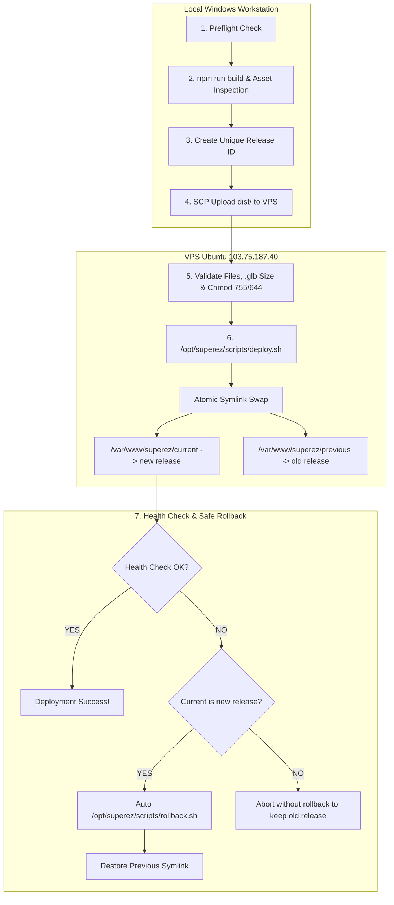

# Hướng Dẫn Tự Động Hóa Triển Khai (Automated Deployment Guide) - Super EZ Tour

Tài liệu hướng dẫn quản trị, vận hành và tự động hóa quy trình **Build**, **Upload**, **Deploy**, **Health Check** và **Rollback** cho Frontend website **Super EZ Tour** (`https://superez.site`).

---

## 1. Tổng Quan Kiến Trúc Deployment

Frontend Super EZ Tour là ứng dụng Single Page Application (SPA) phát triển bằng React 18, Vite 6, tích hợp Three.js (WebGL 3D model), GSAP và MapLibre.

### 1.1 Sơ đồ luồng triển khai (Zero-Downtime Atomic Symlink)



### 1.2 Cấu trúc thư mục trên VPS

```text
/var/www/superez/
├── current -> /var/www/superez/releases/20261119-210000   # Symlink trỏ đến release đang phục vụ
├── previous -> /var/www/superez/releases/20261119-01      # Symlink trỏ đến bản chạy ổn định trước đó
└── releases/
    ├── 20261119-01/                                       # Release ban đầu
    └── 20261119-210000/                                   # Release mới
        ├── assets/
        │   ├── destinations/hanoi/thap_rua_pbr.glb        # Model 3D Tháp Rùa (9.4 MB)
        │   ├── index-xxxx.js
        │   └── index-xxxx.css
        ├── favicon.svg
        ├── index.html
        └── logo.png
```

### 1.3 Cơ chế Atomic Symlink của Nginx

Nginx được cấu hình phục vụ trực tiếp từ `/var/www/superez/current`. Khi kích hoạt bản release mới:
- File symlink `.current.tmp` được tạo trỏ tới release mới.
- Lệnh `mv -Tf /var/www/superez/.current.tmp /var/www/superez/current` thực hiện hoán đổi symlink ở tầng kernel Linux (atomic operation).
- Nginx không cần restart hay reload, không gián đoạn bất kỳ request nào của người dùng (Zero Downtime).

---

## 2. Yêu Cầu Môi Trường Phía Máy Khách (Windows)

Trước khi thực hiện deployment, máy trạm Windows cần đảm bảo:

1. **PowerShell**: Windows PowerShell 5.1 hoặc PowerShell 7+.
2. **Node.js**: Phiên bản `>= 18` (Hiện tại: Node v24.11.0).
3. **npm**: Phiên bản `>= 9` (Hiện tại: npm v11.6.1).
4. **OpenSSH Client**: Đã cài sẵn trên Windows (`C:\Windows\System32\OpenSSH\ssh.exe` và `scp.exe`).
5. **curl**: `C:\Windows\System32\curl.exe`.
6. **SSH Private Key**:
   - Vị trí: `%USERPROFILE%\.ssh\superez_deploy` (hoặc `C:\Users\<username>\.ssh\superez_deploy`).
   - Quyền hạn: Chỉ người dùng hiện tại có quyền đọc (NTFS permissions).
   - Kiểm tra kết nối nhanh bằng lệnh:
     ```powershell
     ssh -i "$env:USERPROFILE\.ssh\superez_deploy" -p 24700 -o BatchMode=yes root@103.75.187.40 echo DEPLOY_READY
     ```
     Nếu trả về `DEPLOY_READY` là cấu hình đạt chuẩn.

---

## 3. Chạy Kiểm Thử An Toàn (Preflight / DryRun)

Trước khi deploy thật, luôn chạy script ở chế độ `DryRun` để xác minh môi trường, quyền kết nối và tính sẵn sàng của server mà **hoàn toàn không tác động đến production**.

```powershell
cd D:\workplace\SuperEZTour
.\deploy.ps1 -DryRun
```

Hoặc sử dụng alias:

```powershell
.\deploy.ps1 -PreflightOnly
```

### Script sẽ kiểm tra:
- Thư mục dự án hiện tại và file `package.json` (`super-ez-tour`).
- Các công cụ CLI: `node`, `npm`, `ssh`, `scp`, `curl.exe`.
- Tồn tại của SSH Private Key `superez_deploy`.
- Kết nối SSH không tương tác tới VPS (`BatchMode=yes`, port `24700`).
- Sự tồn tại và quyền thực thi của `/opt/superez/scripts/deploy.sh` và `rollback.sh` trên VPS.
- Trạng thái phiên bản release hiện đang chạy trên production.

---

## 4. Hướng Dẫn Triển Khai Phiên Bản Mới (Production Deployment)

### 4.1 Lệnh triển khai tiêu chuẩn

Mở PowerShell tại thư mục dự án `D:\workplace\SuperEZTour` và chạy:

```powershell
.\deploy.ps1
```

Nếu gặp thông báo về PowerShell ExecutionPolicy, chạy:

```powershell
powershell -ExecutionPolicy Bypass -File .\deploy.ps1
```

### 4.2 Các tham số nâng cao

| Tham số | Ý nghĩa | Ví dụ |
| :--- | :--- | :--- |
| `-ReleaseId <string>` | Đặt tên release thủ công (mặc định theo timestamp `yyyyMMdd-HHmmss`). | `.\deploy.ps1 -ReleaseId 20261119-v1.0.1` |
| `-DryRun` / `-PreflightOnly` | Chạy kiểm tra preflight mà không tạo release hoặc đổi symlink. | `.\deploy.ps1 -DryRun` |
| `-SkipBuild` | Bỏ qua bước build nếu muốn dùng bản build sẵn có trong `dist/`. | `.\deploy.ps1 -SkipBuild` |
| `-NoRollbackOnFailure` | Tắt tự động rollback khi health check thất bại (dùng khi cần giữ nguyên môi trường lỗi để debug). | `.\deploy.ps1 -NoRollbackOnFailure` |
| `-KeyPath <string>` | Chỉ định đường dẫn key SSH khác mặc định. | `.\deploy.ps1 -KeyPath "D:\keys\my_key"` |

### 4.3 Quy trình 7 bước chi tiết

1. **`[1/7] Preflight`**: Xác minh môi trường máy trạm, key SSH và kiểm tra script trên VPS.
2. **`[2/7] Build`**: Xóa thư mục `dist/` cũ, thực thi `npm run build`, xác thực `index.html` và trích xuất danh sách **TẤT CẢ** bundle JS/CSS (`index-xxxx.js`, `index-xxxx.css`, `maplibre-gl-xxxx.js`, v.v.), kiểm tra kích thước model 3D `.glb` cục bộ.
3. **`[3/7] Create Release`**: Kiểm tra trùng lặp trên VPS và tạo thư mục mới độc lập `/var/www/superez/releases/<ReleaseID>`. Không bao giờ ghi đè release cũ.
4. **`[4/7] Upload`**: Chạy `scp.exe` tải toàn bộ nội dung `dist/` vào thư mục release. Phân quyền thư mục `755`, tệp `644` (tuyệt đối không dùng 777).
5. **`[5/7] Validate`**: Kiểm tra tính toàn vẹn của release trên VPS: `index.html`, `assets/`, số lượng tệp, và **xác minh kích thước chính xác theo từng byte của model 3D `.glb`** trên VPS khớp với bản build cục bộ.
6. **`[6/7] Activate`**: Gọi `/opt/superez/scripts/deploy.sh <ReleaseID>`. Script trên VPS sẽ lưu symlink cũ vào `previous` và chuyển `current` sang bản mới.
7. **`[7/7] Health Check`**: Kiểm tra HTTP 200, kiểm tra HTML có chứa đúng bundle hash vừa build, kiểm tra **tất cả asset JS/CSS**, kiểm tra React Router SPA fallback, kiểm tra model 3D, và xác nhận ViVu backend (`api.vivu.site`) không bị ảnh hưởng.
   - *Cơ chế Safe Rollback*: Script chỉ kích hoạt `/opt/superez/scripts/rollback.sh` nếu xác nhận symlink `current` đã thực sự trỏ tới release mới. Nếu rollback gặp sự cố, script sẽ phát cảnh báo khẩn cấp và cung cấp lệnh khôi phục thủ công.

---

## 5. Hướng Dẫn Rollback

Hệ thống hỗ trợ 2 cơ chế rollback:

### 5.1 Tự động Rollback (Automated Safe Rollback)
Nếu script `deploy.ps1` chạy bước `[7/7] Health Check` và phát hiện:
- Trang chủ `https://superez.site` không trả về 200 hoặc thiếu thẻ root SPA.
- HTML không khớp với bundle JS vừa deploy.
- Bất kỳ tệp JS hoặc CSS nào được tham chiếu trả về lỗi (404/500).
- Đường dẫn SPA con (`/destinations/hanoi`) bị lỗi.
- Model 3D không tải được hoặc Content-Length rỗng.
- ViVu Backend (`https://api.vivu.site/health`) bị lỗi.

Script sẽ kiểm tra: nếu `current` đang trỏ tới bản mới, nó sẽ **ngay lập tức** gọi `/opt/superez/scripts/rollback.sh`, hoàn nguyên `current` về phiên bản `previous`, kiểm tra lại trạng thái và báo cáo lỗi rõ ràng.

### 5.2 Rollback thủ công bằng `rollback.ps1`
Khi muốn chủ động đưa website về phiên bản trước đó:

```powershell
cd D:\workplace\SuperEZTour
.\rollback.ps1
```

Script sẽ:
1. Kết nối VPS, đọc release đang chạy (`current`) và release dự phòng (`previous`).
2. Hiển thị thông tin phiên bản rõ ràng trên màn hình.
3. Yêu cầu người vận hành gõ `yes` để xác nhận.
4. Kích hoạt `/opt/superez/scripts/rollback.sh`.
5. Kiểm tra lại HTTPS và dịch vụ ViVu.

> **Ghi chú**: Nếu chạy trong CI/CD hoặc muốn bỏ qua câu hỏi xác nhận:
> ```powershell
> .\rollback.ps1 -Force
> ```

---

## 6. Tiêu Chí Kiểm Tra Production (Health Checks)

| Hạng mục kiểm tra | Lệnh kiểm tra | Kỳ vọng | Ý nghĩa |
| :--- | :--- | :--- | :--- |
| **Trang chủ HTTPS** | `curl.exe -sI https://superez.site` | `HTTP/1.1 200 OK` | Nginx đang phục vụ tốt qua SSL |
| **Nội dung HTML** | `curl.exe -s https://superez.site` | Chứa `<div id="root">` và hash JS mới | Khẳng định Nginx không cache HTML cũ |
| **TẤT CẢ JS Assets** | `curl.exe -sI https://superez.site/assets/index-xxxx.js` | `HTTP/1.1 200 OK`<br>`Cache-Control: public, immutable` | Mọi asset JS tham chiếu tải thành công |
| **TẤT CẢ CSS Assets** | `curl.exe -sI https://superez.site/assets/index-xxxx.css` | `HTTP/1.1 200 OK` | Mọi asset CSS tham chiếu tải thành công |
| **SPA Route Fallback** | `curl.exe -sI https://superez.site/destinations/hanoi` | `HTTP/1.1 200 OK` | `try_files` chuyển tiếp đúng về `index.html` |
| **Model 3D GLB** | `curl.exe -sI https://superez.site/assets/destinations/hanoi/thap_rua_pbr.glb` | `HTTP/1.1 200 OK`<br>`Content-Length: 9410292` | Model 3D Tháp Rùa đúng kích thước byte |
| **ViVu Backend** | `curl.exe -s https://api.vivu.site/health` | `HTTP/1.1 200 OK`<br>`{"status":"ok",...}` | Xác nhận ViVu hoàn toàn ổn định |

> [!NOTE]
> **Phân biệt HTTP Check và Browser Visual Check**:
> HTTP Health Check đảm bảo server trả về mã 200, SSL hợp lệ, header cache chuẩn và file bundle không bị 404. Tuy nhiên, để xác nhận Three.js render khung hình 3D, WebGL không bị crash và GSAP animation hoạt ảnh mượt mà, kỹ sư phụ trách cần mở trực tiếp trình duyệt (Chrome/Edge) và kiểm tra Console.

---

## 7. Các Lỗi Thường Gặp & Cách Khắc Phục (Troubleshooting)

### 7.1 Lỗi `Identity file ... Permission denied`
- **Nguyên nhân**: File SSH key có phân quyền NTFS quá rộng trên Windows hoặc người dùng chạy bằng tài khoản khác.
- **Khắc phục**:
  ```powershell
  icacls "$env:USERPROFILE\.ssh\superez_deploy" /inheritance:r
  icacls "$env:USERPROFILE\.ssh\superez_deploy" /grant:r "${env:USERNAME}:(R)"
  ```

### 7.2 Lỗi `Quá trình npm run build thất bại`
- **Nguyên nhân**: Lỗi cú pháp JSX, thiếu import, hoặc lỗi TypeScript/Rollup.
- **Khắc phục**: Chạy `npm run build` trực tiếp tại máy trạm và đọc log chi tiết của Vite. `deploy.ps1` sẽ dừng ngay lập tức và không upload code lỗi lên VPS.

### 7.3 Lỗi `Upload qua SCP thất bại`
- **Nguyên nhân**: Kết nối mạng chập chờn, cổng 24700 bị chặn bởi firewall cục bộ, hoặc dung lượng VPS bị đầy.
- **Khắc phục**: Kiểm tra kết nối mạng và dung lượng đĩa trên VPS (`ssh ... "df -h"`).

### 7.4 Lỗi `KHÔNG THỂ ROLLBACK: VPS hiện không có release dự phòng`
- **Nguyên nhân**: Hệ thống mới chỉ có release đầu tiên (`20261119-01`), chưa có release thứ hai nên symlink `/var/www/superez/previous` chưa được tạo.
- **Khắc phục**: Sau khi thực hiện deploy release mới thành công lần đầu, `previous` sẽ tự động trỏ về `20261119-01`. Khi đó tính năng rollback sẽ hoạt động bình thường.

---

## 8. Hướng Dẫn Khôi Phục Thủ Công (Manual Emergency Recovery)

Nếu script tự động gặp sự cố đột ngột trong lúc chạy (mất điện, đứt mạng), quản trị viên có thể kết nối trực tiếp vào VPS qua SSH để xử lý:

```bash
# Đăng nhập vào VPS
ssh -i ~/.ssh/superez_deploy -p 24700 root@103.75.187.40

# 1. Kiểm tra trạng thái thư mục
ls -la /var/www/superez

# 2. Xem danh sách các release đã có
ls -la /var/www/superez/releases

# 3. Để chuyển website về một release cụ thể bằng tay (ví dụ bản an toàn 20261119-01):
ln -s /var/www/superez/releases/20261119-01 /var/www/superez/.manual_current.tmp
mv -Tf /var/www/superez/.manual_current.tmp /var/www/superez/current

# 4. Kiểm tra symlink đã trỏ đúng chưa
readlink -f /var/www/superez/current
```

---

## 9. Chính Sách Quản Lý & Dọn Dẹp Release Cũ (Retention Policy)

Theo thời gian, mỗi lần deploy sẽ tạo ra một thư mục release mới (mỗi release khoảng 10-15 MB). Để tránh đầy dung lượng đĩa:

- **Nguyên tắc**: Luôn giữ lại ít nhất **5 release gần nhất**.
- **Tuyệt đối KHÔNG xóa**: Thư mục đang được trỏ bởi `/var/www/superez/current` và `/var/www/superez/previous`.
- **Lệnh dọn dẹp an toàn trên VPS**:
  ```bash
  # Liệt kê các release và ngày tạo
  ls -lt /var/www/superez/releases

  # Xóa release cũ cụ thể (sau khi xác nhận không phải current hay previous)
  # rm -rf /var/www/superez/releases/<old-release-id>
  ```

---

## 10. Những Thành Phần Tuyệt Đối CẤM Can Thiệp Trên VPS

Hệ thống VPS `103.75.187.40` đang chạy đồng thời ứng dụng gọi xe/vận chuyển **ViVu**. Để đảm bảo an toàn vận hành, kỹ sư triển khai tuân thủ nghiêm ngặt các điều cấm sau:

> [!CAUTION]
> 1. **TUYỆT ĐỐI KHÔNG** sửa đổi cấu hình Nginx của ViVu tại `/etc/nginx/sites-available/vivu.conf` hoặc `/etc/nginx/sites-enabled/vivu.conf`.
> 2. **TUYỆT ĐỐI KHÔNG** restart, stop hoặc can thiệp container Docker `vivu-backend`.
> 3. **TUYỆT ĐỐI KHÔNG** chạy các lệnh ảnh hưởng container như `docker compose down`, `docker stop $(docker ps -q)` hoặc `docker system prune -a`.
> 4. **TUYỆT ĐỐI KHÔNG** can thiệp cơ sở dữ liệu MongoDB của ViVu.
> 5. **TUYỆT ĐỐI KHÔNG** thay đổi cấu hình SSH Server (`/etc/ssh/sshd_config`), không đổi port SSH 24700, không tắt password authentication.
> 6. **TUYỆT ĐỐI KHÔNG** tự ý chạy `certbot --nginx` làm ghi đè các cấu hình SSL đã ổn định.
> 7. **TUYỆT ĐỐI KHÔNG** tự ý xóa bất kỳ release production nào trong `/var/www/superez/releases/` mà chưa có phê duyệt.