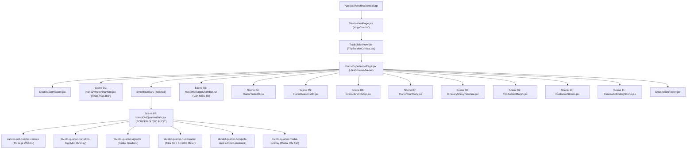
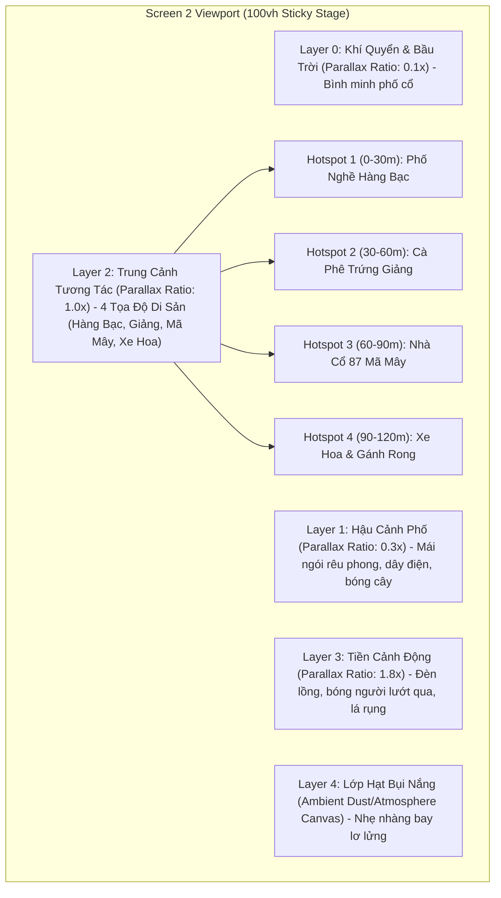

# HÀ NỘI SCREEN 2 — BÁO CÁO AUDIT KIẾN TRÚC & PHÂN TÍCH CHUYỂN ĐỔI
## Technical Architecture & Migration Analysis: Procedural Three.js → Photorealistic 2.5D Cinematic Street Walk

---

## 1. TỔNG QUAN DỰ ÁN & EXECUTIVE SUMMARY

### 1.1 Mục Tiêu & Phạm Vi Audit
- **Dự án:** Super EZ Tour (`D:\workplace\SuperEZTour`)
- **Tuyến đường (Production Route):** `/destinations/ha-noi` (được định tuyến thông qua `src/App.jsx` và `src/features/destinations/DestinationPage.jsx`)
- **Đối tượng khảo sát:** **Screen 2 — Walk Through the Old Quarter (Dạo bước Phố cổ 36 Phố Phường)**.
- **Mục tiêu kỹ thuật:** Đánh giá toàn diện kiến trúc hiện tại của Screen 2 (hiện đang được dựng bằng procedural Three.js low-poly/primitives) để phục vụ kế hoạch chuyển đổi sang trải nghiệm: **Ảnh chụp thực tế độ phân giải cao (Real Photography) + Chiều sâu 2.5D Parallax + GSAP ScrollTrigger Scrubbing + Cinematic Storytelling**.
- **Nguyên tắc thực hiện:** **Chỉ đọc và kiểm tra mã nguồn thực tế (Audit-only)**. Tuyệt đối không thay đổi mã nguồn, không xóa file, không cài package, không sửa cấu trúc thư mục của dự án.

### 1.2 Tóm Tắt Phát Hiện Cốt Lõi (Key Findings)
1. **Kiến trúc WebGL hiện tại:** Screen 2 sử dụng Three.js thuần (`three@0.187.0`) quản lý trực tiếp qua `canvasRef` và `useEffect`, **hoàn toàn không dùng React Three Fiber (R3F)**.
2. **Không có file 3D Model ngoài (Zero GLTF/GLB in Screen 2):** Toàn bộ dãy nhà phố cổ, mái ngói, vỉa hè, dây điện, gánh hàng rong và xe hoa cúc họa mi đều được sinh bằng **hình học cơ bản (Three.js Primitives: Box, Cone, Cylinder, Torus, Sphere)** kết hợp **5 hàm sinh Texture bằng HTML5 Canvas 2D thủ công** (`hanoiStreetAssets.js`).
3. **Hệ thống 120m Walking Distance là một chỉ số ảo (Virtual UI HUD):** Khoảng cách `0m → 120m` trên HUD chỉ là phép tính toán học `Math.round(progress * 120)` dựa trên tỷ lệ cuộn `0.0 <= progress <= 1.0` của GSAP ScrollTrigger. Tọa độ thực của camera Three.js chỉ di chuyển từ `Z = 4.0` đến `Z = -24.0` (quãng đường 28 units). Do đó, **HUD 120m hoàn toàn độc lập với Three.js** và có thể giữ lại nguyên vẹn 100% trong kiến trúc 2.5D.
4. **Bốn tọa độ văn hóa (4 Cultural Hotspots):** Dữ liệu của 4 địa điểm (Hàng Bạc, Cà phê Giảng, 87 Mã Mây, Gánh hàng rong/Xe hoa) hiện đang bị **hardcode cục bộ** trong mảng `OLD_QUARTER_HOTSPOTS` bên trong `HanoiOldQuarterWalk.jsx`, chưa được kết nối trực tiếp vào file cấu hình `src/features/destinations/data/ha-noi.config.js`. Cả 4 ảnh minh họa trong modal hiện đều là **ảnh Unsplash placeholder bên ngoài**, chưa có ảnh chụp thực tế tại chỗ.
5. **Cơ chế chuyển cảnh Screen 1 → Screen 2:** Không tồn tại cơ chế "Willow Wipe" (lá liễu quét màn hình khi thoát Screen 1). Cơ chế thực tế đang hoạt động là **Morning Mist Bridge (Cầu sương mù bình minh)**: Screen 1 ở 90%–100% tăng dần lớp phủ sương mờ vàng kim (`.hero-transition-fog`, opacity 0 → 0.20); Screen 2 ở 0%–15% nhận lớp sương này (`.old-quarter-transition-fog`, opacity 0.18 → 0) và tan dần khi bắt đầu bước đi.

---

## 2. SCREEN 2 COMPONENT ARCHITECTURE

### 2.1 Component Tree & Vị Trí Trong Ứng Dụng

Screen 2 nằm trong trang tổng thể trải nghiệm Hà Nội (`HanoiExperiencePage.jsx`), được mount qua bộ định tuyến của React Router DOM v6:



### 2.2 Chi Tiết File Path & Trách Nhiệm Từng Thành Phần

| File Path | Trách nhiệm thực tế |
| :--- | :--- |
| `src/features/destinations/components/Hanoi/HanoiOldQuarterWalk/HanoiOldQuarterWalk.jsx` | Component chính của Screen 2. Chứa toàn bộ vòng đời Three.js, khởi tạo camera, ánh sáng, ScrollTrigger pinning, logic tính toán 120m, dock điều hướng 4 hotspot và modal chi tiết. |
| `src/features/destinations/components/Hanoi/HanoiOldQuarterWalk/HanoiOldQuarterWalk.css` | Định nghĩa layout toàn màn hình (`100vh`, `min-height: 700px`), định vị tuyệt đối cho WebGL Canvas, lớp sương mù chuyển cảnh, floating HUD header, dock landmark và modal card. |
| `src/features/destinations/components/Hanoi/HanoiOldQuarterWalk/hanoiStreetAssets.js` | Module độc lập phụ trách sinh procedural texture bằng HTML5 Canvas 2D (`createCobblestoneTexture`, `createColonialYellowWallTexture`, `createRoofTileTexture`, `createWoodLouverTexture`, `createSignboardTexture`) và hàm dựng tổ hợp hình học shophouse (`createModularOldQuarterStreet`). |
| `src/features/destinations/components/Hanoi/HanoiExperiencePage.jsx` | Orchestrator gom 11 phân cảnh (Scenes) của Hà Nội. Screen 2 được mount tại dòng 33–35 bên trong thẻ bọc `<ErrorBoundary isolated>`. |
| `src/features/destinations/DestinationPage.jsx` | Trang cha cấp route. Quản lý khởi tạo Lenis smooth scroll, lắng nghe sự kiện đổi ngôn ngữ để gọi `ScrollTrigger.refresh()`, bọc `TripBuilderProvider`. |
| `src/features/destinations/motion/LenisManager.js` | Quản lý vòng đời Singleton của thư viện cuộn mượt Lenis, gắn hàm cuộn vào `gsap.ticker` và đồng bộ `ScrollTrigger.update()`. |
| `src/context/LanguageContext.jsx` | Cung cấp state đa ngôn ngữ (`language`, `isKorean`, `t`). Giúp Screen 2 chuyển đổi nội dung giữa Tiếng Việt và Tiếng Hàn. |
| `src/features/destinations/context/TripBuilderContext.jsx` | Cung cấp hàm `toggleAttraction(attractionId)` để thêm/bớt địa điểm từ modal vào giỏ lịch trình du lịch cá nhân hóa. |

### 2.3 Các React Hooks Sử Dụng Trong Screen 2
Trong `HanoiOldQuarterWalk.jsx`:
- `useRef`:
  - `containerRef`: Trỏ vào thẻ `<section id="scene-old-quarter">` dùng làm trigger và pin cho GSAP ScrollTrigger.
  - `canvasRef`: Trỏ vào thẻ `<canvas>` để WebGLRenderer gắn ngữ cảnh đồ họa.
  - `transitionFogRef`: Trỏ vào lớp `<div>` sương mù chuyển cảnh để GSAP điều khiển `opacity` khi scroll.
  - `animationFrameRef`: Lưu ID của `requestAnimationFrame` để hủy sạch khi unmount.
  - `rendererRef`, `sceneRef`, `cameraRef`: Lưu trữ tham chiếu các thực thể cốt lõi của Three.js ngoài React state.
- `useState`:
  - `activeHotspot` (mặc định: `null`): Lưu object của landmark đang được mở modal.
  - `walkMeters` (mặc định: `0`): Lưu số mét ảo từ `0` đến `120m` hiển thị trên HUD.
  - `activeStepIndex` (mặc định: `0`): Lưu index của milestone hiện tại (`0, 1, 2, 3`) để highlight nút trên floating dock.
- `useEffect`:
  - Một `useEffect` duy nhất với dependency array `[]` (dòng 139–438). Khởi tạo Three.js scene, tạo vật liệu/hình học, đăng ký ScrollTrigger, tạo IntersectionObserver, gắn sự kiện `resize` và thực hiện teardown sạch khi unmount.

### 2.4 Cách Screen 2 Được Mount / Unmount
- **Mounting:** Khi người dùng truy cập `/destinations/ha-noi`, `DestinationPage.jsx` kiểm tra `destination.id === 'ha-noi'` và render `HanoiExperiencePage`. `HanoiOldQuarterWalk` được mount ngay trong luồng DOM (SSR/CSR) dưới Screen 1 (`HanoiAwakeningHero`).
- **Unmounting:** Khi người dùng chuyển sang destination khác (ví dụ: `/destinations/da-nang`) hoặc về trang chủ `/`, component unmount. Clean-up function tại dòng 400–437 thực hiện:
  1. Đặt cờ `isDisposed = true`.
  2. Ngắt kết nối `IntersectionObserver.disconnect()`.
  3. Gỡ bỏ `window.removeEventListener('resize', handleResize)`.
  4. Hủy `cancelAnimationFrame(animationFrameRef.current)`.
  5. Gọi `ctx.revert()` của GSAP Context để giải phóng ScrollTrigger và unpin vùng chứa.
  6. Quét toàn bộ `scene.traverse()` để gọi `.dispose()` trên từng `geometry` và `material`.
  7. Gọi `renderer.dispose()` và giải phóng WebGL Context.

---

## 3. THREE.JS RENDERING ARCHITECTURE

### 3.1 Bảng Kiểm Định Tham Số Render

```text
+-------------------------+-------------------------------------------------------+
| Tham số kỹ thuật        | Giá trị thực tế trong mã nguồn                        |
+-------------------------+-------------------------------------------------------+
| Renderer                | THREE.WebGLRenderer (pure Three.js, canvas trực tiếp)  |
| React Three Fiber (R3F) | KHÔNG SỬ DỤNG                                         |
| Camera                  | THREE.PerspectiveCamera (FOV 48°, Near 0.1, Far 100)  |
| Vị trí ban đầu Camera   | (x: 0, y: 1.85, z: 4.0) — Tầm mắt người đi bộ        |
| Antialiasing            | true                                                  |
| Pixel Ratio             | Math.min(window.devicePixelRatio || 1, 2)             |
| Tone Mapping            | THREE.ACESFilmicToneMapping (Exposure: 1.15)           |
| Color Space             | THREE.SRGBColorSpace                                  |
| Shadow Map              | PCFSoftShadowMap (DirectionalLight 1024x1024)          |
| Môi trường sương mù     | THREE.FogExp2(0x182026, 0.022)                        |
| Background Color        | THREE.Color(0x182026)                                 |
| 3D Model File ngoài     | KHÔNG CÓ (Zero .glb / .gltf files)                    |
| Hệ thống Texture        | 100% Procedural sinh bằng HTML5 Canvas 2D             |
| Vòng lặp Render (RAF)   | 1 loop có kiểm soát bật/tắt qua IntersectionObserver  |
+-------------------------+-------------------------------------------------------+
```

### 3.2 Hệ Thống Chiếu Sáng (Lighting Architecture)
Mã nguồn cấu hình 4 nguồn sáng chính để tái hiện ánh sáng bình minh phố cổ (dòng 194–225):
1. **`AmbientLight`:** Màu `0x4a5560`, cường độ `1.15` — Tạo ánh sáng tán xạ bầu trời sớm mát dịu.
2. **`DirectionalLight` (Mặt trời sớm):** Màu `0xffe2b0` (vàng ấm), cường độ `2.6`, đặt tại vị trí `(14, 20, -10)`. Đổ bóng mềm (`castShadow = true`), shadow camera bounds `[-10, 10, -10, 10]`, `bias = -0.0008` để tránh sọc shadow acne trên mặt đường.
3. **`HemisphereLight`:** Bầu trời `0xffeedd`, mặt đất `0x222a30`, cường độ `1.25` — Tạo độ nảy sáng tự nhiên giữa lòng đường tối và vòm trời sáng.
4. **2 Điểm sáng điểm nhấn (`PointLight`):**
   - Đèn lồng Hàng Bạc: `PointLight(0xffaa44, 1.8, 6, 2)` tại `(-2.8, 2.2, -3.5)`.
   - Đèn quán Cà phê Giảng: `PointLight(0xffa540, 1.8, 6, 2)` tại `(2.8, 2.2, -9.5)`.
   *(Ghi chú trong code dòng 217: Đã tối ưu thay thế 12 PointLight tốn kém ban đầu bằng 2 nguồn sáng nhấn cục bộ).*

### 3.3 Phân Tích Chi Tiết 10 Nhóm Đối Tượng 3D (Object Groups)

| Nhóm đối tượng | Vị trí tạo & Nguồn dữ liệu | Cấu trúc hình học (Geometry) | Tương tác | Phụ thuộc Camera | Đánh giá chuyển sang 2.5D |
| :--- | :--- | :--- | :---: | :---: | :--- |
| **1. Buildings (Nhà shophouse)** | `hanoiStreetAssets.js` (dòng 365–573). Chia 2 bên đường (6 căn trái, 6 căn phải). | `BoxGeometry(4.4, 7.6, 2.0)` (Type A), `BoxGeometry(4.0, 5.4, 2.0)` (Type B), `BoxGeometry(4.2, 6.6, 2.0)` (Type C). | Không | Không (Static) | **THAY THẾ TOÀN BỘ (REPLACE)** bằng các lớp ảnh chụp mặt tiền nhà cổ cắt tỉa PNG/WebP xếp lớp parallax. |
| **2. Shopfronts & Doors** | Tạo trong từng hàm build shophouse (`hanoiStreetAssets.js`). | Cửa gỗ `BoxGeometry(1.8, 2.4, 0.12)`, cửa bức bàn `BoxGeometry(2.2, 2.2, 0.1)`. Biển hiệu `BoxGeometry` phủ canvas texture. | Không | Không | **THAY THẾ (REPLACE)** bằng ảnh thực tế của từng cửa hàng. |
| **3. Road (Lòng đường)** | `hanoiStreetAssets.js` (dòng 331–340). | `PlaneGeometry(8.4, 44, 32, 64)`. Xoay `-Math.PI / 2`, đặt tại `(0, 0, -14)`. 4,096 triangles. | Không | Nhận bóng đổ | **THAY THẾ (REPLACE)** bằng ảnh texture mặt đường đá bazan lát phẳng trải dài kết hợp CSS 3D perspective hoặc blend gradient. |
| **4. Sidewalks & Curbs** | `hanoiStreetAssets.js` (dòng 344–360). | 2 bó vỉa đá `BoxGeometry(0.3, 0.2, 44)` + 2 dải vỉa hè `BoxGeometry(2.4, 0.18, 44)`. | Không | Không | **LOẠI BỎ (REMOVE)** hoặc tích hợp vào ảnh nền đường phố 2.5D. |
| **5. Roofs (Mái ngói âm dương)** | Tạo trong từng hàm build shophouse. | `ConeGeometry(3.2, 1.6, 4)` xoay 45° ép tỉ lệ để tạo mái dốc 4 mặt, phủ texture ngói `roofTile`. | Không | Không | **THAY THẾ (REPLACE)** bằng ảnh mái ngói thật cắt lớp. |
| **6. Street Lamps & Lanterns** | Tạo trong shophouse (dòng 423–433, 478–488). | `SphereGeometry(0.18, 12, 12)` với `MeshStandardMaterial` có `emissive: 0xffaa44`. | Không | Không | **TÁI TẠO (REFACTOR)** bằng ánh sáng gradient phát quang (CSS box-shadow/glow). |
| **7. Flower Bicycle (Xe hoa cúc)** | `hanoiStreetAssets.js` (dòng 578–626) đặt tại `Z = -21.2`. | 2 bánh `TorusGeometry`, khung `CylinderGeometry`, sọt nan `BoxGeometry`, **28 cụm hoa** (56 quả cầu `SphereGeometry`). | Không | Không | **THAY THẾ HOÀN TOÀN (REPLACE)** bằng ảnh chụp tách nền cực nét xe hoa cúc họa mi Hà Nội. |
| **8. Bamboo Vendor (Gánh hàng rong)** | `hanoiStreetAssets.js` (dòng 631–646) đặt tại `Z = -4.2`. | 2 thúng `CylinderGeometry(0.38, 0.28, 0.25, 16)`, đòn gánh `CylinderGeometry(0.025, 0.025, 1.5)`. | Không | Không | **THAY THẾ HOÀN TOÀN (REPLACE)** bằng ảnh chụp người phụ nữ gánh hoa quả rong phố cổ. |
| **9. Hotspot Beacons (Vòng sáng 3D)** | `HanoiOldQuarterWalk.jsx` (dòng 242–272). 4 điểm trên mặt đường tại `Z = -3.5, -9.5, -15.5, -21.5`. | Vòng tròn `RingGeometry(0.35, 0.55, 20)` + Cột sáng `CylinderGeometry(0.04, 0.15, 2.2, 8)`. | Có pulse animation trong RAF | Nhìn từ trên mặt đường | **CHUYỂN THÀNH HTML/SVG HOTSPOT (REFACTOR)** ghim trực tiếp trên các lớp ảnh 2.5D. |
| **10. Overhead Cables (Dây điện)** | `hanoiStreetAssets.js` (dòng 650–663). 7 đường dây giăng ngang. | `CatmullRomCurve3` lấy 24 điểm nội suy thành `Line(BufferGeometry, LineBasicMaterial)`. | Không | Không | **THAY THẾ (REPLACE)** bằng ảnh SVG hoặc PNG tách lớp dây điện đặc trưng Hà Nội. |

---

## 4. SCROLL & CAMERA SYSTEM

### 4.1 Khởi Tạo ScrollTrigger & Chiều Dài Pin
Trong `HanoiOldQuarterWalk.jsx` (dòng 334–365):
```javascript
const ctx = gsap.context(() => {
  ScrollTrigger.create({
    trigger: container,
    start: 'top top',
    end: '+=280%',
    pin: true,
    scrub: 1.4,
    anticipatePin: 1,
    onUpdate: (self) => {
      const progress = Number.isFinite(self.progress) ? self.progress : 0;
      scrollProgress = progress;

      // 120m Walking Distance Progress
      const meters = Math.round(progress * 120);
      setWalkMeters((prev) => (prev !== meters ? meters : prev));

      // Milestone active indicator
      const newStep = progress < 0.25 ? 0 : progress < 0.5 ? 1 : progress < 0.75 ? 2 : 3;
      setActiveStepIndex((prev) => (prev !== newStep ? newStep : prev));
      ...
    },
  });
}, container);
```
- **Kích thước Pin:** `end: '+=280%'` tương đương chiều dài cuộn kéo dài bằng **2.8 lần chiều cao viewport (280vh)**.
- **Scrub:** `1.4` giây tạo độ trễ mượt mà khi cuộn.
- **AnticipatePin:** `1` giúp triệt tiêu hiện tượng giật layout khi pin kích hoạt.

### 4.2 Đồng Bộ Lenis với GSAP ScrollTrigger
File `src/features/destinations/motion/LenisManager.js` thực hiện cầu nối:
```javascript
// Dòng 41-54 LenisManager.js
scrollHandler = () => {
  ScrollTrigger.update();
};
lenisInstance.on('scroll', scrollHandler);

tickerCallback = (time) => {
  if (lenisInstance) {
    lenisInstance.raf(time * 1000);
  }
};
gsap.ticker.add(tickerCallback);
gsap.ticker.lagSmoothing(0);
```
Mỗi frame của GSAP ticker kích hoạt hàm `.raf()` của Lenis, đồng thời Lenis gửi tín hiệu `ScrollTrigger.update()`. Điều này đảm bảo vị trí pin và scrub của Screen 2 khớp tuyệt đối với quán tính cuộn của chuột và trackpad.

### 4.3 Quỹ Đạo Chuyển Động Camera (Pedestrian Walk Simulation)
Trong vòng lặp `animate()` (dòng 298–320 `HanoiOldQuarterWalk.jsx`):
```javascript
const rawProgress = scrollProgress;
const progress = Number.isFinite(rawProgress) ? rawProgress : 0;
const t = Math.max(0, Math.min(1, progress));
// Tuyến tính dọc trục Z từ Z = 4.0 (đầu phố) đến Z = -24.0 (cuối phố)
const targetZ = 4.0 - t * 28.0;

// Mô phỏng nhịp bước chân người đi bộ (7 nhịp bước trên hành trình)
const walkCycle = t * 45;
const swayX = Math.sin(walkCycle) * 0.14;                 // Lắc ngang nhẹ
const bobY = 1.85 + Math.abs(Math.sin(walkCycle * 2)) * 0.035; // Nhấp nhô bước chân

// Hướng ánh mắt (Gaze) quay nhẹ về phía landmark đang đến gần
let gazeX = 0;
if (t > 0.1 && t < 0.3) gazeX = -0.4;       // Liếc trái về Hàng Bạc
else if (t >= 0.3 && t < 0.55) gazeX = 0.4; // Liếc phải về Cà phê Giảng
else if (t >= 0.55 && t < 0.78) gazeX = -0.35;// Liếc trái về 87 Mã Mây
else if (t >= 0.78) gazeX = 0.35;          // Liếc phải về Xe Hoa

camera.position.set(swayX, bobY, targetZ);
camera.lookAt(gazeX, 1.8, targetZ - 12.0);
```

### 4.4 Phân Tích Bản Chất "120m Walking Distance"
- **Xác định bản chất:** `120m` là một **hệ thống tiến trình toán học độc lập (Independent UI Progress)**, hoàn toàn không phải là đơn vị đo đạc vật lý ràng buộc trong WebGL.
  - Công thức: `meters = Math.round(progress * 120)` (dòng 347).
  - Tọa độ Three.js: di chuyển quãng đường `4.0 - (-24.0) = 28` Three.js units.
- **Khả năng giữ lại HUD khi chuyển sang 2.5D:** **100% Khả thi và cực kỳ dễ dàng**. Khi chuyển sang 2.5D, ScrollTrigger vẫn scrub biến `progress` từ `0` đến `1`, HUD counter tiếp tục đọc giá trị này và hiển thị `0m → 120m` mà không phụ thuộc bất kỳ dòng code WebGL nào.

### 4.5 Hành Vi Khi Reverse Scroll, Resize & Đổi Ngôn Ngữ
- **Reverse Scroll:** Hoạt động hoàn hảo hai chiều nhờ `scrub: 1.4` của GSAP. Khi cuộn ngược lên, số mét đếm lùi, camera lùi lại và sương mù chuyển cảnh xuất hiện trở lại ở `progress <= 0.15`.
- **Resize:** Lắng nghe sự kiện `resize` (dòng 387–395), cập nhật `camera.aspect = w / h`, `camera.updateProjectionMatrix()` và gọi `renderer.setSize(w, h)`.
- **Đổi Ngôn Ngữ (KO <-> VI):**
  - Trong `HanoiOldQuarterWalk.jsx`, hook `useEffect` có dependency `[]`. Khi bấm đổi ngôn ngữ trên Header, component **KHÔNG BỊ REMOUNT**, Three.js scene không bị khởi tạo lại, camera không bị giật về vị trí đầu.
  - Component cha `DestinationPage.jsx` (dòng 96–132) có hook lắng nghe `[language]`, sử dụng cơ chế **double requestAnimationFrame** sau khi font load để gọi `ScrollTrigger.refresh()`, tính toán lại vị trí pin mà không làm mất trạng thái cuộn hiện tại.

---

## 5. BỐN TỌA ĐỘ VĂN HÓA DI SẢN (FOUR CULTURAL LANDMARKS)

Toàn bộ dữ liệu của 4 địa điểm được trích xuất nguyên bản từ mảng `OLD_QUARTER_HOTSPOTS` (dòng 20–120 `HanoiOldQuarterWalk.jsx`):

### 5.1 Bảng Dữ Liệu Chi Tiết 4 Địa Điểm

```text
====================================================================================================
LANDMARK 01: PHỐ NGHỀ KIM HOÀN HÀNG BẠC
====================================================================================================
- ID: 'hang-bac' | Index: 1 | Icon: ShoppingBag
- Tên Tiếng Việt: Phố Nghề Kim Hoàn Hàng Bạc
- Tên Tiếng Hàn: 항박 은세공 장인 거리
- Tên Tiếng Anh: Hang Bac Silversmiths Guild
- Category VI: VĂN HÓA PHỐ NGHỀ | Category KO: 500년 전통 장인 가업
- Tọa độ 3D: depthZ = -3.5, side = 'left' (x = -2.2, y = 0.06)
- Khoảng cách trên hành trình 120m: Kích hoạt tại mốc 0m – 30m (progress < 0.25)
- Tóm tắt VI: "Con phố kim hoàn cổ kính hơn 500 năm tuổi, nơi các bậc nghệ nhân kim hoàn làng Định Công quy tụ đúc bạc nén cho triều đình Thăng Long."
- Tóm tắt KO: "15세기 탕롱 황실에 은괴를 납품하던 장인들이 모여 형성된 500년 역사의 은세공 거리."
- Điểm nhấn VI (details):
  1. Đình Kim Ngân thờ tổ nghề kim hoàn lập từ thời Hậu Lê
  2. Kỹ thuật chạm khắc bạc thủ công tinh xảo bậc nhất kinh kỳ
  3. Trải nghiệm ghé thăm xưởng chế tác gia truyền cùng nghệ nhân
- Điểm nhấn KO (detailsKr):
  1. 후 레 왕조 때 건립된 은세공 시조를 모시는 낌응안 사당
  2. 망치와 정만으로 빚어내는 극상의 전통 은세공 기법
  3. 전담 가이드와 함께 장인의 옛 공방을 직접 방문하는 프라이빗 탐방
- Hình ảnh hiện tại: https://images.unsplash.com/photo-1526778548025-fa2f459cd5c1?auto=format&fit=crop&w=1200&q=80
  -> [TRẠNG THÁI ASSET]: MISSING IMAGE ASSET (Ảnh Unsplash đường phố chung chung)

====================================================================================================
LANDMARK 02: CÀ PHÊ TRỨNG GIA TRUYỀN GIẢNG
====================================================================================================
- ID: 'cafe-giang' | Index: 2 | Icon: Coffee
- Tên Tiếng Việt: Cà Phê Trứng Gia Truyền Giảng
- Tên Tiếng Hàn: 원조 에그커피 지앙 살롱
- Tên Tiếng Anh: Heirloom Egg Coffee Salon
- Category VI: TINH HOA ẨM THỰC | Category KO: 1946년부터 이어진 전설의 미식
- Tọa độ 3D: depthZ = -9.5, side = 'right' (x = 2.2, y = 0.06)
- Khoảng cách trên hành trình 120m: Kích hoạt tại mốc 30m – 60m (0.25 <= progress < 0.5)
- Tóm tắt VI: "Khởi nguồn từ năm 1946 do cụ Nguyễn Văn Giảng sáng tạo, lớp kem trứng vàng óng sánh mịn hòa quyện cùng cà phê Robusta đậm đà."
- Tóm tắt KO: "1946년 소피텔 메트로폴 바텐더 출신 응우옌 반 지앙이 창안한 진한 로부스타와 달걀 크림의 궁극의 조화."
- Điểm nhấn VI (details):
  1. Công thức đánh kem trứng bí truyền không hề có vị tanh
  2. Không gian giếng trời nhuốm màu thời gian với bàn gỗ xưa
  3. Bao gồm trong mọi hành trình Private Tour của Super EZ Tour
- Điểm nhấn KO (detailsKr):
  1. 달걀 비린내 없이 벨벳처럼 부드러운 3대째 비밀 휘핑 비법
  2. 세월이 깃든 나무 테이블과 안뜰 햇살이 머무는 고택 공간
  3. Super EZ Tour 하노이 전용 투어 고객 전원 VIP 좌석 제공
- Hình ảnh hiện tại: https://images.unsplash.com/photo-1514432324607-a09d9b4aefdd?auto=format&fit=crop&w=1200&q=80
  -> [TRẠNG THÁI ASSET]: MISSING IMAGE ASSET (Ảnh Unsplash tách cà phê phương Tây)

====================================================================================================
LANDMARK 03: NHÀ CỔ DI SẢN 87 MÃ MÂY
====================================================================================================
- ID: 'ma-may-87' | Index: 3 | Icon: Home
- Tên Tiếng Việt: Nhà Cổ Di Sản 87 Mã Mây
- Tên Tiếng Hàn: 87 마메이 전통 고택
- Tên Tiếng Anh: Ancient Heritage House 87 Ma May
- Category VI: KIẾN TRÚC NHÀ ỐNG | Category KO: 19세기 후반 상인 전통 목조 가옥
- Tọa độ 3D: depthZ = -15.5, side = 'left' (x = -2.2, y = 0.06)
- Khoảng cách trên hành trình 120m: Kích hoạt tại mốc 60m – 90m (0.5 <= progress < 0.75)
- Tóm tắt VI: "Ngôi nhà ống hai tầng điển hình xây dựng từ cuối thế kỷ 19, với kết cấu gỗ lim, giếng trời đón gió và không gian thờ tự trang nghiêm."
- Tóm tắt KO: "19세기 말에 지어진 좁고 깊은 전형적인 튜브형 상가 주택. 통풍과 채광을 돕는 중정과 묵직한 림 목재 구조."
- Điểm nhấn VI (details):
  1. Kiến trúc nhà ống độc đáo vừa buôn bán vừa sinh hoạt
  2. Giếng trời trung tâm điều hòa vi khí hậu mát mẻ tự nhiên
  3. Bảo tồn nguyên vẹn đồ gỗ, trường kỷ và gốm cổ Thăng Long
- Điểm nhấn KO (detailsKr):
  1. 1층 상점, 2층 주거 및 제단을 갖춘 상인 가옥의 전형
  2. 도심 속에서 자연 바람과 빛을 끌어들이는 지혜로운 중정
  3. 백 년 전 고가구와 다기 세트가 그대로 보존된 유산
- Hình ảnh hiện tại: https://images.unsplash.com/photo-1583417319070-4a69db38a482?auto=format&fit=crop&w=1200&q=80
  -> [TRẠNG THÁI ASSET]: MISSING IMAGE ASSET (Ảnh Unsplash ngõ phố chung chung)

====================================================================================================
LANDMARK 04: GÁNH HÀNG RONG & XE HOA PHỐ CỔ
====================================================================================================
- ID: 'ganh-hang-rong' | Index: 4 | Icon: Camera
- Tên Tiếng Việt: Gánh Hàng Rong & Xe Hoa Phố Cổ
- Tên Tiếng Hàn: 골목 행상과 계절을 실은 꽃 자전거
- Tên Tiếng Anh: Flower Bicycles & Street Vendors
- Category VI: NHỊP SỐNG KÝ ỨC | Category KO: 하노이 골목길의 서정적 일상
- Tọa độ 3D: depthZ = -21.5, side = 'right' (x = 2.2, y = 0.06)
- Khoảng cách trên hành trình 120m: Kích hoạt tại mốc 90m – 120m (progress >= 0.75)
- Tóm tắt VI: "Hình ảnh những chiếc xe đạp chở đầy hoa cúc họa mi hay sen ngát hương, cùng tiếng rao êm đềm đã trở thành linh hồn thơ mộng của Hà Nội."
- Tóm tắt KO: "계절마다 바뀌는 꽃을 가득 실은 자전거와 대나무 광주리를 멘 행상들이 만들어내는 하노이만의 서정시."
- Điểm nhấn VI (details):
  1. Cúc họa mi đầu đông, hoa loa kèn tháng tư, sen mùa hạ
  2. Nghệ nhân gánh hoa quả rong bước đi nhẹ tênh qua phố cổ
  3. Điểm chụp ảnh nghệ thuật được chuyên gia gợi ý góc máy đẹp
- Điểm nhấn KO (detailsKr):
  1. 초겨울의 하얀 국화, 4월의 나팔꽃, 한여름 서호의 연꽃
  2. 아침 햇살 속 골목을 지나는 꽃 자전거의 그림 같은 실루엣
  3. 전문 사진작가가 추천하는 하노이 최고의 스냅 촬영 명소
- Hình ảnh hiện tại: https://images.unsplash.com/photo-1509042239860-f550ce710b93?auto=format&fit=crop&w=1200&q=80
  -> [TRẠNG THÁI ASSET]: MISSING IMAGE ASSET (Ảnh Unsplash bán hoa đường phố)
====================================================================================================
```

### 5.2 Cơ Chế Hiển Thị Marker & Điều Khiển Tương Tác
- **Trong Three.js Scene:** Mỗi địa điểm có một nhóm beacon 3D gồm vòng tròn dây `RingGeometry` nhấp nháy theo hàm sin thời gian thực (`b.ring.scale.set(pulse, pulse, pulse)`) và một trụ sáng hình trụ mờ `CylinderGeometry`. Tuy nhiên, các beacon 3D này **không có raycaster gắn click event**. Người dùng không thể click trực tiếp vào lòng đường 3D.
- **Trên UI Dock:** Người dùng tương tác thông qua hàng nút nổi ở dưới đáy màn hình (`.dock-buttons-row`, dòng 501–523).
  - Nút landmark đang kích hoạt được gán class `.dock-btn-active` theo tiến trình cuộn:
    `const newStep = progress < 0.25 ? 0 : progress < 0.5 ? 1 : progress < 0.75 ? 2 : 3;`
  - Khi click vào bất kỳ nút nào trong dock, hàm `handleOpenHotspot(spot)` được gọi, mở modal chi tiết của địa điểm đó.

---

## 6. MODAL & TRIPBUILDER INTEGRATION

### 6.1 Phân Tích Kỹ Thuật Modal Hiện Tại
Modal được khai báo trực tiếp ở cuối file `HanoiOldQuarterWalk.jsx` (dòng 527–609):
- **Quản lý State:** Sử dụng state nội bộ `activeHotspot` (`null` = đóng, `spot` = mở).
- **Click Outside:** Hoạt động thông qua thẻ bọc `.old-quarter-modal-overlay` có `onClick={handleCloseHotspot}`, và thẻ con `.old-quarter-modal-card` có `onClick={(e) => e.stopPropagation()}` để chặn sủi bọt sự kiện.
- **Animation:** Hoàn toàn dựa vào CSS Animation:
  - Overlay: `@keyframes modalFadeIn { from { opacity: 0; } to { opacity: 1; } }` (0.3s).
  - Card: `@keyframes cardScaleUp { from { opacity: 0; transform: scale(0.94); } to { opacity: 1; transform: scale(1); } }` (0.35s).
- **Các khiếm khuyết trợ năng & hành vi cần nâng cấp:**
  1. *Chưa có Keyboard Handling:* Nhấn phím `Escape` không đóng được modal.
  2. *Chưa có Focus Management:* Không bẫy focus (focus trap) bên trong modal, phím `Tab` vẫn lọt ra các nút phía sau.
  3. *Chưa khóa cuộn trang (Body Scroll Lock):* Khi mở modal, lăn chuột vẫn kích hoạt cuộn trang ngầm bên dưới (Screen 2 vẫn tiếp tục scrub camera!).
  4. *ARIA attributes:* Đã có `role="dialog"` và `aria-modal="true"` cơ bản, nhưng thiếu `aria-labelledby`.

### 6.2 Tích Hợp TripBuilder & Schema Dữ Liệu
- **Vị trí Context:** `src/features/destinations/context/TripBuilderContext.jsx`.
- **Hàm được Screen 2 sử dụng:** `const { toggleAttraction } = useTripBuilder();`.
- **Hành vi khi click "Thêm vào Lịch Trình Riêng":**
  ```javascript
  const handleAddSpotToTrip = (spotId) => {
    toggleAttraction(spotId);
    handleCloseHotspot();
  };
  ```
- **Phân tích cơ chế `toggleAttraction` trong Context:**
  ```javascript
  // Dòng 85-93 TripBuilderContext.jsx
  const toggleAttraction = useCallback((attractionId) => {
    setTripState((prev) => {
      const exists = prev.selectedAttractions.includes(attractionId);
      const updated = exists
        ? prev.selectedAttractions.filter((id) => id !== attractionId)
        : [...prev.selectedAttractions, attractionId];
      return { ...prev, selectedAttractions: updated };
    });
  }, []);
  ```
- **Vấn đề phát hiện (UX Desync):**
  - Schema của `TripBuilderContext` lưu trữ các ID địa điểm trong mảng `tripState.selectedAttractions`.
  - Tuy nhiên, `HanoiOldQuarterWalk.jsx` **không đọc `tripState.selectedAttractions`**. Nút bấm trong modal luôn hiển thị chữ "Thêm vào Lịch Trình Riêng" (kèm icon `Sparkles`), không đổi thành trạng thái "Đã thêm" hay "Xóa khỏi lịch trình". Nếu người dùng mở lại modal và ấn nút lần 2, hàm `toggleAttraction` sẽ xóa địa điểm đó ra khỏi mảng mà không hề có thông báo!
  - *Giải pháp khi chuyển đổi sang 2.5D:* Đọc `const { tripState, toggleAttraction } = useTripBuilder();`, kiểm tra `const isAdded = tripState.selectedAttractions.includes(activeHotspot.id);` để cập nhật trạng thái UI và màu nút (Checkmark vs Plus) chuẩn xác.

---

## 7. CHUYỂN CẢNH SCREEN 1 → SCREEN 2 (SCREEN TRANSITION ANALYSIS)

### 7.1 Phân Tích Trạng Thái Thực Tế: Liễu Rủ, Match Cut & Sương Mù

Người dùng đặt ra câu hỏi về chuỗi chuyển cảnh: **Tháp Rùa 360° → Willow Wipe → Sunlight Match Cut → Old Quarter**. Qua kiểm tra từng dòng mã nguồn của cả hai phân cảnh, trạng thái thực tế như sau:

| Khái niệm chuyển cảnh | Trạng thái thực tế trong mã nguồn | Phân tích chi tiết |
| :--- | :---: | :--- |
| **Tháp Rùa 360° Orbit** | **ĐÃ TRIỂN KHAI HOÀN CHỈNH** | Trong `HanoiAwakeningHero.jsx` (Stage B: 15%–85%), camera Three.js quay đúng 1 vòng tròn 360° xung quanh mô hình Tháp Rùa thực tế (`thap_rua_pbr.glb`), bán kính `orbitRadius = 14.5`, độ cao `7.5m`. |
| **Willow Wipe (Cành liễu gạt màn hình)** | **CHƯA ĐƯỢC TRIỂN KHAI NHƯ CƠ CHẾ WIPE** | File `hoan_kiem_willow_fg.webp` chỉ được dùng làm tiền cảnh ở **Stage A (0%–15%)**. Khi camera bắt đầu orbit (15%–23%), lá liễu **mờ dần rồi tắt hẳn (`opacity: 0`)**. Ở cuối Screen 1 (85%–100%), cành liễu hoàn toàn vô hình (`opacity = 0`), không hề có chuyển động quét ngang màn hình (Wipe) để cắt cảnh sang Screen 2! |
| **Sunlight Match Cut** | **TRIỂN KHAI DƯỚI DẠNG ĐỒNG BỘ ÁNH SÁNG & SƯƠNG MÙ (Mist Bridge)** | Cả Screen 1 và Screen 2 đều sử dụng chung tông màu sương mù `0x182026`, tông sáng mặt trời sớm `0xffe2b0` và camera FOV 46°/48°. |
| **Morning Mist Bridge** | **ĐÃ TRIỂN KHAI HOÀN HẢO** | **Screen 1 (90%–100%):** `.hero-transition-fog` tăng độ mờ từ 0 lên 0.20.<br>**Screen 2 (0%–15%):** `.old-quarter-transition-fog` nhận độ mờ từ 0.18 giảm về 0. |

### 7.2 Quan Hệ ScrollTrigger Giữa Hai Screen
- Hai Screen là hai thẻ `<section>` nằm liền kề trong luồng DOM của `HanoiExperiencePage.jsx`.
- **Screen 1:** `trigger: container`, `pin: true`, `end: '+=200%'`.
- **Screen 2:** `trigger: container`, `pin: true`, `end: '+=280%'`.
- **Hoạt động tuần tự:** Không sử dụng chung instance ScrollTrigger hay timeline liên kết. Khi người dùng cuộn hết 200% của Screen 1, GSAP giải phóng pin của Screen 1, trang cuộn tự nhiên đến đầu của Screen 2. Lúc này Screen 2 chạm mép trên (`top top`) và bắt đầu chu kỳ pin 280% của riêng mình.
- **Stacking Context:** Cả hai Screen đều có `position: relative`, `height: 100vh`, `overflow: hidden`, `z-index` độc lập. Hoàn toàn không xảy ra xung đột layer hay đè chồng canvas.
- **Ràng buộc khi chuyển Screen 2 sang 2.5D:** Cần giữ nguyên lớp phủ `.old-quarter-transition-fog` ở đầu Screen 2 (chạy trong khoảng `0% <= progress <= 0.15`) để tiếp nhận làn sương ban mai từ Screen 1 truyền sang, tạo cảm giác bước vào phố cổ liền mạch.

---

## 8. DANH MỤC TÀI NGUYÊN (IMAGE & ASSET INVENTORY)

### 8.1 Tài Nguyên Đang Được Screen 2 Sử Dụng Trực Tiếp

```text
+---+---------------------------------------------------------+-----------+----------------------+--------------------+---------------------------------------+
| # | Đường dẫn / Nguồn Asset                                  | Định dạng | Độ phân giải / Size  | Component sử dụng  | Tình trạng & Khả năng tái sử dụng     |
+---+---------------------------------------------------------+-----------+----------------------+--------------------+---------------------------------------+
| 1 | Cobblestone Texture (createCobblestoneTexture)          | Canvas 2D | 512 x 512 px (RAM)   | hanoiStreetAssets  | Sinh procedural. Bỏ khi sang 2.5D.    |
| 2 | Yellow Wall Texture (createColonialYellowWallTexture)   | Canvas 2D | 512 x 512 px (RAM)   | hanoiStreetAssets  | Sinh procedural. Bỏ khi sang 2.5D.    |
| 3 | Roof Tile Texture (createRoofTileTexture)               | Canvas 2D | 512 x 512 px (RAM)   | hanoiStreetAssets  | Sinh procedural. Bỏ khi sang 2.5D.    |
| 4 | Wood Louver Texture (createWoodLouverTexture)           | Canvas 2D | 256 x 256 px (RAM)   | hanoiStreetAssets  | Sinh procedural. Bỏ khi sang 2.5D.    |
| 5 | Signboard Textures (createSignboardTexture)             | Canvas 2D | 512 x 128 px (RAM)   | hanoiStreetAssets  | Sinh procedural. Bỏ khi sang 2.5D.    |
| 6 | Unsplash: Phố Hàng Bạc (photo-1526778548025-...)        | JPG Web   | 1200 x 800 (URL)     | Modal Landmark 1   | [MISSING ASSET] Cần thay bằng ảnh thật|
| 7 | Unsplash: Cà Phê Giảng (photo-1514432324607-...)        | JPG Web   | 1200 x 800 (URL)     | Modal Landmark 2   | [MISSING ASSET] Cần thay bằng ảnh thật|
| 8 | Unsplash: 87 Mã Mây (photo-1583417319070-...)           | JPG Web   | 1200 x 800 (URL)     | Modal Landmark 3   | [MISSING ASSET] Cần thay bằng ảnh thật|
| 9 | Unsplash: Xe Hoa / Gánh Rong (photo-1509042239860-...)  | JPG Web   | 1200 x 800 (URL)     | Modal Landmark 4   | [MISSING ASSET] Cần thay bằng ảnh thật|
+---+---------------------------------------------------------+-----------+----------------------+--------------------+---------------------------------------+
```

### 8.2 Tài Nguyên Có Sẵn Trong Kho Lưu Trữ Cục Bộ (`public/assets/destinations/hanoi/`)
1. `thap_rua_pbr.glb` (9.4 MB) — Dành riêng cho Screen 1 (Tháp Rùa).
2. `hoan_kiem_dawn_desktop.webp` (817 kB, 2560x1440) — Nền hồ bình minh Screen 1.
3. `hoan_kiem_dawn_mobile.webp` (268 kB, 1080x1920) — Nền hồ mobile Screen 1.
4. `hoan_kiem_willow_fg.webp` (110 kB, 2048x1152) — Tiền cảnh cành liễu Screen 1.
5. `hoan_kiem_mist.webp` (26 kB, 1920x1080) — Texture sương mù mặt hồ Screen 1.

> **KẾT LUẬN QUAN TRỌNG VỀ ASSET HÀ NỘI PHỐ CỔ:**
> **Hiện tại dự án CHƯA CÓ bất kỳ file ảnh chụp chất lượng cao cục bộ nào dành cho Screen 2** (chưa có ảnh Hàng Bạc, Cà phê Giảng, 87 Mã Mây, Gánh hàng rong, mặt tiền nhà phố cổ, hay các lớp parallax). Khi triển khai giao diện 2.5D, cần chuẩn bị bộ ảnh chụp thực tế chuyên nghiệp để đưa vào `public/assets/destinations/hanoi/old-quarter/`.

---

## 9. CSS & UI ARCHITECTURE

### 9.1 Hệ Thống Phân Tầng Z-Index
Trong `HanoiOldQuarterWalk.css`:
- `z-index: 1`: `.old-quarter-canvas` (Canvas 3D WebGL nằm ở đáy).
- `z-index: 2`: `.old-quarter-vignette` (Lớp vignette tối 4 góc tạo chiều sâu điện ảnh).
- `z-index: 3`: `.old-quarter-hud-header` (Khu vực thông tin tiêu đề, mốc dạo bước 120m, đặt `pointer-events: none`).
- `z-index: 4`: `.old-quarter-hotspots-dock` (Thanh dock chứa 4 nút landmark tương tác).
- `z-index: 5`: `.old-quarter-transition-fog` (Lớp sương mù chuyển cảnh từ Screen 1, `pointer-events: none`).
- `z-index: 1000`: `.old-quarter-modal-overlay` (Modal chi tiết khi mở, phủ toàn bộ màn hình).

### 9.2 Khả Năng Tái Sử Dụng CSS Cho Giao Diện 2.5D
- **TÁI SỬ DỤNG 100% (KEEP AS-IS):**
  - `.old-quarter-hud-header`, `.hud-pill`, `.hud-scene-title`, `.hud-scene-desc`, `.hud-walk-counter`.
  - `.old-quarter-hotspots-dock`, `.dock-buttons-row`, `.dock-spot-btn`, `.dock-btn-active`, `.dock-btn-ping`.
  - `.old-quarter-modal-overlay`, `.old-quarter-modal-card`, `.modal-hero-image-wrap`, `.modal-body-content`, `.modal-add-trip-btn`.
  - `.old-quarter-transition-fog`, `.old-quarter-vignette`.
- **THAY THẾ (REPLACE):**
  - Thay thế `.old-quarter-canvas` (vốn chỉ chứa WebGL canvas) bằng một container HTML/CSS đa tầng `.old-quarter-cinematic-viewport` chứa các lớp ảnh 2.5D:
    - Layer 0: Sky/Atmosphere (Bầu trời phố cổ bình minh).
    - Layer 1: Background Shophouses (Dãy nhà phía xa, dây điện).
    - Layer 2: Midground Street Life & Facades (Mặt tiền các ngôi nhà di sản, cửa hàng).
    - Layer 3: Foreground Street Props (Gánh hàng rong, xe hoa cúc họa mi, bóng người đi bộ).
    - Layer 4: Ambient Dust / Sunbeam Particles (Hạt bụi nắng mai lấp lánh).

---

## 10. PHÂN TÍCH HIỆU NĂNG (PERFORMANCE AUDIT)

### 10.1 Định Lượng Tài Nguyên Phục Vụ Render Screen 2 (Source-based Estimation)
1. **Số lượng Geometry khởi tạo:**
   - Mặt đường, vỉa hè, bó vỉa: 5 geometries.
   - 12 căn nhà cổ: Mỗi căn gồm 1 tường chính + 1 mái + 1 cửa + 1 biển hiệu + 2 ban công + 2-4 cửa sổ + 1 đèn lồng = ~10 geometries x 12 = ~120 geometries.
   - Xe hoa cúc họa mi: 2 bánh xe + 1 khung + 1 giỏ + **56 cánh/nhụy hoa** = ~60 geometries.
   - Gánh hàng rong: 2 thúng nan + 1 đòn gánh = 3 geometries.
   - 7 dây điện: 7 `Line(BufferGeometry)` = 7 geometries.
   - 4 beacon 3D: 4 vòng tròn + 4 cột sáng = 8 geometries.
   - **Tổng cộng: ~203 Mesh/Line Geometries riêng biệt trong scene!**
2. **Số lượng Draw Calls (Ước tính):**
   - Các vật liệu không sử dụng cơ chế `InstancedMesh` hay Batching. Mỗi mesh được vẽ độc lập qua vòng lặp render, cộng thêm shadow map pass từ DirectionalLight.
   - **Draw Calls ước tính: ~250–350 draw calls / frame!** Đây là con số khá nặng đối với các thiết bị di động tầm trung.
3. **Texture Loading & Memory:**
   - 5 Canvas 2D sinh động trong bộ nhớ RAM, kích thước tổng thể khoảng 512x512 x 4 + 256x256 + 512x128 x 12. Chiếm dung lượng GPU texture nhẹ (~8–12 MB).
4. **Vòng lặp RequestAnimationFrame & IntersectionObserver:**
   - Đã được tối ưu hóa rất tốt ở phiên bản hiện tại: Sử dụng `IntersectionObserver` với `rootMargin: '150px'` để dừng hoàn toàn vòng lặp render khi người dùng cuộn ra ngoài màn hình, giúp GPU nghỉ ngơi 0% khi xem các scene khác.
5. **Teardown & Memory Leak Prevention:**
   - Quá trình unmount đã duyệt đệ quy `scene.traverse()` để giải phóng bộ nhớ `geometry.dispose()` và `material.dispose()`. Không có nguy cơ rò rỉ GPU memory.
6. **Vấn đề thẩm mỹ cốt lõi:**
   - Dù hệ thống procedural PBR được viết rất kỳ công, việc dựng phố cổ bằng các khối hình hộp (Box, Cone, Cylinder) tạo cảm giác **low-poly đồ chơi mô hình (toy-like / procedural blocky look)**, không phản ánh được chất thơ, nét rêu phong, vết nứt thời gian và vẻ đẹp quyến rũ đích thực của Phố cổ Hà Nội 36 Phố Phường.

---

## 11. MIGRATION FEASIBILITY MATRIX (BẢNG ĐÁNH GIÁ CHUYỂN ĐỔI)

| Module / Tính năng | Phân loại | Giải pháp chi tiết | Lý do kỹ thuật |
| :--- | :---: | :--- | :--- |
| **Three.js WebGL Canvas** | <mark>**REMOVE**</mark> | Loại bỏ toàn bộ `THREE.Scene`, `THREE.PerspectiveCamera`, `THREE.WebGLRenderer`, `hanoiStreetAssets.js`. | Giảm 200+ draw calls, loại bỏ hoàn toàn gánh nặng GPU, triệt tiêu nguy cơ crash WebGL context trên iOS Safari. |
| **Procedural Texture Generators** | <mark>**REMOVE**</mark> | Xóa bỏ các hàm tạo texture giả lập tường vàng, ngói, đá lát bằng Canvas 2D. | Không còn cần thiết khi chuyển sang dùng ảnh chụp thực tế. |
| **HUD Header (Tiêu đề, Badge)** | <mark>**KEEP**</mark> | Giữ nguyên 100% cấu trúc JSX và CSS của `.old-quarter-hud-header`. | Thiết kế đã chuẩn nhận diện thương hiệu sang trọng, hỗ trợ song ngữ VI/KO mượt mà. |
| **Live Walking Counter (0–120m)** | <mark>**KEEP**</mark> | Giữ nguyên logic `Math.round(progress * 120)` cập nhật theo ScrollTrigger. | Là giá trị toán học thuần túy, không phụ thuộc WebGL, mang lại cảm giác nhập vai dạo bước. |
| **Hotspots Floating Dock** | <mark>**KEEP**</mark> | Giữ nguyên cấu trúc nút bấm 4 địa điểm, hiệu ứng ping, trạng thái active theo tiến trình. | UI navigation hiện đại, hỗ trợ bấm chuyển nhanh tới các điểm nhấn. |
| **Editorial Detail Modal** | <mark>**REFACTOR**</mark> | Giữ nguyên giao diện card, nâng cấp thêm: Keyboard ESC, click-outside, body-scroll-lock, và đồng bộ state với `tripState.selectedAttractions`. | Giữ trải nghiệm người dùng, sửa các khiếm khuyết trợ năng (a11y) và đồng bộ TripBuilder. |
| **Tích Hợp TripBuilder Context** | <mark>**REFACTOR**</mark> | Nâng cấp nút "Thêm vào lịch trình" để hiển thị icon Checkmark và trạng thái "Đã thêm" nếu ID đã nằm trong giỏ. | Khắc phục hiện tượng người dùng click lần 2 bị xóa mất địa điểm. |
| **GSAP ScrollTrigger Pinning** | <mark>**REFACTOR**</mark> | Giữ cơ chế `pin: true`, `end: '+=280%'`, `scrub: 1.4`. Chuyển đối tượng animate từ camera Three.js sang các timeline điều khiển `x`, `y`, `scale` của các lớp ảnh 2.5D. | Đảm bảo chiều dài cuộn và cảm giác nhịp độ không đổi so với toàn bộ trang. |
| **Morning Mist Bridge Transition** | <mark>**KEEP**</mark> | Giữ nguyên lớp `.old-quarter-transition-fog` mờ dần từ 0% đến 15% cuộn. | Đảm bảo chuyển cảnh liền mạch từ Screen 1 (Tháp Rùa) sang Screen 2. |
| **Hệ thống 4 Landmark Assets** | <mark>**REPLACE**</mark> | Thay thế 4 link ảnh Unsplash placeholder bằng ảnh chụp thực tế chất lượng cao, độ sắc nét cao của Hàng Bạc, Cà phê Giảng, 87 Mã Mây và Gánh hoa. | Nâng tầm thẩm mỹ đạt chuẩn Photorealistic Cinematic Luxury Travel. |
| **Hệ Thống Phố Cổ (Street View)** | <mark>**REPLACE**</mark> | Xây dựng kiến trúc **2.5D Multi-Layer Parallax Viewport** bằng CSS 3D Transforms (`translate3d`, `scale`) kết hợp GSAP Timeline Scrubbing. | Mang lại độ chân thực 100%, cinematic storytelling, tiết kiệm 90% tài nguyên so với 3D mesh. |

---

## 12. KIẾN TRÚC ĐỀ XUẤT CHO SCREEN 2 MỚI (RECOMMENDED 2.5D ARCHITECTURE)

### 12.1 Mô Hình 4 Lớp Parallax Không Gian Chiều Sâu (2.5D Depth Stack)

Thay vì render hình học 3D, viewport của Screen 2 sẽ là một sân khấu thị giác gồm 4 lớp ảnh chụp nghệ thuật di chuyển với các vận tốc (parallax ratio) khác nhau khi người dùng cuộn chuột:



### 12.2 Cơ Chế GSAP ScrollTrigger Điều Khiển Hành Trình 2.5D
```javascript
// Phác thảo luồng điều khiển GSAP cho 2.5D Street Walk
const streetTl = gsap.timeline({
  scrollTrigger: {
    trigger: containerRef.current,
    start: 'top top',
    end: '+=280%',
    pin: true,
    scrub: 1.2,
    anticipatePin: 1,
    onUpdate: (self) => {
      const p = self.progress;
      setWalkMeters(Math.round(p * 120));
      setActiveStepIndex(p < 0.25 ? 0 : p < 0.5 ? 1 : p < 0.75 ? 2 : 3);
    }
  }
});

// Chuyển động lướt ngang/chiều sâu dọc phố cổ
streetTl
  .to(layerFarRef.current, { x: '-15%', ease: 'none' }, 0)
  .to(layerMidRef.current, { x: '-65%', ease: 'none' }, 0)
  .to(layerNearRef.current, { x: '-120%', ease: 'none' }, 0);
```

---

## 13. RỦI RO & RÀNG BUỘC TƯƠNG THÍCH (RISKS & CONSTRAINTS)

1. **Ràng buộc phụ thuộc dự án (Dependency Isolation):**
   - **TUYỆT ĐỐI KHÔNG GỠ BỎ `three` KHỎI `package.json`**. Three.js vẫn là trái tim của Screen 1 (`HanoiAwakeningHero` - Tháp Rùa 360°), Screen 3 (`HanoiHeritageChamber` - Văn Miếu), Screen 4 (`HanoiTaste3D`), Screen 5 (`HanoiSeasons3D`) và toàn bộ trang Đà Nẵng (`FlyThroughScene`, `Flight3DScene`, `VehicleShowcase3D`). Việc tối ưu Screen 2 chỉ loại bỏ Three.js **ở cấp độ component cục bộ**, không tác động tới hệ thống.
2. **Kích thước Asset ảnh (Image Payload & Lazy Loading):**
   - Sử dụng định dạng ảnh WebP nén chất lượng cao (quality 82–85%).
   - Tổng dung lượng bộ ảnh 2.5D cho Screen 2 cần kiểm soát **dưới 2.5 MB** (nhẹ hơn nhiều so với việc tải 9.4 MB model GLB của Screen 1).
   - Thiết lập `loading="eager"` cho 2 lớp ảnh đầu tiên để hiển thị tức thì, các lớp tiếp theo tải bổ trợ.
3. **Hiệu ứng cuộn trên Mobile (Mobile Touch Scrolling):**
   - Các thuộc tính CSS 3D transforms (`transform: translate3d(...)`) cần được kích hoạt `will-change: transform` để tận dụng GPU Hardware Acceleration của trình duyệt di động, đảm bảo mượt mà 60 FPS trên iPhone/Android mà không tiêu tốn pin như WebGL.

---

## 14. DANH SÁCH FILE CẦN THAO TÁC KHI THỰC HIỆN TRIỂN KHAI

Khi được người dùng phê duyệt bước triển khai, các file cần tác động bao gồm:

1. **File sửa đổi (Modify):**
   - `src/features/destinations/components/Hanoi/HanoiOldQuarterWalk/HanoiOldQuarterWalk.jsx`: Thay thế WebGL canvas bằng 2.5D multi-plane container, giữ nguyên HUD, dock, modal logic.
   - `src/features/destinations/components/Hanoi/HanoiOldQuarterWalk/HanoiOldQuarterWalk.css`: Bổ sung styles cho các lớp parallax 2.5D, hoàn thiện a11y và scroll locking cho modal.
2. **File xóa / không còn sử dụng (Deprecate/Remove):**
   - `src/features/destinations/components/Hanoi/HanoiOldQuarterWalk/hanoiStreetAssets.js`: Toàn bộ 669 dòng code sinh procedural mesh và canvas texture sẽ không còn cần thiết.
3. **Thư mục tài nguyên mới cần thêm (New Assets Directory):**
   - `public/assets/destinations/hanoi/old-quarter/`:
     - `hanoi_street_sky_bg.webp` (Bầu trời phố cổ)
     - `hanoi_street_layer_far.webp` (Mái ngói, hậu cảnh phố)
     - `hanoi_hang_bac_facade.webp` (Mặt tiền phố Hàng Bạc)
     - `hanoi_cafe_giang_facade.webp` (Không gian Cà phê Giảng)
     - `hanoi_ma_may_facade.webp` (Nhà cổ di sản 87 Mã Mây)
     - `hanoi_flower_bicycle_fg.webp` (Xe hoa cúc họa mi / gánh hàng rong)

---

## 15. KẾT LUẬN & ĐỀ XUẤT CỦA TECHNICAL AUDITOR

Hệ thống mã nguồn Screen 2 hiện tại được lập trình rất bài bản về mặt lifecycle (có cleanup geometry/material, có IntersectionObserver ngắt RAF, có state throttling tránh re-render React thừa). Tuy nhiên, về mặt trải nghiệm người dùng cao cấp (Luxury Tourism), **cách tiếp cận dựng hình Three.js procedural bằng các khối hình học cơ bản đã bộc lộ hạn chế lớn về mặt mỹ thuật**.

Việc chuyển dịch sang mô hình **Real Photography + 2.5D Cinematic Parallax**:
- **Khả thi 100%** mà không làm đứt gãy kiến trúc tổng thể của trang Hà Nội.
- **Giữ nguyên 100% các thành phần cốt lõi:** HUD Header, chỉ số dạo bước `0–120m`, dock 4 landmark, modal trải nghiệm độc quyền và tích hợp TripBuilder.
- **Tối ưu vượt trội:** Giảm 200+ draw calls, nhẹ nhàng hơn trên mobile, và quan trọng nhất là mang lại **cảm xúc chân thực, nét đẹp cổ kính đúng chất Hà Nội** mà hình khối low-poly 3D không thể nào truyền tải được.

---
*Báo cáo được thực hiện bởi Senior React Architect & Three.js/GSAP Specialist. Trạng thái repository hoàn toàn nguyên vẹn.*
