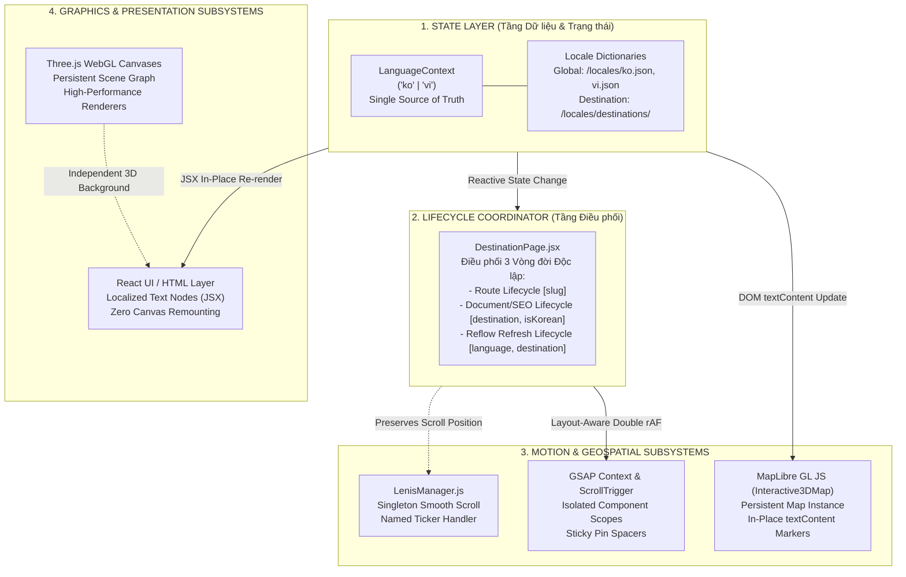
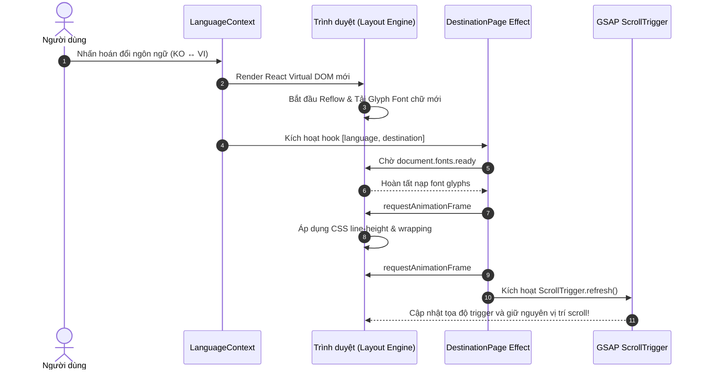
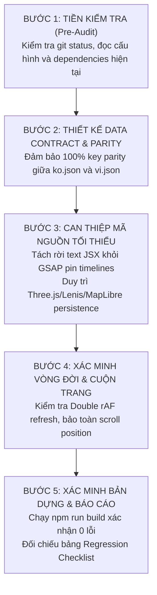

# TIÊU CHUẨN KỸ THUẬT ĐA NGÔN NGỮ & VÒNG ĐỜI 3D / GSAP / LENIS
## Super EZ Tour — Luxury Travel Platform Internationalization & 3D Lifecycle Engineering Standards

> **Tài liệu Kỹ thuật Chuẩn hóa (Production Engineering Standards)**  
> **Dự án:** Super EZ Tour (`D:/workplace/SuperEZTour`)  
> **Phiên bản:** 2.0.0 — Bản phát hành chính thức  
> **Ngôn ngữ hỗ trợ:** Korean (`ko`) & Vietnamese (`vi`)  
> **Trạng thái:** `PRODUCTION READY`  
> **Áp dụng cho:** Tất cả Nhà phát triển (Frontend Developers), Kỹ sư WebGL/Three.js, Kỹ sư GSAP Motion, và Trợ lý Lập trình AI (AI Coding Agents).

---

## MỤC LỤC CHI TIẾT (TABLE OF CONTENTS)

1. [Chương 01: Mục đích & Phạm vi (Purpose & Scope)](#chương-01-mục-đích--phạm-vi-purpose--scope)
2. [Chương 02: Kiến trúc Tổng thể Hệ thống (Project Architecture)](#chương-02-kiến-trúc-tổng-thể-hệ-thống-project-architecture)
3. [Chương 03: Kiến trúc Ngôn ngữ Toàn cục (Language Architecture)](#chương-03-kiến-trúc-ngôn-ngữ-toàn-cục-language-architecture)
4. [Chương 04: Cơ cấu & Tổ chức File Locale (Locale File Organization)](#chương-04-cơ-cấu--tổ-chức-file-locale-locale-file-organization)
5. [Chương 05: Quy ước Đặt tên Translation Key (Translation Key Conventions)](#chương-05-quy-ước-đặt-tên-translation-key-translation-key-conventions)
6. [Chương 06: Nguyên tắc Bảo toàn Nội dung Tiếng Hàn Gốc (Korean Baseline Preservation)](#chương-06-nguyên-tắc-bảo-toàn-nội-dung-tiếng-hàn-gốc-korean-baseline-preservation)
7. [Chương 07: Tiêu chuẩn Dịch thuật Tiếng Việt Cao cấp (Vietnamese Luxury Editorial Standard)](#chương-07-tiêu-chuẩn-dịch-thuật-tiếng-việt-cao-cấp-vietnamese-luxury-editorial-standard)
8. [Chương 08: Tiêu chuẩn Độc lập cho 10 Điểm đến (Destination Independence Standard)](#chương-08-tiêu-chuẩn-độc-lập-cho-10-điểm-đến-destination-independence-standard)
9. [Chương 09: An toàn Hợp đồng Dữ liệu (Data Contract Safety)](#chương-09-an-toàn-hợp-đồng-dữ-liệu-data-contract-safety)
10. [Chương 10: Vòng đời React & Chuyển đổi Ngôn ngữ (React Lifecycle & Language Switching)](#chương-10-vòng-đời-react--chuyển-đổi-ngôn-ngữ-react-lifecycle--language-switching)
11. [Chương 11: Quyền Sở hữu & Quản lý GSAP / ScrollTrigger (GSAP & ScrollTrigger Ownership)](#chương-11-quyền-sở-hữu--quản-lý-gsap--scrolltrigger-gsap--scrolltrigger-ownership)
12. [Chương 12: Vòng đời Cuộn mượt Lenis (Lenis Smooth Scroll Lifecycle)](#chương-12-vòng-đời-cuộn-mượt-lenis-lenis-smooth-scroll-lifecycle)
13. [Chương 13: Vòng đời & Quản lý Tài nguyên Three.js Canvas (Three.js Scene Lifecycle)](#chương-13-vòng-đời--quản-lý-tài-nguyên-threejs-canvas-threejs-scene-lifecycle)
14. [Chương 14: Tái tính toán Layout Reflow & ScrollTrigger Refresh](#chương-14-tái-tính-toán-layout-reflow--scrolltrigger-refresh)
15. [Chương 15: Bảo toàn Vị trí Cuộn Trang (Scroll Position Preservation)](#chương-15-bảo-toàn-vị-trí-cuộn-trang-scroll-position-preservation)
16. [Chương 16: Tích hợp Đa ngôn ngữ MapLibre GL 3D (MapLibre GL Localization)](#chương-16-tích-hợp-đa-ngôn-ngữ-maplibre-gl-3d-maplibre-gl-localization)
17. [Chương 17: Typography, Xử lý Phông chữ & Responsive (Typography & Layout Constraints)](#chương-17-typography-xử-lý-phông-chữ--responsive-typography--layout-constraints)
18. [Chương 18: Định dạng Bản địa Hóa (Locale-Aware Formatting)](#chương-18-định-dạng-bản-địa-hóa-locale-aware-formatting)
19. [Chương 19: Quy trình Kiểm tra & Test Tự động (Validation & Automated Testing)](#chương-19-quy-trình-kiểm-tra--test-tự-động-validation--automated-testing)
20. [Chương 20: Bảng Kiểm tra Hồi quy 3D Localization (Regression Checklist)](#chương-20-bảng-kiểm-tra-hồi-quy-3d-localization-regression-checklist)
21. [Chương 21: Bảng Tra cứu Sự cố & Hướng xử lý (Troubleshooting & Triage Matrix)](#chương-21-bảng-tra-cứu-sự-cố--hướng-xử-lý-troubleshooting--triage-matrix)
22. [Chương 22: 15 Quy tắc Bắt buộc dành cho AI Agent & Quy trình Bảo trì (AI Agent Mandatory Rules)](#chương-22-15-quy-tắc-bắt-buộc-dành-cho-ai-agent--quy-trình-bảo-trì-ai-agent-mandatory-rules)

---

## QUY ƯỚC NHÃN TRẠNG THÁI (STATUS TAG CONVENTIONS)

Trong toàn bộ tài liệu này, các tiêu chuẩn và đoạn code được phân loại minh bạch theo 5 nhãn chuẩn sau:
- `[CURRENT IMPLEMENTATION]`: Tính năng và giải pháp hiện đã có trong codebase và đã được kiểm chứng hoạt động.
- `[REQUIRED STANDARD]`: Quy chuẩn bắt buộc mọi lập trình viên và AI agent phải tuân thủ nghiêm ngặt trong mọi lần chỉnh sửa.
- `[RECOMMENDED IMPROVEMENT]`: Giải pháp tối ưu được đề xuất triển khai trong các phiên bản kế tiếp để nâng cao chất lượng mã nguồn.
- `[KNOWN ISSUE]`: Lỗi kỹ thuật đã từng xảy ra trong lịch sử codebase, cần nắm rõ nguyên nhân để không tái phạm.
- `[NOT VERIFIED]`: Giả thuyết hoặc tính năng thử nghiệm chưa có đủ bằng chứng thực nghiệm trên môi trường chạy thực tế.

---

## CHƯƠNG 01: MỤC ĐÍCH & PHẠM VI (PURPOSE & SCOPE)

### 1.1. Sứ mệnh của Tài liệu
`LOCALIZATION_GUIDELINES.md` được xây dựng để trở thành bản thiết kế kỹ thuật (Technical Blueprint) và chuẩn mực thực thi cao nhất cho nền tảng du lịch cá nhân hóa cao cấp **Super EZ Tour**. Tài liệu giải quyết bài toán phức tạp bậc nhất trong lập trình Frontend hiện đại: **Sự giao thoa giữa hệ thống đa ngôn ngữ phản ứng (Reactive Internationalization) và các hệ thống đồ họa 3D WebGL / GSAP ScrollTrigger / Lenis Smooth Scroll / MapLibre GL.**

### 1.2. Đối tượng Áp dụng
- **AI Coding Agents (Antigravity, Claude Code, Cursor, Copilot Workspace):** Phải đọc và áp dụng tài liệu này như một hệ thống quy tắc tối thượng trước khi sinh code hoặc sửa đổi bất kỳ file nào trong dự án.
- **Senior Frontend Engineers & WebGL Developers:** Căn cứ để review pull request, duy trì tính ổn định của kiến trúc và tối ưu hóa hiệu năng render.
- **QA / Test Automation Engineers:** Cung cấp ma trận kiểm thử (Test Matrix) và checklist hồi quy trực quan.

### 1.3. Phạm vi Dự án
- **Phạm vi Trang:** Áp dụng cho toàn bộ nền tảng: Trang chủ (`/`), Trang Destination Trải nghiệm 3D (`/destinations/da-nang`, `/destinations/ha-noi`), và lộ trình mở rộng 8 điểm đến tiếp theo.
- **Ngôn ngữ Mục tiêu:** Song ngữ Tiếng Hàn (`ko` — Korean) và Tiếng Việt (`vi` — Vietnamese), sẵn sàng mở rộng sang Tiếng Anh (`en`) trong tương lai.
- **Yêu cầu Cốt lõi:** Quá trình chuyển đổi ngôn ngữ (`KO <-> VI`) phải diễn ra tức thì, liền mạch, mượt mà ở mức 60-120 FPS, **tuyệt đối không làm gián đoạn, giật lag, reset scroll hoặc phá vỡ trạng thái của các scene 3D.**

---

## CHƯƠNG 02: KIẾN TRÚC TỔNG THỂ HỆ THỐNG (PROJECT ARCHITECTURE)

Hệ thống Super EZ Tour được tổ chức theo kiến trúc phân tầng chuyên biệt, tách rời tuyệt đối giữa **Tầng Trạng thái Ngôn ngữ (Language State Layer)**, **Tầng Điều phối Vòng đời (Lifecycle Coordinator)**, và **Tầng Render Tương tác (3D / Motion / DOM Subsystems)**.

### 2.1. Sơ đồ Kiến trúc Phân tầng (Architecture Diagram)



### 2.2. Phân định Trách nhiệm Các Tầng (Separation of Concerns)

| Phân tầng | Thành phần chính | Trách nhiệm cốt lõi | Phản ứng khi chuyển đổi Ngôn ngữ |
| :--- | :--- | :--- | :--- |
| **Localization State** | [LanguageContext.jsx](file:///D:/workplace/SuperEZTour/src/context/LanguageContext.jsx) | Lưu trữ ngôn ngữ hiện tại, persist `localStorage`, cung cấp hàm `toggleLanguage()`. | Thay đổi state `language` ('ko' ↔ 'vi'), thông báo đến các component qua Context. |
| **Route / Lifecycle** | [DestinationPage.jsx](file:///D:/workplace/SuperEZTour/src/features/destinations/DestinationPage.jsx) | Điều phối các scene, cập nhật document title, kích hoạt layout refresh an toàn. | Giữ nguyên DOM tree, thực hiện Double rAF để kích hoạt `ScrollTrigger.refresh()`. Không reset scroll! |
| **Motion Subsystem** | [LenisManager.js](file:///D:/workplace/SuperEZTour/src/features/destinations/motion/LenisManager.js) | Cung cấp singleton cuộn mượt (smooth scrolling), kết nối với ticker của GSAP. | Tiếp tục chạy bình thường, duy trì vị trí `window.scrollY`. Tuyệt đối không hủy hoặc khởi tạo lại Lenis. |
| **Animation Subsystem** | GSAP Timelines & ScrollTriggers | Điều khiển hiệu ứng pin dính, parallax, chuyển động chữ và camera scroll. | Giữ nguyên pin-spacers và timeline; chỉ tính toán lại điểm trigger sau khi text mới hoàn tất reflow. |
| **3D Graphics** | Three.js Scene Components | Render môi trường 3D WebGL (máy bay, mây, cầu Rồng, vịnh biển, ẩm thực). | Tiếp tục render loop ở 60fps; không bị remount, không re-compile shader, không dispose texture. |
| **Geospatial Map** | [Interactive3DMap.jsx](file:///D:/workplace/SuperEZTour/src/features/destinations/components/Interactive3DMap/Interactive3DMap.jsx) | Hiển thị địa hình 3D MapLibre và các điểm đánh dấu (HTML Markers). | Giữ nguyên Map instance; chỉ cập nhật nội dung nhãn chữ qua `markerElement.textContent`. |

---

## CHƯƠNG 03: KIẾN TRÚC NGÔN NGỮ TOÀN CỤC (LANGUAGE ARCHITECTURE)

`[CURRENT IMPLEMENTATION]` Hệ thống ngôn ngữ của Super EZ Tour tuân thủ nghiêm ngặt nguyên lý **Single Source of Truth (Nguồn Chân lý Duy nhất)** thông qua React Context API.

### 3.1. Phân tích `LanguageContext.jsx`
Toàn bộ ứng dụng được bọc bởi `LanguageProvider` tại cấp độ cao nhất của ứng dụng:
- **Tập tin nguồn:** [src/context/LanguageContext.jsx](file:///D:/workplace/SuperEZTour/src/context/LanguageContext.jsx)
- **Các giá trị cốt lõi được export:**
  - `language`: Chuỗi mã ngôn ngữ ISO (`'ko'` hoặc `'vi'`). Mặc định khởi tạo là `'ko'`.
  - `isKorean`: Giá trị boolean tiện ích (`language === 'ko'`).
  - `toggleLanguage()`: Hàm hoán đổi giữa `'ko'` và `'vi'`.
  - `setLanguage(lang)`: Hàm thiết lập tường minh một mã ngôn ngữ cụ thể.
  - `t(key, params)`: Hàm dịch chuỗi từ điển toàn cục (Global Dictionary).

### 3.2. Đồng bộ LocalStorage & Thuộc tính HTML DOM
Mỗi khi ngôn ngữ thay đổi, `LanguageContext` thực hiện:
1. Lưu vào trình duyệt: `localStorage.setItem('superez_language', language);`
2. Cập nhật thẻ root HTML: `document.documentElement.lang = language;` giúp các bộ đọc màn hình (Screen Readers), trình duyệt và công cụ tìm kiếm (SEO) nhận biết đúng ngôn ngữ trang.

```javascript
// [CURRENT IMPLEMENTATION] src/context/LanguageContext.jsx
const [language, setLanguageState] = useState(() => {
  try {
    const saved = localStorage.getItem('superez_language');
    if (saved === 'ko' || saved === 'vi') return saved;
  } catch (e) {
    console.warn('[LanguageContext] Failed to read localStorage:', e);
  }
  return 'ko'; // Baseline mặc định cho Super EZ Tour
});
```

---

## CHƯƠNG 04: CƠ CẤU & TỔ CHỨC FILE LOCALE (LOCALE FILE ORGANIZATION)

`[REQUIRED STANDARD]` Hệ thống từ điển ngôn ngữ được cấu trúc theo mô hình phân tách phạm vi (Scoped Localization) nhằm ngăn chặn xung đột dữ liệu và tối ưu hóa việc phân tách gói mã (Code Splitting):

### 4.1. Cấu trúc Cây Thư mục Chuẩn
```text
src/
├── locales/
│   ├── ko.json                         <-- [Global] Tiếng Hàn (Navbar, Booking, Common UI, Footer)
│   ├── vi.json                         <-- [Global] Tiếng Việt (Navbar, Booking, Common UI, Footer)
│   └── destinations/
│       ├── da-nang/
│       │   ├── ko.json                 <-- [Destination] Từ điển tiếng Hàn hoàn chỉnh cho Đà Nẵng (472 keys)
│       │   └── vi.json                 <-- [Destination] Từ điển tiếng Việt hoàn chỉnh cho Đà Nẵng (472 keys)
│       ├── ha-noi/
│       │   ├── ko.json                 <-- [Destination] Từ điển tiếng Hàn Hà Nội
│       │   └── vi.json                 <-- [Destination] Từ điển tiếng Việt Hà Nội
│       └── [slug]/
│           ├── ko.json
│           └── vi.json
```

### 4.2. Nguyên tắc Phân tầng Không gian Tên (Namespace Hierarchy)
File JSON của từng destination phải được phân cấp logic theo đúng tên các scene hoặc component đại diện:
- `meta`: Tiêu đề trang, mô tả SEO, từ khóa chia sẻ mạng xã hội.
- `hero`: Tiêu đề chính, phụ đề, CTA khám phá ban đầu.
- `airplane`: Trải nghiệm mở màn bay đến điểm đến, badge chuyên cơ.
- `experiences`: Chuỗi trải nghiệm đặc quyền (Cinematic sequence).
- `culinary`: Nghệ thuật ẩm thực, tên món ăn, triết lý hương vị.
- `nightlife`: Đời sống về đêm, du thuyền, không gian giải trí.
- `nature`: Khám phá thiên nhiên, sinh thái, bán đảo, danh thắng.
- `heritage`: Di sản văn hóa, phố cổ, kiến trúc tâm linh.
- `itinerary`: Lịch trình chi tiết theo từng ngày (Day 1..N), sáng/chiều/tối.
- `map`: Bản đồ tương tác 3D, danh sách địa danh, thông tin tọa độ hiển thị.
- `quote`: Biểu mẫu tư vấn riêng tư, liên hệ đặt lịch trình cao cấp.

### 4.3. Quy tắc Đối xứng 100% (100% Key Parity Rule)
`[REQUIRED STANDARD]` Giữa `ko.json` và `vi.json` của cùng một phân vùng:
- **Số lượng keys phải hoàn toàn bằng nhau.**
- **Cấu trúc cây dữ liệu (Object tree structure) phải đồng nhất tuyệt đối.**
- **Kiểu dữ liệu của từng key (string, array, boolean, number) phải tương ứng 1:1.**
- Nghiêm cấm tình trạng một key trả về string ở `ko.json` nhưng lại trả về array ở `vi.json`.

---

## CHƯƠNG 05: QUY ƯỚC ĐẶT TÊN TRANSLATION KEY (TRANSLATION KEY CONVENTIONS)

`[REQUIRED STANDARD]` Để đảm bảo mã nguồn dễ bảo trì, rõ ràng và nhất quán giữa các nhà phát triển và AI agents, hệ thống quy định các chuẩn đặt tên sau:

### 5.1. Định dạng Chuẩn (Format Standards)
1. **Kiểu chữ (Casing):** Sử dụng `camelCase` cho tên key (ví dụ: `titleHighlight`, `badgeVip`, `ctaExplore`).
2. **Nguyên tắc Ngữ nghĩa (Semantic Naming):** Đặt tên key theo **vai trò của thành phần trên giao diện**, tuyệt đối không đặt theo nội dung văn bản.
3. **Độ sâu tối đa (Nesting Depth):** Giới hạn phân cấp tối đa là 4 cấp: `scene.subSection.card.property`.

### 5.2. Bảng So sánh Chống Mô thức (Anti-Patterns vs Best Practices)

| Mô thức Sai lệch (Anti-Pattern - ❌ CẤM) | Chuẩn mực Kỹ thuật (Best Practice - ✅ CHUẨN) | Giải thích nguyên nhân |
| :--- | :--- | :--- |
| `"welcomeToDanang": "Đà Nẵng chào đón bạn"` | `"hero.headline": "Đà Nẵng chào đón bạn"` | Tránh sửa key khi thông điệp marketing thay đổi. |
| `"danang_intro_text_1": "..."` | `"overview.description": "..."` | Không dùng snake_case và số thứ tự vô nghĩa. |
| `"buttonText": "Xem ngay"` | `"culinary.ctaDetails": "Xem chi tiết"` | Tránh generic keys gây xung đột và khó tra cứu. |
| `"p1": "...", "p2": "..."` | `"itinerary.day1.morning.desc": "..."` | Rõ ràng về ngữ cảnh và vị trí xuất hiện trên UI. |
| `"chuyenCo": "Chuyên cơ riêng"` | `"airplane.serviceBadge": "Chuyên cơ riêng"` | Không đặt key bằng tiếng Việt không dấu hoặc tiếng Hàn phiên âm. |

### 5.3. Sử dụng Tham số Động (Interpolation)
Khi chuỗi chứa các giá trị biến đổi (số lượng, tên người dùng, ngày tháng), sử dụng cú pháp dấu ngoặc nhọn `{param}`:
```json
{
  "itinerary": {
    "dayCountLabel": "Hành trình {days} ngày {nights} đêm",
    "guestGreeting": "Kính chào Quý khách {name}"
  }
}
```

---

## CHƯƠNG 06: NGUYÊN TẮC BẢO TOÀN NỘI DUNG TIẾNG HÀN GỐC (KOREAN BASELINE PRESERVATION)

`[REQUIRED STANDARD]` Super EZ Tour được xây dựng với định vị phục vụ phân khúc khách hàng thượng lưu Hàn Quốc. Do đó, toàn bộ nội dung tiếng Hàn đã được biên dịch, rà soát văn hóa và phê duyệt kỹ thuật bởi các chuyên gia bản địa.

### 6.1. Quy tắc Tối thượng
1. **Tiếng Hàn là Đường chuẩn (Korean Baseline):** Tập tin `ko.json` và cấu hình gốc tiếng Hàn trong `da-nang.config.js` / `hanoi.config.js` là tiêu chuẩn chân lý về nội dung và cấu trúc.
2. **Nghiêm cấm Tự ý Sửa đổi (Zero Unauthorized Rewrites):** Lập trình viên và AI agents tuyệt đối không được tự ý viết lại, tóm tắt, diễn đạt lại hoặc cắt xén câu chữ tiếng Hàn để "cho vừa layout" hoặc "tiện code".
3. **Quy trình Điều chỉnh:** Bất kỳ thay đổi nào đối với chuỗi tiếng Hàn chỉ được phép thực hiện khi có yêu cầu bằng văn bản rõ ràng từ Product Owner / Khách hàng.

---

## CHƯƠNG 07: TIÊU CHUẨN DỊCH THUẬT TIẾNG VIỆT CAO CẤP (VIETNAMESE LUXURY EDITORIAL STANDARD)

`[REQUIRED STANDARD]` Bản dịch tiếng Việt không phải là việc dịch từng từ thô thiển qua Google Translate. Bản dịch tiếng Việt của Super EZ Tour phải toát lên đẳng cấp của một **Tạp chí Phong cách Sống & Du lịch Thượng lưu (Luxury Travel & Lifestyle Editorial)**.

### 7.1. Định hướng Văn phong (Tone & Voice)
- **Trang nhã, Quý phái:** Sử dụng ngôn từ giàu hình ảnh, trau chuốt, khơi gợi xúc cảm và giá trị di sản.
- **Tôn trọng Khách hàng:** Đại từ và câu từ thể hiện sự tận tâm, chuyên nghiệp, bảo mật và tinh tế.
- **Tránh Tuyệt đối:** Ngôn ngữ giật gân rẻ tiền, từ ngữ bình dân đường phố, hoặc các câu văn dịch máy ngô nghê thiếu tự nhiên.

### 7.2. Bảng Tra cứu Thuật ngữ Chuyên ngành Chuẩn (Official Luxury Glossary)

| Thuật ngữ Tiếng Anh | Tiếng Hàn Chuẩn (Baseline) | Tiếng Việt Chuẩn Super EZ Tour | Từ ngữ Cấm dùng (Bình dân / Sai ngữ cảnh) |
| :--- | :--- | :--- | :--- |
| **Luxury Private Tour** | 럭셔리 프라이빗 투어 | Tour Du lịch Riêng tư Thượng lưu | Tour cao cấp giá rẻ, Đi chơi riêng |
| **Bespoke Itinerary** | 맞춤형 여행 일정 | Lịch trình Thiết kế May đo Độc bản | Lịch trình tự chọn, Tour ghép |
| **Signature Experience** | 시그니처 경험 | Trải nghiệm Dấu ấn Đặc quyền | Điểm tham quan nổi tiếng, Trải nghiệm hot |
| **Private Jet / Aviation** | 전용기 항공 | Chuyên cơ Hàng không Riêng biệt | Máy bay thuê chuyến, Vé máy bay riêng |
| **Curated Journey** | 엄선된 여정 | Hành trình Tuyển chọn Tinh tế | Chuyến đi gom chọn, Tour sắp sẵn |
| **Chauffeur-driven Limousine**| 전용 기사 동반 리무진 | Xe Limousine cùng Tài xế Riêng | Xe đưa đón VIP, Xe ôm cao cấp |
| **Fine Dining / Culinary** | 미식 예술 / 파인 다이닝 | Nghệ thuật Ẩm thực Đỉnh cao | Quán ăn ngon, Bữa ăn sang chảnh |
| **VIP Fast Track Concierge** | VIP 패스트트랙 컨시어지 | Dịch vụ Thông quan Nhanh & Trợ lý VIP | Lối đi nhanh VIP, Dẫn tour ưu tiên |
| **Heritage / Sanctuary** | 유산과 안식처 | Miền Di sản & Chốn An yên | Khu di tích cổ, Điểm tâm linh cũ |
| **Dedicated Expert Host** | 전담 여행 전문가 | Chuyên gia Lữ hành Tận tâm | Hướng dẫn viên, Người dẫn đoàn |

---

## CHƯƠNG 08: TIÊU CHUẨN ĐỘC LẬP CHO 10 ĐIỂM ĐẾN (DESTINATION INDEPENDENCE STANDARD)

`[REQUIRED STANDARD]` Super EZ Tour định hướng xây dựng không gian 3D tương tác sống động cho **toàn bộ 10 điểm đến hàng đầu Việt Nam**. Tuyệt đối không thiết kế hệ thống theo tư duy cục bộ "chỉ có Đà Nẵng là điểm đến duy nhất".

### 8.1. Danh mục 10 Điểm đến Chiến lược
- **Miền Bắc (4 điểm đến):** Hà Nội, Sa Pa, Hạ Long, Ninh Bình.
- **Miền Trung (4 điểm đến):** Đà Nẵng, Huế, Nha Trang, Đà Lạt.
- **Miền Nam (2 điểm đến):** Hồ Chí Minh, Phú Quốc.

### 8.2. Nguyên tắc: "One Shared Platform — Multiple Destination Identities"
1. **Chung Nền tảng Kỹ thuật:** Tất cả 10 điểm đến cùng chia sẻ `LanguageContext`, `LenisManager`, cơ chế kiểm soát lifecycle và các UI components toàn cục (`DestinationHeader`, `DestinationFooter`, `QuoteModal`).
2. **Tự do Bản sắc Sáng tạo:** Mỗi điểm đến sở hữu một concept nghệ thuật và không gian 3D riêng biệt:
   - *Đà Nẵng:* Bay xuyên không gian ven biển, Cầu Rồng phun lửa, Bà Nà Hills quy mô hoành tráng.
   - *Hà Nội:* Dạo bước qua miền ký ức văn hóa, phố cổ rêu phong, Tháp Rùa Hồ Gươm, trà sen thanh tịnh.
3. **Cấm Ép buộc Cấu trúc (No Rigid Structure Enforcement):** Không bắt buộc Hà Nội hoặc các điểm đến mới phải có đúng 14 scene như Đà Nẵng, hoặc phải dùng đúng các ID navigation của Đà Nẵng. Mỗi điểm đến tự định nghĩa danh sách section thông qua file cấu hình riêng (ví dụ: `hanoi.config.js`, `da-nang.config.js`).

---

## CHƯƠNG 09: AN TOÀN HỢP ĐỒNG DỮ LIỆU (DATA CONTRACT SAFETY)

`[REQUIRED STANDARD]` Trong lập trình ứng dụng có tương tác 3D và bản đồ, sự nhầm lẫn giữa **Định danh Kỹ thuật (Technical Identifiers)** và **Văn bản Hiển thị (Display Strings)** là nguyên nhân hàng đầu gây crash ứng dụng và mất liên kết dữ liệu.

### 9.1. Phân định Ranh giới Bất biến

```text
┌────────────────────────────────────────────────────────┐
│ BẤT BIẾN (IMMUTABLE TECHNICAL IDENTIFIERS)             │
│ Tuyệt đối KHÔNG dịch, KHÔNG đổi theo ngôn ngữ:         │
│ - id: 'dragon-bridge', 'ba-na-hills'                   │
│ - slug: 'da-nang', 'ha-noi'                            │
│ - coordinates: [108.2208, 16.0678]                     │
│ - icon: 'compass', 'award', 'sparkles'                 │
│ - sceneKey: 'airplanePortal', 'culinaryFilm'           │
└────────────────────────────────────────────────────────┘
                           │ Liên kết thông qua ID
┌──────────────────────────▼─────────────────────────────┐
│ ĐA NGÔN NGỮ (LOCALIZED PRESENTATION DATA)              │
│ Thay đổi phản ứng theo 'ko' hoặc 'vi':                 │
│ - title: '용다리의 불꽃' ↔ 'Vũ Điệu Lửa Cầu Rồng'      │
│ - subtitle: '황홀한 밤의 전설' ↔ 'Huyền Thoại Đêm Vàng'│
│ - description: '...' ↔ '...'                           │
│ - badge: '시그니처' ↔ 'Đặc Quyền'                      │
└────────────────────────────────────────────────────────┘
```

### 9.2. Chuẩn Schema Hợp đồng Dữ liệu (TypeScript Definition Reference)

```typescript
// [REQUIRED STANDARD] Data Contract cho các Điểm đến & Scene
export interface LocalizedDestinationData {
  // === Technical Contract (Immutable) ===
  readonly id: string;                  // Ví dụ: "da-nang" (Dùng cho Router, State, Cache)
  readonly coordinates: [number, number]; // [Kinh độ (Lng), Vĩ độ (Lat)]
  readonly routeKey: string;            // Đường dẫn URL
  readonly targetSceneId: string;       // ID neo cuộn trang DOM

  // === Localized Presentation Layer (Reactive) ===
  display: {
    name: string;                       // Tên hiển thị ("Đà Nẵng" | "다낭")
    tagline: string;                    // Khẩu hiệu
    shortDescription: string;           // Tóm tắt ngắn gọn
    tags: string[];                     // Nhãn phân loại
  };
}
```

---

## CHƯƠNG 10: VÒNG ĐỜI REACT VÀ CHUYỂN ĐỔI NGÔN NGỮ (REACT LIFECYCLE & LANGUAGE SWITCHING)

`[REQUIRED STANDARD]` Đây là trái tim của sự ổn định hệ thống. Cần hiểu rõ sự khác biệt giữa việc **chuyển trang (Route change)** và **chuyển đổi ngôn ngữ (Language toggle)**.

### 10.1. Điều cấm Kỵ Tuyệt đối: `key={language}`
`[KNOWN ISSUE]` **NGHIÊM CẤM** đặt thuộc tính `key={language}` lên thẻ bao bọc của `DestinationPage` hoặc bất kỳ container chứa canvas 3D nào!
- **Hậu quả khi vi phạm:** React xem component mang key mới là một cây hoàn toàn mới. Toàn bộ DOM bị unmount và mount lại từ đầu. Trình duyệt tự động nhảy cuộn về đỉnh trang (`scrollY = 0`), WebGL context bị hủy và khởi tạo lại gây giật khựng (stuttering 1-3 giây), và toàn bộ trạng thái camera bị xóa sạch!

### 10.2. Kiến trúc 3 Vòng đời Độc lập (The 3 Lifecycles Pattern)
`[CURRENT IMPLEMENTATION]` Trong [src/features/destinations/DestinationPage.jsx](file:///D:/workplace/SuperEZTour/src/features/destinations/DestinationPage.jsx), vòng đời đã được tách bạch thành 3 `useEffect` riêng biệt:

```javascript
// [CURRENT IMPLEMENTATION] DestinationPage.jsx

// =========================================================================
// 1. ROUTE LIFECYCLE: Chỉ chạy khi đổi Destination hoặc Slug
// =========================================================================
useEffect(() => {
  if (!slug) return;
  
  // Chỉ cuộn về đỉnh khi người dùng thực sự chuyển sang một điểm đến khác
  window.scrollTo(0, 0);

  // Khởi tạo Lenis Smooth Scroll singleton
  LenisManager.init();

  const handlePageScroll = (e) => {
    // Logic quản lý header hiển thị
  };
  window.addEventListener('scroll', handlePageScroll, { passive: true });

  return () => {
    window.removeEventListener('scroll', handlePageScroll);
    LenisManager.destroy(); // Dọn dẹp an toàn khi rời trang
  };
}, [slug]); // <-- TUYỆT ĐỐI KHÔNG đưa language/isKorean vào đây!

// =========================================================================
// 2. SEO & DOCUMENT LIFECYCLE: Chạy khi đổi ngôn ngữ để cập nhật Meta Tags
// =========================================================================
useEffect(() => {
  if (destination) {
    document.title = `${destination.name} | Super EZ Tour`;
    document.documentElement.lang = isKorean ? 'ko' : 'vi';
  }
}, [destination, isKorean]); // Hoàn toàn không can thiệp vào Scroll hay DOM Canvas

// =========================================================================
// 3. LAYOUT-AWARE REFRESH LIFECYCLE: Tái tính toán ScrollTrigger sau reflow
// =========================================================================
useEffect(() => {
  // Sử dụng Double RequestAnimationFrame kết hợp Document Fonts Ready
  let rafId1, rafId2;
  
  const refreshLayout = () => {
    rafId1 = requestAnimationFrame(() => {
      rafId2 = requestAnimationFrame(() => {
        // Đảm bảo DOM đã hoàn tất tính toán kích thước ký tự mới
        ScrollTrigger.refresh();
      });
    });
  };

  if (document.fonts && document.fonts.ready) {
    document.fonts.ready.then(refreshLayout);
  } else {
    refreshLayout();
  }

  return () => {
    cancelAnimationFrame(rafId1);
    cancelAnimationFrame(rafId2);
  };
}, [language, destination]); // Tuyệt đối không destroy Lenis hay reset scroll!
```

---

## CHƯƠNG 11: QUYỀN SỞ HỮU & QUẢN LÝ GSAP / SCROLLTRIGGER (GSAP & SCROLLTRIGGER OWNERSHIP)

### 11.1. Nguyên tắc Phân quyền (Ownership Principle)
`[REQUIRED STANDARD]` Mỗi component chỉ có quyền sở hữu và dọn dẹp các animation/trigger do chính nó sinh ra thông qua `gsap.context()` hoặc `gsap.matchMedia()`.
- **Cấm Tuyệt đối:** Không bao giờ được gọi `ScrollTrigger.killAll()` hoặc `gsap.killTweensOf('*')` trong các hàm cleanup của component con. Làm như vậy sẽ giết chết toàn bộ animations và pin-spacers của tất cả các scene khác trên trang!

### 11.2. Sự cố Sụp đổ Pin-Spacer (The Pin-Spacer Collapse Bug)
`[KNOWN ISSUE]` Đây là nguyên nhân trực tiếp dẫn đến hiện tượng người dùng phản ánh: *"khi đang lướt dở chừng đổi ngôn ngữ thì trang bị nhảy loạn xạ qua các cụm khác nhau"*.

#### Cơ chế Phát sinh Lỗi:
1. Khi một component (ví dụ: `AirplanePortalScene`, `ExperiencesCinematicSequence`, `CulinaryFilmScene`, `ItineraryStickyTimeline`) sử dụng hiệu ứng `pin: true` trong ScrollTrigger.
2. GSAP chèn vào DOM một phần tử đệm có chiều cao lớn (gọi là `pin-spacer`, thường từ 2,000px đến 6,000px mỗi scene).
3. Nếu `useEffect` khởi tạo animation chứa dependency là một đối tượng dữ liệu ngôn ngữ (ví dụ: `[heroData]`, `[services]`, `[dishes]`, `[days]`):
   - Khi đổi ngôn ngữ, đối tượng tham chiếu thay đổi (object reference change).
   - React kích hoạt cleanup của effect: `ctx.revert()` được gọi.
   - `ctx.revert()` **xóa bỏ toàn bộ các pin-spacer khỏi DOM** trong một tích tắc!
   - Chiều cao toàn trang đột ngột co rút từ 25,000px xuống chỉ còn 4,000px.
   - Vị trí cuộn hiện tại của người dùng (ví dụ: `scrollY = 12,000px`) vượt quá chiều cao mới của trang. Trình duyệt bắt buộc phải kéo giật `scrollY` về đáy trang hoặc một tọa độ ngẫu nhiên.
   - Sau đó effect chạy lại, dựng lại pin-spacer, nhưng vị trí scroll đã bị sai lệch hoàn toàn!

#### Giải pháp Kỹ thuật Chuẩn (The Standard Fix):
`[REQUIRED STANDARD]` **Tách rời vĩnh viễn cấu trúc ScrollTrigger khỏi nội dung văn bản.**
- Hiệu ứng Pin và Timeline chuyển động chỉ khởi tạo **ĐÚNG MỘT LẦN** khi mount (phụ thuộc vào mảng rỗng `[]` hoặc độ dài mảng nguyên thủy ổn định `[services.length]`).
- Nội dung văn bản (tiêu đề, mô tả, thẻ badge) được render trực tiếp qua React JSX. Khi state `language` đổi, React tự cập nhật các node văn bản trong DOM mà **không hề chạm vào GSAP Timeline hay Pin-Spacer**.

```javascript
// [REQUIRED STANDARD] Mô hình Chuẩn Tránh Sụp Đổ Pin-Spacer
useEffect(() => {
  const ctx = gsap.context(() => {
    const tl = gsap.timeline({
      scrollTrigger: {
        trigger: sectionRef.current,
        pin: true,           // Dựng Pin-Spacer
        scrub: 1,
        start: 'top top',
        end: '+=300%'
      }
    });

    // Timeline chỉ điều khiển chuyển động hình học, tỷ lệ, opacity
    tl.to(cardRef.current, { scale: 1.1, opacity: 1 });
  }, sectionRef);

  return () => ctx.revert(); // Chỉ revert khi component thực sự Unmount khỏi DOM
}, []); // <-- Dependencies RỖNG: Không phụ thuộc vào text dịch!
```

---

## CHƯƠNG 12: VÒNG ĐỜI CUỘN MƯỢT LENIS (LENIS SMOOTH SCROLL LIFECYCLE)

`[CURRENT IMPLEMENTATION]` Toàn bộ chuyển động cuộn của Super EZ Tour được điều khiển bởi [src/features/destinations/motion/LenisManager.js](file:///D:/workplace/SuperEZTour/src/features/destinations/motion/LenisManager.js) theo mô hình Singleton tối ưu.

### 12.1. Quản lý Named Callback trong GSAP Ticker
`[REQUIRED STANDARD]` Để Lenis và GSAP ScrollTrigger đồng bộ ở tần số làm tươi màn hình cao (60Hz - 144Hz), Lenis được kết nối vào `gsap.ticker`.
- **Lỗi Rò rỉ Bộ nhớ Thường gặp:** Đăng ký hàm nặc danh `gsap.ticker.add((time) => lenis.raf(time * 1000))`. Khi unmount hoặc re-run, hàm nặc danh không thể bị gỡ bỏ, dẫn đến việc tích tụ hàng chục ticker loop chạy ngầm, làm nóng máy và tụt FPS trầm trọng.
- **Giải pháp Chuẩn:** Khai báo một hằng số tham chiếu hàm có tên (Named Function Callback) và sử dụng chính nó trong hàm dọn dẹp:

```javascript
// [CURRENT IMPLEMENTATION] src/features/destinations/motion/LenisManager.js
class LenisManagerClass {
  constructor() {
    this.lenis = null;
    this.tickerCallback = null;
    this.scrollHandler = null;
  }

  init(options = {}) {
    if (this.lenis) return this.lenis; // Bảo toàn Singleton

    this.lenis = new Lenis({
      duration: 1.2,
      easing: (t) => Math.min(1, 1.001 - Math.pow(2, -10 * t)),
      smoothWheel: true,
      ...options
    });

    // 1. Lưu trữ named callback cho GSAP Ticker
    this.tickerCallback = (time) => {
      if (this.lenis) this.lenis.raf(time * 1000);
    };
    gsap.ticker.add(this.tickerCallback);
    gsap.ticker.lagSmoothing(0);

    // 2. Lưu trữ named handler cho ScrollTrigger update
    this.scrollHandler = () => ScrollTrigger.update();
    this.lenis.on('scroll', this.scrollHandler);

    return this.lenis;
  }

  destroy() {
    if (this.tickerCallback) {
      gsap.ticker.remove(this.tickerCallback); // Gỡ bỏ chính xác
      this.tickerCallback = null;
    }
    if (this.lenis) {
      if (this.scrollHandler) {
        this.lenis.off('scroll', this.scrollHandler);
        this.scrollHandler = null;
      }
      this.lenis.destroy();
      this.lenis = null;
    }
  }
}

export const LenisManager = new LenisManagerClass();
```

---

## CHƯƠNG 13: VÒNG ĐỜI & QUẢN LÝ TÀI NGUYÊN THREE.JS CANVAS (THREE.JS SCENE LIFECYCLE)

### 13.1. Sự Độc lập Tuyệt đối giữa 3D Canvas và Ngôn ngữ
`[REQUIRED STANDARD]` Không gian 3D WebGL (Three.js) là nền tảng đồ họa nghệ thuật. Mô hình 3D, hạt ánh sáng, shaders, và camera chuyển động **không chứa chuỗi ký tự ngôn ngữ**.
- Khi người dùng chuyển đổi ngôn ngữ, **tuyệt đối không được hủy và tạo lại WebGLRenderer**. Canvas 3D phải tiếp tục chạy render loop mà không bị gián đoạn dù chỉ 1 frame.

### 13.2. Tiêu chuẩn Khởi tạo & Dọn dẹp Tài nguyên Three.js (Disposal Standards)
Khi component 3D thực sự unmount (khi người dùng chuyển trang sang một URL khác), toàn bộ tài nguyên GPU phải được giải phóng sạch sẽ để ngăn chặn lỗi tràn bộ nhớ (Memory Leak / Context Lost):

```javascript
// [REQUIRED STANDARD] Chuẩn Dọn dẹp Tài nguyên Three.js
useEffect(() => {
  const container = containerRef.current;
  if (!container) return;

  const renderer = new THREE.WebGLRenderer({
    powerPreference: "high-performance",
    antialias: true,
    alpha: true
  });
  renderer.setPixelRatio(Math.min(window.devicePixelRatio, 2));
  renderer.setSize(container.clientWidth, container.clientHeight);
  container.appendChild(renderer.domElement);

  // Resize Listener an toàn
  const handleResize = () => {
    if (!container) return;
    camera.aspect = container.clientWidth / container.clientHeight;
    camera.updateProjectionMatrix();
    renderer.setSize(container.clientWidth, container.clientHeight);
  };
  window.addEventListener('resize', handleResize);

  return () => {
    window.removeEventListener('resize', handleResize);
    
    // 1. Dừng render loop
    cancelAnimationFrame(animationFrameId);

    // 2. Giải phóng hình học và vật liệu
    scene.traverse((child) => {
      if (child.isMesh) {
        if (child.geometry) child.geometry.dispose();
        if (child.material) {
          if (Array.isArray(child.material)) {
            child.material.forEach((m) => disposeMaterial(m));
          } else {
            disposeMaterial(child.material);
          }
        }
      }
    });

    // 3. Giải phóng renderer và buộc hủy ngữ cảnh WebGL
    renderer.dispose();
    renderer.forceContextLoss();
    if (renderer.domElement && renderer.domElement.parentNode) {
      renderer.domElement.parentNode.removeChild(renderer.domElement);
    }
  };
}, []);
```

---

## CHƯƠNG 14: TÁI TÍNH TOÁN LAYOUT REFLOW & SCROLLTRIGGER REFRESH

### 14.1. Bản chất Kỹ thuật của Hiện tượng Lệch Kích thước Chữ
`[CURRENT IMPLEMENTATION]` Tiếng Hàn và Tiếng Việt có đặc tính ngôn ngữ học và độ dài câu chữ rất khác nhau:
- Một câu văn tiếng Việt cao cấp có dấu thanh đầy đủ thường **dài hơn câu văn tiếng Hàn tương ứng từ 15% đến 35%**.
- Sự chênh lệch độ dài này làm thay đổi số dòng văn bản (line wrapping), làm tăng hoặc giảm chiều cao của các khối DOM (DOM element height).
- Nếu không thông báo cho GSAP ScrollTrigger tính toán lại, các điểm kích hoạt (`start`, `end`, `trigger points`) sẽ bị lệch khỏi vị trí thực tế trên màn hình.

### 14.2. Kỹ thuật "Double rAF + Fonts Ready"
Để đảm bảo ScrollTrigger được làm mới tại thời điểm chính xác nhất (khi trình duyệt đã tải xong font chữ và vẽ xong bố cục mới):



---

## CHƯƠNG 15: BẢO TOÀN VỊ TRÍ CUỘN TRANG (SCROLL POSITION PRESERVATION)

`[REQUIRED STANDARD]` Đây là tiêu chuẩn trải nghiệm cao cấp nhất của Super EZ Tour: **Người dùng đang đứng ở bất kỳ vị trí nào trên trang, khi chuyển đổi ngôn ngữ, họ phải tiếp tục đứng chính xác tại ngữ cảnh đó, đọc tiếp nội dung bằng ngôn ngữ mới.**

### 15.1. Bảng Đối chiếu Nguyên nhân Trôi Scroll & Cách Xử lý

| Hiện tượng lỗi | Nguyên nhân gốc rễ (Root Cause) | Giải pháp Tiêu chuẩn (Standard Fix) |
| :--- | :--- | :--- |
| Đang đọc dở chừng đổi ngôn ngữ bị giật về đỉnh trang (`scrollY = 0`). | Thẻ cha mang thuộc tính `key={language}` hoặc `useEffect` chuyển trang có dependency `[language]` chứa `window.scrollTo(0,0)`. | Bỏ `key={language}`. Đưa `window.scrollTo(0,0)` vào duy nhất một `useEffect` phụ thuộc `[slug]`. |
| Đang xem scene 3D đổi ngôn ngữ bị trôi tụt xuống cuối trang. | Pin-spacers bị destroy do effect pin phụ thuộc vào object text dịch, làm trang co ngắn đột ngột. | Dependencies của pinned timelines phải là `[]`. Render text qua JSX in-place. |
| Sau khi đổi ngôn ngữ, cuộn tiếp thì các hiệu ứng animation bị kích hoạt sớm hoặc trễ. | Trình duyệt chưa hoàn tất tính toán font tiếng Việt khi ScrollTrigger refresh. | Áp dụng kỹ thuật Double rAF kết hợp `document.fonts.ready` tại `DestinationPage.jsx`. |

---

## CHƯƠNG 16: TÍCH HỢP ĐA NGÔN NGỮ MAPLIBRE GL 3D (MAPLIBRE GL LOCALIZATION)

`[CURRENT IMPLEMENTATION]` Bản đồ tương tác tại [src/features/destinations/components/Interactive3DMap/Interactive3DMap.jsx](file:///D:/workplace/SuperEZTour/src/features/destinations/components/Interactive3DMap/Interactive3DMap.jsx) sử dụng thư viện MapLibre GL JS kết hợp địa hình 3D (3D Terrain Mesh) và các Custom HTML Markers.

### 16.1. Quy tắc: Bất biến Map Instance
- **Tuyệt đối không:** Gọi `map.remove()` và khởi tạo lại bản đồ khi đổi ngôn ngữ. Việc nạp lại Vector Tiles và 3D Terrain qua mạng tốn 2-5 giây và gây nhấp nháy màn hình.
- **Quy chuẩn Chuẩn hóa:** Bản đồ được khởi tạo duy nhất một lần. Khi `language` hoặc dữ liệu `destinations` thay đổi, hệ thống duyệt qua các DOM element của markers hiện có và cập nhật trực tiếp văn bản thông qua thuộc tính an toàn `textContent`:

```javascript
// [CURRENT IMPLEMENTATION] Interactive3DMap.jsx
// Reactive Marker Label Update mà KHÔNG làm tạo lại bản đồ
useEffect(() => {
  if (!mapInstanceRef.current || !markersRef.current.length) return;

  markersRef.current.forEach(({ element, dest }) => {
    // 1. Tìm phần tử label bằng selector ngữ nghĩa
    const titleEl = element.querySelector('.marker-label-title');
    if (titleEl) {
      // 2. Cập nhật trực tiếp textContent (Phòng chống XSS & Không reflow map)
      const localizedName = dest.title || dest.name || '';
      if (titleEl.textContent !== localizedName) {
        titleEl.textContent = localizedName;
      }
    }
  });
}, [destinations, isKorean]); // Chạy nhẹ nhàng trong vài microsecond!
```

---

## CHƯƠNG 17: TYPOGRAPHY, XỬ LÝ PHÔNG CHỮ & RESPONSIVE (TYPOGRAPHY & LAYOUT CONSTRAINTS)

### 17.1. Phông chữ Hỗ trợ Chuẩn (Font Stacks)
Dự án sử dụng các họ font chuẩn quốc tế có độ tương thích glyphs 100% cho cả chữ tượng hình Hangul và chữ Latinh mang dấu thanh tiếng Việt:
- **Tiêu đề Luxury & Editorial:** `'Playfair Display'`, `'Cinzel'`, serif.
- **Nội dung & Giao diện Kỹ thuật:** `'Noto Sans KR'`, `'Inter'`, system-ui, sans-serif.

### 17.2. Quy tắc Ngắt dòng và Dấu thanh (Diacritics & Line Breaking)
`[REQUIRED STANDARD]` Để văn bản hiển thị đẹp hoàn hảo và không bị cắt cụt (clipping):
1. **Đối với Tiếng Hàn:** Bắt buộc áp dụng `word-break: keep-all;` để các từ tiếng Hàn không bị ngắt đôi giữa chừng một cách ngớ ngẩn.
2. **Đối với Tiếng Việt:**
   - Sử dụng `line-height` tối thiểu là `1.4` đến `1.6` cho nội dung văn bản để các dấu thanh (dấu hỏi, ngã, nặng, mũ) không bị đè lên dòng trên hoặc bị cắt cụt trên trình duyệt Safari/iOS.
   - Tránh dùng cố định `height` bằng pixel cho các khối chứa văn bản; luôn dùng `min-height` kết hợp `padding` để tự động giãn nở khi tiếng Việt dài hơn.

### 17.3. Ma trận Breakpoints Thử nghiệm Bắt buộc
Mọi thành phần giao diện đa ngôn ngữ phải được kiểm tra hiển thị không tràn viền (overflow-x) trên 5 độ phân giải:
1. **Desktop Siêu rộng:** `1440px` (Màn hình máy tính chuẩn).
2. **Laptop / Tablet Ngang:** `1024px`.
3. **Tablet Đứng:** `768px`.
4. **Mobile Chuẩn:** `390px` (iPhone 14/15/16).
5. **Mobile Nhỏ:** `320px` (Thiết bị hạn chế không gian hiển thị).

---

## CHƯƠNG 18: ĐỊNH DẠNG BẢN ĐỊA HÓA (LOCALE-AWARE FORMATTING)

`[REQUIRED STANDARD]` Không chỉ có chữ viết, định dạng ngày tháng, tiền tệ và thời gian du lịch cũng phải tuân thủ chặt chẽ thói quen văn hóa của từng quốc gia:

### 18.1. Quy chuẩn So sánh Văn hóa (Cultural Conventions)

| Hạng mục dữ liệu | Định dạng Tiếng Hàn (`ko`) | Định dạng Tiếng Việt (`vi`) | Ghi chú Kỹ thuật |
| :--- | :--- | :--- | :--- |
| **Thời lượng Tour** | `3박 4일` (Đêm trước, Ngày sau) | `4 ngày 3 đêm` (Ngày trước, Đêm sau) | Cấm dịch `3박 4일` thành "3 đêm 4 ngày". Người Việt luôn nói Ngày trước Đêm sau. |
| **Ngày tháng** | `2026년 11월 19일` | `Ngày 19 tháng 11 năm 2026` hoặc `19/11/2026` | Năm/Tháng/Ngày đối với Hàn; Ngày/Tháng/Năm đối với Việt. |
| **Tiền tệ Bản địa** | `₩1,200,000` hoặc `120만 원` | `24.500.000 ₫` hoặc `24,5 triệu VNĐ` | Dấu chấm/phẩy phân cách hàng nghìn theo chuẩn địa phương. |
| **Tiền tệ Quốc tế** | `$1,500 USD` | `1.500 USD` | Tiêu chuẩn tham chiếu quốc tế cho khách hàng thượng lưu. |
| **Xưng hô Khách hàng**| `고객님` (Kính ngữ trân trọng) | `Quý khách` / `Quý chủ nhân` | Giữ chuẩn mực khách hàng cao cấp trong toàn bộ thông báo. |

---

## CHƯƠNG 19: QUY TRÌNH KIỂM TRA & TEST TỰ ĐỘNG (VALIDATION & AUTOMATED TESTING)

Để ngăn chặn lỗi thiếu sót key trước khi đưa mã nguồn lên môi trường Production, dự án áp dụng quy trình kiểm tra tự động 3 bước:

### 19.1. Script Tự động Kiểm tra 100% Key Parity
`[CURRENT IMPLEMENTATION]` Dự án sử dụng script kiểm thử độc lập viết bằng Node.js để đối chiếu cấu trúc JSON giữa hai ngôn ngữ:

```javascript
// scratch/validate_locale_parity.cjs
const fs = require('fs');
const path = require('path');

function getFlattenKeys(obj, prefix = '') {
  let keys = [];
  for (const [k, v] of Object.entries(obj)) {
    const fullKey = prefix ? `${prefix}.${k}` : k;
    if (v && typeof v === 'object' && !Array.isArray(v)) {
      keys = keys.concat(getFlattenKeys(v, fullKey));
    } else {
      keys.push({ key: fullKey, type: Array.isArray(v) ? 'array' : typeof v });
    }
  }
  return keys;
}

function compareLocales(koPath, viPath) {
  const koData = JSON.parse(fs.readFileSync(koPath, 'utf8'));
  const viData = JSON.parse(fs.readFileSync(viPath, 'utf8'));

  const koKeys = getFlattenKeys(koData);
  const viKeys = getFlattenKeys(viData);

  const koMap = new Map(koKeys.map(i => [i.key, i.type]));
  const viMap = new Map(viKeys.map(i => [i.key, i.type]));

  let missingInVi = [];
  let missingInKo = [];
  let typeMismatch = [];

  for (const [key, type] of koMap.entries()) {
    if (!viMap.has(key)) missingInVi.push(key);
    else if (viMap.get(key) !== type) {
      typeMismatch.push({ key, koType: type, viType: viMap.get(key) });
    }
  }
  for (const [key] of viMap.entries()) {
    if (!koMap.has(key)) missingInKo.push(key);
  }

  console.log(`Kết quả so sánh [${path.basename(path.dirname(koPath))}]:`);
  console.log(`- Tổng số keys Tiếng Hàn: ${koMap.size}`);
  console.log(`- Tổng số keys Tiếng Việt: ${viMap.size}`);
  console.log(`- Keys thiếu ở VI: ${missingInVi.length}`);
  console.log(`- Keys thiếu ở KO: ${missingInKo.length}`);
  console.log(`- Lệch kiểu dữ liệu: ${typeMismatch.length}`);

  if (missingInVi.length || missingInKo.length || typeMismatch.length) {
    process.exit(1);
  }
  console.log('✅ CHÚC MỪNG: Parity đạt 100% hoàn hảo!');
}
```

### 19.2. Kiểm tra Bản dựng Production (Production Build Verification)
Trước khi bàn giao bất kỳ tính năng nào, bắt buộc phải chạy lệnh build production:
```powershell
npm run build
```
Kết quả mong đợi: `vite build` hoàn tất thành công trong vòng dưới 10 giây, mã thoát `exit code 0`, không có bất kỳ cảnh báo lỗi cú pháp hoặc import thiếu.

---

## CHƯƠNG 20: BẢNG KIỂM TRA HỒI QUY 3D LOCALIZATION (REGRESSION CHECKLIST)

Mỗi khi bổ sung nội dung hoặc chỉnh sửa code liên quan đến ngôn ngữ hay 3D, hãy rà soát bảng kiểm tra sau:

```markdown
### DANH MỤC KIỂM TRA HỒI QUY TOÀN DIỆN (INTERACTIVE CHECKLIST)

#### 1. React & DOM Architecture
- [ ] KHÔNG có thuộc tính `key={language}` trên `DestinationPage` hoặc các container 3D.
- [ ] Tất cả các thẻ `<html lang="...">` cập nhật chính xác 'ko' hoặc 'vi' khi toggle.
- [ ] Document title thay đổi đúng định dạng: `[Tên điểm đến] | Super EZ Tour`.
- [ ] Không có thông báo lỗi React Hydration hoặc lỗi DOM Nesting trong DevTools Console.

#### 2. Lenis Smooth Scroll & Ticker
- [ ] Lenis được khởi tạo duy nhất 1 lần (Singleton) trong suốt phiên xem Destination.
- [ ] Ticker callback của GSAP là named function, được remove sạch khi unmount.
- [ ] Chuyển đổi ngôn ngữ KO ↔ VI KHÔNG kích hoạt `LenisManager.init()` hoặc `destroy()`.
- [ ] Con lăn chuột và phím cuộn trang hoạt động mượt mà liên tục, không bị sượng lag.

#### 3. GSAP & ScrollTrigger Health
- [ ] Toàn bộ các pinned timelines KHÔNG chứa dependency là object text ngôn ngữ.
- [ ] Chiều cao trang và các khối pin-spacers giữ nguyên kích thước khi đổi ngôn ngữ.
- [ ] Vị trí cuộn trang của người dùng (`window.scrollY`) được bảo toàn 100%.
- [ ] Hàm `ScrollTrigger.refresh()` được gọi thông qua kỹ thuật Double rAF sau khi fonts ready.

#### 4. Three.js WebGL Canvases
- [ ] Canvas 3D tiếp tục render ở 60-120 FPS khi đổi ngôn ngữ; không bị re-mount.
- [ ] Không xảy ra sự cố WebGL Context Lost (`THREE.WebGLRenderer: Context Lost`).
- [ ] Thử nghiệm co giãn cửa sổ trình duyệt (Window Resize), camera aspect ratio cập nhật mượt mà.
- [ ] Rời trang (Unmount route), toàn bộ geometry, material, texture được dispose sạch sẽ.

#### 5. MapLibre GL 3D Map
- [ ] Map instance duy trì ổn định; không bị khởi tạo lại (`new maplibregl.Map`) khi đổi ngôn ngữ.
- [ ] Toàn bộ nhãn HTML Markers cập nhật tức thì tên địa danh bằng ngôn ngữ mới.
- [ ] Tọa độ địa lý và camera bay tới các điểm không bị sai lệch.
- [ ] Không rò rỉ WebGL Context của bản đồ.

#### 6. Typography & Responsive
- [ ] Phông chữ tiếng Việt hiển thị rõ nét toàn bộ dấu thanh, không bị lỗi font ô vuông (tofu).
- [ ] Văn bản tiếng Hàn tuân thủ `word-break: keep-all;`.
- [ ] Kiểm tra responsive trên các độ rộng: 1440px, 1024px, 768px, 390px, 320px.
- [ ] Không xuất hiện thanh cuộn ngang ngoài ý muốn (`overflow-x: hidden` được đảm bảo).
```

---

## CHƯƠNG 21: BẢNG TRA CỨU SỰ CỐ & HƯỚNG XỬ LÝ (TROUBLESHOOTING & TRIAGE MATRIX)

| Mã sự cố | Hiện tượng quan sát | Nguyên nhân cốt lõi | Hướng khắc phục kỹ thuật |
| :--- | :--- | :--- | :--- |
| **BUG-01** | Người dùng đang cuộn dở trang, nhấn đổi ngôn ngữ thì trang bị nhảy vọt về đầu hoặc vị trí bất định. | Effect pin chứa dependency `[heroData]` làm GSAP revert xóa pin-spacers; hoặc có `key={language}` trên component cha. | Xóa dependency text khỏi effect pin (dùng `[]`), render text qua React JSX. Bỏ `key={language}`. |
| **BUG-02** | Trình duyệt càng lướt càng nóng máy, quạt tản nhiệt quay mạnh, FPS tụt từ 60 xuống dưới 20. | Rò rỉ GSAP Ticker do dùng anonymous function `(time) => lenis.raf(time)` không gỡ bỏ được. | Lưu tham chiếu callback vào biến `this.tickerCallback` và gọi `gsap.ticker.remove(this.tickerCallback)`. |
| **BUG-03** | Chữ tiếng Việt trên Safari bị mất dấu hỏi/ngã ở hàng trên, hoặc chữ bị đè dòng. | Thuộc tính `line-height` quá nhỏ (< 1.2) hoặc container đặt cố định `height` bằng pixel. | Nâng `line-height: 1.5;`, đổi `height` thành `min-height` với padding dưới thoáng đãng. |
| **BUG-04** | Đổi ngôn ngữ xong thì marker trên bản đồ MapLibre vẫn hiển thị tiếng cũ hoặc bản đồ nhấp nháy đen. | Bản đồ bị re-create bằng `new maplibregl.Map()` hoặc thiếu effect cập nhật text DOM của markers. | Giữ nguyên map instance; thêm effect lắng nghe `[language]` để update `markerEl.textContent`. |
| **BUG-05** | Sau khi chuyển ngôn ngữ, animation cuộn bị chạy trước khi người dùng kịp lướt đến section. | ScrollTrigger chưa kịp refresh sau khi font chữ tiếng Việt tải xong và làm dãn dài DOM. | Dùng `document.fonts.ready.then(() => requestAnimationFrame(() => ScrollTrigger.refresh()))`. |
| **BUG-06** | Console báo lỗi đỏ: `WARNING: Too many active WebGL contexts. Oldest context will be lost`. | Các component 3D khi unmount không gọi `renderer.dispose()` và `renderer.forceContextLoss()`. | Triển khai đúng hàm cleanup Three.js tiêu chuẩn tại Chương 13 trong mọi scene canvas. |

---

## CHƯƠNG 22: 15 QUY TẮC BẮT BUỘC DÀNH CHO AI AGENT & QUY TRÌNH BẢO TRÌ (AI AGENT MANDATORY RULES)

### 22.1. 15 Điều Răn Kỹ thuật Dành cho AI Coding Agents
Tất cả các AI Coding Agents khi nhận lệnh can thiệp vào codebase Super EZ Tour **PHẢI TUÂN THỦ TUYỆT ĐỐI 15 NGUYÊN TẮC SAU**:

1. **QUY TẮC 01:** Tuyệt đối KHÔNG BAO GIỜ đặt `key={language}` hoặc `key={isKorean}` lên bất kỳ container chứa canvas 3D hoặc trang Destination nào.
2. **QUY TẮC 02:** Tuyệt đối KHÔNG BAO GIỜ đưa state `language` hoặc `isKorean` vào dependency array của các `useEffect` chứa logic khởi tạo Lenis, WebGL Canvas, hoặc MapLibre GL.
3. **QUY TẮC 03:** Tuyệt đối KHÔNG BAO GIỜ đưa các đối tượng dữ liệu dịch (ví dụ: `[heroData]`, `[services]`, `[dishes]`, `[days]`) vào dependency array của các `useEffect` chứa hiệu ứng `pin: true` trong ScrollTrigger.
4. **QUY TẮC 04:** Tuyệt đối KHÔNG BAO GIỜ gọi `ScrollTrigger.killAll()` hoặc `gsap.killTweensOf('*')` trong các component con. Chỉ sử dụng `gsap.context()` hoặc `gsap.matchMedia()` cục bộ.
5. **QUY TẮC 05:** Luôn sử dụng Named Function Callback khi làm việc với `gsap.ticker.add()` và phải dọn dẹp bằng `gsap.ticker.remove()`.
6. **QUY TẮC 06:** Giữ nguyên vẹn 100% nội dung tiếng Hàn gốc trong `ko.json` và các file cấu hình. Không tự ý biên tập, viết lại hoặc rút ngắn tiếng Hàn.
7. **QUY TẮC 07:** Mọi key mới được bổ sung vào `ko.json` bắt buộc phải được tạo ngay lập tức vào `vi.json` với cùng cấp bậc và cùng kiểu dữ liệu (Đảm bảo 100% Parity).
8. **QUY TẮC 08:** Dịch tiếng Việt theo phong cách tạp chí thượng lưu (Luxury Editorial), sử dụng chính xác các thuật ngữ trong Bảng Glossary Chuẩn tại Chương 07.
9. **QUY TẮC 09:** Không bao giờ dịch hoặc làm biến đổi các định danh kỹ thuật (`id`, `slug`, `coordinates`, `routeKey`, `sceneKey`).
10. **QUY TẮC 10:** Khi cần tính toán lại vị trí ScrollTrigger sau khi đổi ngôn ngữ, bắt buộc phải sử dụng kỹ thuật Double rAF kết hợp `document.fonts.ready`.
11. **QUY TẮC 11:** Trong các component 3D Three.js, luôn dọn dẹp geometries, materials, textures và gọi `renderer.forceContextLoss()` khi unmount.
12. **QUY TẮC 12:** Cập nhật nhãn bản đồ MapLibre trực tiếp qua DOM `textContent` của marker, tuyệt đối không re-render lại toàn bộ Map instance.
13. **QUY TẮC 13:** Kiểm tra và đảm bảo CSS hiển thị tiếng Việt có `line-height` an toàn và `min-height` linh hoạt để không cắt cụt dấu thanh.
14. **QUY TẮC 14:** Luôn kiểm tra kết quả `git status` trước khi sửa đổi, chỉ chỉnh sửa đúng phạm vi được giao, không làm ảnh hưởng đến các điểm đến khác.
15. **QUY TẮC 15:** Sau khi hoàn thành bất kỳ chỉnh sửa nào, bắt buộc phải chạy lệnh kiểm tra bản dựng `npm run build` và xác nhận không có lỗi biên dịch.

### 22.2. Quy trình Thực thi Tiêu chuẩn (Standard Operating Procedure for AI)



---

## TÀI LIỆU THAM KHẢO & LIÊN KẾT MÃ NGUỒN (SOURCE CODE REFERENCES)

1. [src/context/LanguageContext.jsx](file:///D:/workplace/SuperEZTour/src/context/LanguageContext.jsx) — Single source of truth cho toàn bộ hệ thống ngôn ngữ Super EZ Tour.
2. [src/features/destinations/DestinationPage.jsx](file:///D:/workplace/SuperEZTour/src/features/destinations/DestinationPage.jsx) — Bộ điều phối vòng đời 3 tầng (Route, Document, Layout Reflow).
3. [src/features/destinations/motion/LenisManager.js](file:///D:/workplace/SuperEZTour/src/features/destinations/motion/LenisManager.js) — Singleton Smooth Scroll quản lý GSAP Ticker không rò rỉ bộ nhớ.
4. [src/features/destinations/components/Interactive3DMap/Interactive3DMap.jsx](file:///D:/workplace/SuperEZTour/src/features/destinations/components/Interactive3DMap/Interactive3DMap.jsx) — Quản lý MapLibre 3D Terrain và reactive HTML markers.
5. [src/locales/destinations/da-nang/ko.json](file:///D:/workplace/SuperEZTour/src/locales/destinations/da-nang/ko.json) — Baseline từ điển tiếng Hàn cho điểm đến Đà Nẵng (472 keys).
6. [src/locales/destinations/da-nang/vi.json](file:///D:/workplace/SuperEZTour/src/locales/destinations/da-nang/vi.json) — Bản dịch tiếng Việt chuẩn tạp chí thượng lưu cho Đà Nẵng (472 keys).

---
*Tài liệu này được phê duyệt và lưu trữ tại gốc dự án Super EZ Tour. Mọi đóng góp hoặc sửa đổi kỹ thuật phải tuân thủ nghiêm ngặt quy trình kiểm soát phiên bản và vượt qua bài kiểm tra hồi quy tại Chương 20.*
