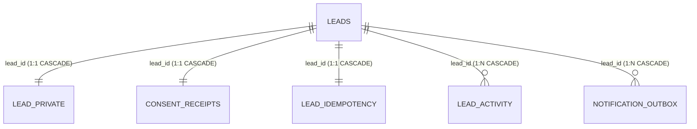

# Database Architecture — Super EZ Tour

## 1. Provider & Environment Isolation

Super EZ Tour uses **PostgreSQL 17** via `pg` (`node-postgres`) with reviewed, versioned SQL migrations.

| Environment | Host / Binding | Database Name | TLS Policy | Role Separation |
|---|---|---|---|---|
| **Local Development** | `127.0.0.1:55431` (`infrastructure/docker/compose.dev.yml`) | `superez_lead_dev` | `disable` (loopback only) | Dedicated dev owner (`superez_dev`) |
| **Integration Testing** | `127.0.0.1:55432` (`infrastructure/docker/compose.test.yml`) | `superez_lead_test` | `disable` (loopback only) | Disposable test DB (`superez_test`) |
| **Production (Target)** | **Supabase Managed PostgreSQL** | Dedicated production DB (forbids `superez_lead_dev`/`test`) | **`verify-full` mandatory** (+ optional `DATABASE_CA_FILE`) | Separate `MIGRATION_DATABASE_URL` (DDL owner) vs `DATABASE_URL` (least-privilege runtime role) |

### Non-Negotiable Database Boundaries
- **Fastify Owns All Access:** Only `apps/api/src/database/*` and module repositories query PostgreSQL.
- **No Browser DB Access:** Supabase Data API (PostgREST) must remain disabled or unexposed for `superez_leads`. Supabase Auth is **not** used.
- **Strict ViVu Isolation:** Super EZ Tour never shares databases, roles, containers, or credentials with the ViVu MongoDB/backend stack.

---

## 2. Schema `superez_leads` (`001_lead_foundation.sql`)

All privileges on schema `superez_leads`, its tables, and its sequences are explicitly revoked from `PUBLIC`.

### Table Inventory

| Table | Primary Key | Purpose & Key Constraints |
|---|---|---|
| `superez_leads.migration_history` | `name` (`text`) | Tracks applied SQL files, normalized-LF SHA-256 `checksum`, and `applied_at`. |
| `superez_leads.leads` | `id` (`uuid`) | Core inquiry metadata: `public_reference` (`UNIQUE`, `^SEZ-[A-F0-9]{32}$`), `schema_version = 1`, `market = 'KR'`, `locale` (`ko`/`vi`), `destination_id`, `source`, `entry_route`, `departure_status`/`departure_date`, `duration_status`/`duration_days`, `adults` (`1..999`), `children` (`0..999`), `itinerary_id`, `preferences` (`jsonb` object), `status` (`NEW`, `CONTACTED`, `CONSULTING`, `QUOTED`, `CONFIRMED`, `CLOSED`), `closure_reason`, `assignee_id`, `record_version` (`> 0`). |
| `superez_leads.lead_private` | `lead_id` (`uuid`) | Isolated PII record (`customer_name` 1..100 chars, `contact_method` `phone`/`email`/`kakao`, `contact_value` 1..254 chars, `special_requests` <=1000 chars) enabling narrow RBAC reveal and future retention anonymization without losing aggregate lead metrics. |
| `superez_leads.consent_receipts` | `lead_id` (`uuid`) | Auditable privacy consent proof (`policy_version`, `accepted = true`, `accepted_at`, `locale`). |
| `superez_leads.lead_idempotency` | `(scope, attempt_key)` | Replay & conflict ledger storing HMAC-SHA-256 `payload_digest` (`^[a-f0-9]{64}$`) and `UNIQUE` `lead_id`. |
| `superez_leads.lead_activity` | `id` (`bigint IDENTITY`) | Append-only lifecycle audit log (`event_type`, `actor_id`, `from_status`, `to_status`, `created_at`). |
| `superez_leads.notification_outbox` | `id` (`bigint IDENTITY`) | Transactional outbox queue (`event_type`, `event_version`, `event_key UNIQUE`, `status` in `PENDING`/`PROCESSING`/`DELIVERED`/`RETRY`/`EXHAUSTED`, `next_attempt_at`, `attempt_count`, `last_error_code`). Contains zero customer PII. |

### Indexes
- `leads_status_recent`: `(status, received_at DESC, id)`
- `leads_assignee_recent`: `(assignee_id, status, received_at DESC)`
- `leads_destination_recent`: `(destination_id, received_at DESC)`
- `lead_activity_history`: `(lead_id, created_at, id)`
- `outbox_ready`: `(next_attempt_at, id) WHERE status IN ('PENDING', 'RETRY')`

---

## 3. Transaction, Idempotency & Migration Rules

1. **Atomic Six-Table Intake (`persistLead`):**
   - Runs inside a single `BEGIN ISOLATION LEVEL READ COMMITTED` transaction.
   - Acquires a transaction-scoped advisory lock `pg_advisory_xact_lock(hashtextextended('public-consultation-v1:' || attempt_key, 0))` to serialize concurrent identical `Idempotency-Key` retries without blocking unrelated leads.
   - Commits `leads`, `lead_private`, `consent_receipts`, `lead_idempotency`, `lead_activity`, and `notification_outbox` atomically, or rolls back all six on any error.
2. **Explicit Checksummed Migrations (`apps/api/src/database/migrate.ts`):**
   - Never executed automatically during Fastify server startup.
   - Executed explicitly via `npm run migrate:api` (dev) or `node dist/database/migrate.js` (compiled production image).
   - Serialized by `pg_advisory_xact_lock`, enforcing immutable prefix order and LF-normalized SHA-256 checksum verification.
3. **Connection Pool Bounds (`apps/api/src/database/pool.ts`):**
   - `max`: default `5` (configurable `1..30` via `DATABASE_POOL_MAX`).
   - `connectionTimeoutMillis`: default `2000ms` (`1..15000ms`).
   - `idleTimeoutMillis`: `10000ms`; `statement_timeout`: `5000ms`; `query_timeout`: `6500ms`.
   - Failed `ROLLBACK` automatically evicts the broken client (`client.release(true)`).
