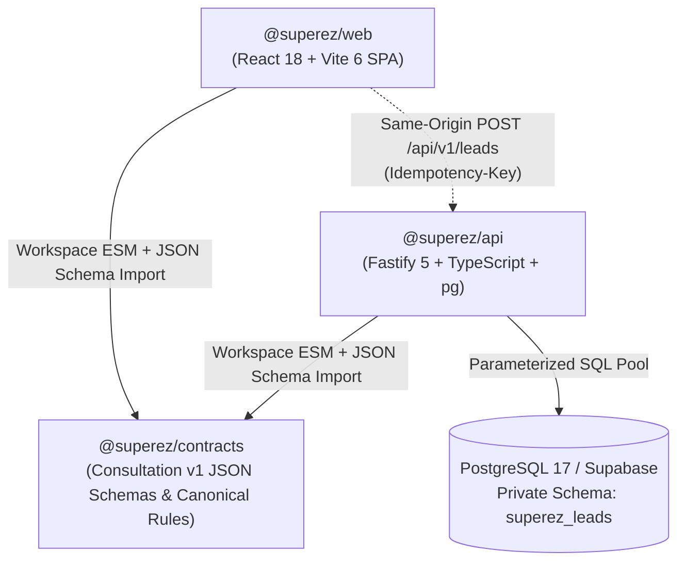

# System Architecture — Super EZ Tour

## 1. Business & Product Positioning

**Super EZ Tour** is a Korean-first inbound private travel platform specializing in 100% tailor-made journeys across Vietnam for South Korean travelers (`market = 'KR'`), with full bilingual runtime support in **Korean (`ko`, primary customer default)** and **Vietnamese (`vi`, internal review & editorial parity)**.

Core architectural principles:
- **Conversion-First Cinematic Storytelling:** Editorial photography, 3D WebGL scenes, MapLibre 3D terrain, and GSAP ScrollTrigger timelines support private tour comprehension and qualified consultation requests.
- **Strict Server Authority:** Fastify (`@superez/api`) owns all validation, canonicalization, authorization, idempotency, and PostgreSQL persistence. The browser never accesses database tables directly.
- **Explicit Production Gates:** Customer PII intake and OpenAPI documentation fail closed in production until legal consent wording, operational contact channels, and Supabase production roles are separately approved.

---

## 2. Enterprise Monorepo Topology (npm Workspaces)

The repository uses native **npm Workspaces** (`node >=24 <25`) with one authoritative root `package-lock.json` and zero external orchestration bloat:

```text
SuperEZTour/
├── apps/
│   ├── web/                # @superez/web — React 18 + Vite 6 customer SPA
│   └── api/                # @superez/api — Fastify 5 + TypeScript + PostgreSQL Lead API
├── packages/
│   └── contracts/          # @superez/contracts — Versioned JSON Schemas & shared domain rules
├── infrastructure/
│   ├── docker/             # Local PostgreSQL 17 dev/test Docker Compose definitions
│   └── nginx/              # Reference Nginx static + /api/v1 reverse-proxy template
├── scripts/
│   ├── deployment/         # Zero-downtime atomic symlink PowerShell deploy & rollback scripts
│   └── validation/         # Automated contract & KO/VI localization parity validators
└── docs/                   # Canonical architecture, feature, operations & ADR documentation
```

*(Future `apps/admin` for staff lead management is reserved for Task 03.3 when separately approved; no placeholder app is scaffolded prematurely.)*

### Workspace Dependency Graph



### Architecture Boundary Rules
1. `@superez/web` **must never** import `@superez/api` code or database drivers.
2. `@superez/api` **must never** import React/DOM components from `@superez/web`.
3. `@superez/contracts` **must remain zero-dependency and environment-agnostic** (pure JSON schemas, canonical ID sets, and pure string/date normalizers).
4. Secrets (`DATABASE_URL`, `MIGRATION_DATABASE_URL`, `LEAD_DIGEST_KEY`) exist exclusively in server-side environment configuration and must never be prefixed with `VITE_`.

---

## 3. Frontend Architecture (`@superez/web`)

### 3.1 Routing & Code Splitting
- **`/` (`Home`):** Lazy-loaded editorial homepage with 7 curated sections (`HeroBanner`, `DestinationNavigation`, `SignatureJourneys`, `TravelThemes`, `PremiumServices`, `WhyChooseUs`, `TravelReviews`) wrapped by the Home layout (`Header`, `MegaMenu`, `MobileMenu`, `Footer`, `FloatingActions`).
- **`/destinations/:slug` (`DestinationPage`):** Lazy-loaded destination landing coordinator:
  - `ha-noi`: Dynamically loads `HanoiExperiencePage` (10 active editorial & interactive screens).
  - `da-nang`: Dynamically loads `DaNangExperiencePage` (14 immersive scenes, with Three.js `FlyThroughScene` isolated into its own async chunk so `three` is never downloaded on `/` or `/destinations/ha-noi`).
  - Unconfigured Vietnam destinations (`sa-pa`, `ha-long`, `ninh-binh`, `hue`, `nha-trang`, `da-lat`, `ho-chi-minh`, `phu-quoc`): Renders the localized Coming Soon experience with direct 1:1 consultation CTA.
- **`*` (Fallback):** Safe localized Not-Found / Coming-Soon recovery view.

### 3.2 Three-Lifecycle Coordinator Pattern
`DestinationPage.jsx` enforces strict separation across three React `useEffect` lifecycles:
1. **Route Lifecycle (`[slug]`):** Scrolls to `(0, 0)` only when navigating to a different destination, initializes the singleton `LenisManager` (`src/utils/lenisManager.js`), and cleans up on route exit.
2. **Document & SEO Lifecycle (`[destination, isKorean, slug]`):** Updates `document.title` and `<html lang="ko|vi">` without touching scroll state or WebGL canvases.
3. **Layout-Aware Reflow Lifecycle (`[language, destination]`):** Awaits `document.fonts.ready` followed by a double `requestAnimationFrame` before calling `ScrollTrigger.refresh()`, preserving the user's exact scroll position across `KO ↔ VI` switches.

### 3.3 State Management
- **`LanguageContext`:** Single source of truth for `'ko'` (default) and `'vi'`, persisted to `localStorage['superez_language']`. Global UI strings reside in `src/locales/{ko,vi}.json`; destination-heavy dictionaries load inside their respective destination modules.
- **`ConsultationContext`:** Manages modal/drawer visibility, focus restoration, destination-scoped `quickDrafts` in RAM, and the idempotent submission state machine (`consultationAttempts.js`).
- **`TripBuilderContext`:** Scoped to destination routes; synchronizes attraction selections (`Interactive3DMap`), culinary selections (`HanoiTaste3D` / `CulinaryFilmScene`), itinerary duration, and the 7-step `TripBuilderMorph` customizer.

---

## 4. Backend Architecture (`@superez/api`)

- **Runtime:** Node.js 24 LTS (`>=24 <25`), Fastify 5, strict TypeScript (`erasableSyntaxOnly: true`), `pg` connection pool.
- **Lifecycle Separation:** `src/app.ts` (`buildApp` factory supporting `app.inject` tests and `onClose` pool teardown) is cleanly separated from `src/server.ts` (process listener and idempotent `SIGINT`/`SIGTERM` graceful shutdown).
- **Modules:**
  - `health`: `GET /health/live` (process liveness `200`) and `GET /health/ready` (verifies `superez_leads.leads` & `superez_leads.notification_outbox` existence via `to_regclass`, returning `200` or `503 DATABASE_UNAVAILABLE`).
  - `leads`: `POST /api/v1/leads` with route-scoped `@fastify/rate-limit`, strict AJV validation (`removeAdditional: false`, `coerceTypes: false`), domain canonicalization (`NFC` Unicode, `+8210...` Korean mobile normalization, `Asia/Seoul` calendar validation), HMAC-SHA-256 payload digesting, and atomic 6-table PostgreSQL persistence.
- **Privacy-Safe Observability:** Default Fastify request logging is disabled; custom `onResponse` logs emit only `{ requestId, route, method, status, elapsedMs }`. Error responses strictly conform to `error.schema.json` without stack traces, SQL details, or echoed PII.
