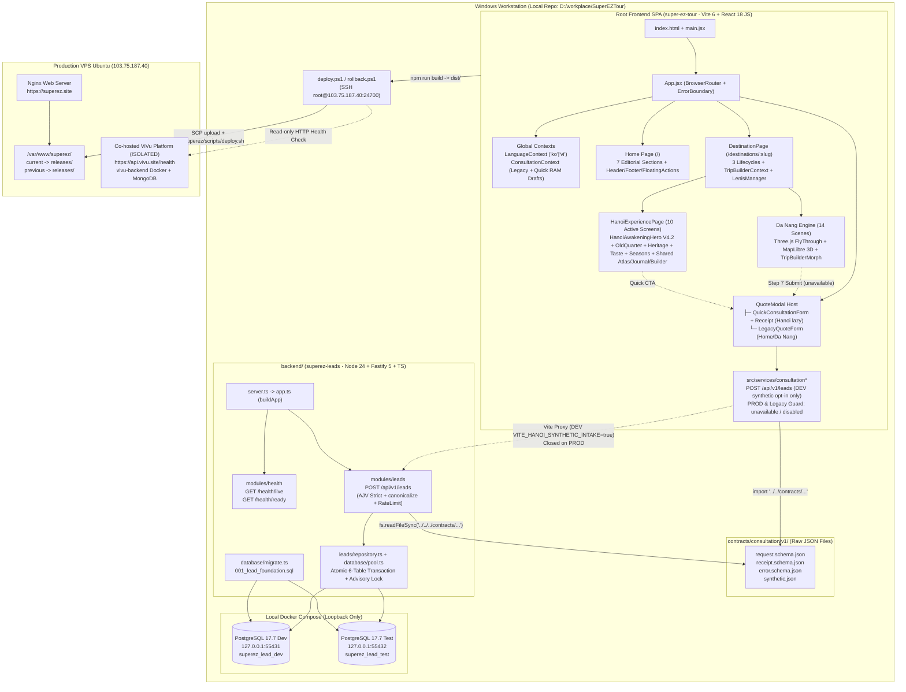

# SUPER EZ TOUR — FULL PROJECT ARCHITECTURE AUDIT

> **Tài liệu Kiểm toán Kiến trúc Toàn diện (Enterprise Monorepo Readiness Audit)**
> - **Dự án:** Super EZ Tour (`super-ez-tour` / `superez-leads`)
> - **Repository Root:** `D:\workplace\SuperEZTour`
> - **Git Branch & Baseline Commit:** `main` @ `e32bfc3ce2a73f18c02b0d2f2cea0849d17a11e0` (cùng các thay đổi local chưa commit thuộc chuỗi Task 01, Task 02 V1.1, Task 03.0, Task 03.1 & Task 03.2)
> - **Vai trò thực hiện:** Senior Software Architect
> - **Chế độ thực thi:** **STRICT READ-ONLY AUDIT** (Không chỉnh sửa source code, không di chuyển thư mục, không cài đặt dependencies, không can thiệp cấu hình hay production database)
> - **Ngày thực hiện:** 2026-11-28

---

## Mục lục

1. [Executive Summary](#1-executive-summary)
2. [Full Directory Tree](#2-full-directory-tree)
3. [Frontend Architecture](#3-frontend-architecture)
4. [Backend Architecture](#4-backend-architecture)
5. [Database Architecture](#5-database-architecture)
6. [Shared Contracts](#6-shared-contracts)
7. [Dependency Analysis](#7-dependency-analysis)
8. [Infrastructure and Deployment](#8-infrastructure-and-deployment)
9. [Security Assessment](#9-security-assessment)
10. [Technical Debt](#10-technical-debt)
11. [Architecture Risks](#11-architecture-risks)
12. [Enterprise Monorepo Readiness](#12-enterprise-monorepo-readiness)
13. [Current Architecture Diagram](#13-current-architecture-diagram)
14. [File and Module Responsibility Mapping](#14-file-and-module-responsibility-mapping)
15. [Recommended Migration Candidates](#15-recommended-migration-candidates)
16. [Unresolved Questions](#16-unresolved-questions)

---

## 1. Executive Summary

### 1.1 Bức tranh toàn cảnh hiện trạng Repository
Repository `SuperEZTour` hiện đang ở **giai đoạn chuyển giao kiến trúc (Transitional Hybrid Repository)** từ một ứng dụng Single-Page Application (SPA) thuần tĩnh sang hệ thống đa thành phần phục vụ mô hình kinh doanh **Korean Inbound Private Travel** (tour du lịch riêng tư thiết kế may đo tại Việt Nam dành cho khách hàng Hàn Quốc, hỗ trợ song ngữ `ko`/`vi`).

Hiện tại, trong cùng một repository gốc đang tồn tại **2 ứng dụng thực thi độc lập** và **1 thư mục hợp đồng dữ liệu chung**, nhưng **chưa được quản lý bởi bất kỳ công cụ Workspace/Monorepo nào**:

1. **Public Customer Website (Frontend SPA — Root directory):**
   - Đặt trực tiếp tại thư mục gốc ([package.json](file:///D:/workplace/SuperEZTour/package.json), [vite.config.js](file:///D:/workplace/SuperEZTour/vite.config.js), [index.html](file:///D:/workplace/SuperEZTour/index.html), [src/](file:///D:/workplace/SuperEZTour/src)).
   - Xây dựng bằng **React 18.3 + Vite 6 + JavaScript (JSX/ESM)**, kết hợp **GSAP 3.15 + ScrollTrigger + Lenis + Three.js + MapLibre GL JS + Swiper**.
   - Phục vụ trang chủ (`/`) và landing engine trải nghiệm đa tầng cho các điểm đến (`/destinations/da-nang`, `/destinations/ha-noi`, cùng trạng thái `coming_soon` cho 8 điểm đến Việt Nam còn lại).
2. **Lead Reception API (Backend Service — `backend/`):**
   - Đặt trong thư mục con [backend/](file:///D:/workplace/SuperEZTour/backend) với [backend/package.json](file:///D:/workplace/SuperEZTour/backend/package.json) và [backend/package-lock.json](file:///D:/workplace/SuperEZTour/backend/package-lock.json) riêng biệt.
   - Xây dựng ở mốc **Task 03.1 Foundation** bằng **Node.js 24 LTS + TypeScript 5.9 (`strict: true`, native TS execution) + Fastify 5 + PostgreSQL 17 (`pg`)**.
   - Cung cấp health endpoints (`/health/live`, `/health/ready`) và endpoint tiếp nhận yêu cầu tư vấn (`POST /api/v1/leads`) với cơ chế ghi atomic 6 bảng, idempotency HMAC-SHA-256 và transactional outbox. Trên môi trường dev loopback, Frontend Hà Nội (`QuickConsultationForm`) đã có adapter kết nối opt-in (`Task 03.2` qua biến `VITE_HANOI_SYNTHETIC_INTAKE=true`), trong khi trên production cả Frontend lẫn Backend đều **đóng cứng cổng tiếp nhận** (`INTAKE_UNAVAILABLE` HTTP 503).
3. **Shared API Contracts (`contracts/`):**
   - Đặt tại [contracts/consultation/v1/](file:///D:/workplace/SuperEZTour/contracts/consultation/v1), chứa các tệp JSON Schema phiên bản `v1` (`request.schema.json`, `receipt.schema.json`, `error.schema.json`) và mẫu test `synthetic.json`. Hiện được cả Frontend (`../../contracts/...` trong `src/services/consultationApiService.js`) lẫn Backend (`../../../contracts/...` trong `backend/src/shared/contracts.ts`) nhảy ra ngoài thư mục `src/` của mình bằng đường dẫn tương đối trực tiếp trên hệ thống file — chưa phải là một npm workspace package.

### 1.2 Các phát hiện kiến trúc trọng yếu (Key Findings)
- **Điểm mạnh nổi bật:**
  - **Backend Foundation (Task 03.1) có chất lượng kỹ thuật rất cao:** Phân tách rõ lifecycle `buildApp` / `server.ts`, cấu hình AJV nghiêm ngặt (`removeAdditional: false`, `coerceTypes: false`), chuẩn hóa dữ liệu miền (NFC, chuẩn hóa SĐT Hàn Quốc `+8210...`, múi giờ `Asia/Seoul`), bảo đảm toàn vẹn giao dịch PostgreSQL 6 bảng + advisory lock, kiểm thử tích hợp thực tế trên PostgreSQL 17 và kiểm tra không rò rỉ PII ra log.
  - **Cơ chế điều phối vòng đời cuộn mượt & đa ngôn ngữ ở trang Destination ổn định:** [DestinationPage.jsx](file:///D:/workplace/SuperEZTour/src/features/destinations/DestinationPage.jsx) và [LenisManager.js](file:///D:/workplace/SuperEZTour/src/features/destinations/motion/LenisManager.js) tách bạch rõ Route Lifecycle, SEO Lifecycle và Double-rAF `ScrollTrigger.refresh()`, ngăn chặn lỗi mất vị trí cuộn khi đổi ngôn ngữ `KO ↔ VI`.
- **Điểm nghẽn & Rủi ro lớn trước khi lên Enterprise Monorepo:**
  1. **Root-level App Pollution (Critical):** Frontend SPA đang chiếm giữ trực tiếp thư mục gốc (`package.json`, `src/`, `public/`, `vite.config.js`, `.env`). Không thể bật `workspaces` chuẩn của npm/Turborepo tại root nếu chưa tách Frontend vào `apps/web` (hoặc giữ bước chuyển tiếp có kiểm soát).
  2. **Cross-Root Relative Contract Imports & Logic Duplication (High):** Cả Frontend ([consultationApiService.js](file:///D:/workplace/SuperEZTour/src/services/consultationApiService.js#L1-L2)) và Backend ([contracts.ts](file:///D:/workplace/SuperEZTour/backend/src/shared/contracts.ts#L4)) đang import trực tiếp `../../contracts/...` và `../../../contracts/...` qua đường dẫn tương đối mỏng manh (sẽ gãy ngay khi dời vào `apps/web` và `apps/api`). Đồng thời, Frontend ([consultationModel.js](file:///D:/workplace/SuperEZTour/src/components/common/QuoteModal/consultationModel.js)) vẫn tự viết lại toàn bộ logic chuẩn hóa SĐT `+82`, kiểm tra ngày `Asia/Seoul`, danh sách ID hợp lệ — trùng lặp với [backend/src/modules/leads/validation.ts](file:///D:/workplace/SuperEZTour/backend/src/modules/leads/validation.ts), còn các luồng Legacy/TripBuilder vẫn trả `{ status: 'unavailable' }`.
  3. **Coupling ngược chiều trong Frontend & Bundle Phình to (High):** Component dùng chung `components/common/QuoteModal` lại import ngược vào `features/destinations/components/Hanoi/...` và `features/destinations/motion/LenisManager`; `src/context/ConsultationContext.jsx` import ngược vào `components/common/QuoteModal`. Toàn bộ ứng dụng (bao gồm `three` 0.187, cấu hình Đà Nẵng + Hà Nội hơn 2.400 dòng, từ điển JSON) bị đóng gói chung vào một chunk `index.js` nặng **1,787.78 kB** (chưa tính `maplibre-gl` **1,114.54 kB** và `logo.png` **759.02 kB**).
  4. **Sự phân mảnh của 4 cơ chế Đa ngôn ngữ & 3 hệ màu CSS (Medium–High):** Song song tồn tại i18n qua `LanguageContext` JSON, merge JSON động ở Đà Nẵng, hậu tố `*Vi`/`*Kr` trong JS object, và dictionary nội bộ trong từng component Hà Nội.
  5. **Ràng buộc cứng trong Script Triển khai VPS (High):** [deploy.ps1](file:///D:/workplace/SuperEZTour/deploy.ps1) kiểm tra cứng `package.json.name === "super-ez-tour"` tại `$PSScriptRoot`, build ra `./dist`, kiểm tra byte-by-byte file `thap_rua_pbr.glb` (9.41 MB dù `src/` không còn sử dụng), và chia sẻ chung hạ tầng VPS `103.75.187.40` với hệ thống **ViVu** đang chạy live.
  6. **Chưa có ứng dụng Admin, Auth/RBAC, CI/CD, Linter/Formatter (High):** Chưa tồn tại Admin UI, xác thực nhân viên, ESLint/Prettier hay pipeline GitLab CI/GitHub Actions; file `.env` gốc đang bị Git theo dõi (`tracked`).

### 1.3 Đánh giá mức độ sẵn sàng chuyển đổi sang Enterprise Monorepo
- **Mức độ sẵn sàng hiện tại:** **TRUNG BÌNH – KHẢ THI CÓ ĐIỀU KIỆN (MODERATE — CONDITIONALLY READY)**.
- Ranh giới miền nghiệp vụ giữa **Public Web**, **Lead API**, và **Consultation Contracts** đã hình thành rõ ràng về mặt tư duy thiết kế, nhưng **cần thực hiện một pha Pre-Monorepo Hygiene & Refactoring ngắn gọn** (gỡ coupling ngược ở Frontend, xử lý `.env` tracked, chuẩn hóa contract package, cập nhật tham số đường dẫn build trong `deploy.ps1`) trước khi di chuyển vật lý thư mục sang cấu trúc `apps/*` và `packages/*`.

---

## 2. Full Directory Tree

### 2.1 Danh sách các thư mục bị loại trừ hoặc rút gọn nội dung

Bảng dưới đây ghi nhận đầy đủ mọi thư mục bị loại trừ khỏi cây mã nguồn chi tiết theo đúng quy định kiểm toán:

| Tên thư mục | Vị trí tương đối (từ Root) | Trạng thái trên đĩa | Số lượng file | Mục đích & Vai trò |
|---|---|---|---|---|
| `.git` | `.git/` | Tồn tại | 1,693 | Kho lưu trữ lịch sử phiên bản, objects, refs và index của Git. |
| `node_modules` (Root) | `node_modules/` | Tồn tại | 9,471 | Thư mục chứa dependencies của ứng dụng Frontend Vite/React tại root. |
| `node_modules` (Backend) | `backend/node_modules/` | Tồn tại | 3,571 | Thư mục chứa dependencies riêng của dịch vụ Fastify/PostgreSQL/TypeScript. |
| `dist` (Root) | `dist/` | Không tồn tại lúc audit | 0 | Thư mục xuất bản build tĩnh mặc định của Frontend (`vite build`), được `deploy.ps1` xóa/tạo mới khi deploy. |
| `dist` (Backend) | `backend/dist/` | Tồn tại | 12 | Đầu ra biên dịch JavaScript từ TypeScript (`tsc -p tsconfig.json`) của Backend. |
| `.local-postgres` | `backend/.local-postgres/` | Không tồn tại lúc audit (khai báo trong `backend/.gitignore`) | 0 | Thư mục tạm phục vụ chạy PostgreSQL cục bộ / chứa output kiểm thử tạm (`frontend-dist` trong quá trình verify Task 03.1). |
| `build` / `coverage` / `.vite` | *(Toàn repo)* | Không tồn tại | 0 | Các thư mục build/coverage/cache tiêu chuẩn (Vite lưu pre-bundled cache bên trong `node_modules/.vite`). |
| `audit-evidence` *(Rút gọn media/logs)* | `audit-evidence/` | Tồn tại | 97 | Chứa ảnh chụp màn hình kiểm thử Playwright (`.png`), console logs (`.log`) và kết quả đo đạc (`.txt`) của Task 02 V1.1, Task 03.0, Task 03.1 và Task 03.2. |
| `public/assets/destinations/hanoi` *(Rút gọn media)* | `public/assets/destinations/hanoi/` | Tồn tại | 110 | Kho tài nguyên hình ảnh WebP độ phân giải cao (Desktop/Mobile), `manifest.json` cho các màn hình Hà Nội và 1 model 3D `thap_rua_pbr.glb` (9.41 MB). |

### 2.2 Cây thư mục mã nguồn đầy đủ (`D:\workplace\SuperEZTour`)

```text
SuperEZTour/
├── .git/                                           [EXCLUDED: Git VCS metadata — 1,693 files]
├── node_modules/                                   [EXCLUDED: Frontend npm packages — 9,471 files]
├── .env                                            [Tracked env file — chứa khóa VITE_MAPBOX_ACCESS_TOKEN]
├── .env.example                                    [Template biến môi trường Frontend]
├── .gitignore                                      [Cấu hình loại trừ Git ở cấp Root]
├── index.html                                      [Entry HTML của Vite SPA]
├── package.json                                    [Manifest gốc của Frontend: "super-ez-tour"]
├── package-lock.json                               [Lockfile v3 của Frontend]
├── vite.config.js                                  [Cấu hình Vite 6, React plugin, alias '@']
├── deploy.ps1                                      [Script PowerShell deploy 7 bước lên VPS Ubuntu]
├── rollback.ps1                                    [Script PowerShell rollback atomic symlink trên VPS]
├── README.md                                       [Tài liệu giới thiệu dự án (phiên bản đầu, nhiều chỗ lỗi thời)]
├── DEPLOYMENT.md                                   [Tài liệu vận hành deploy/rollback & quy tắc cách ly ViVu]
├── LOCALIZATION_GUIDELINES.md                      [Tiêu chuẩn kỹ thuật song ngữ KO/VI & vòng đời 3D/GSAP/Lenis]
├── HANOI_SCREEN4_CHACA_V3_REPORT.md                [Báo cáo triển khai màn hình ẩm thực Hà Nội V3]
├── HANOI_SCREEN5_SEASONS_V1_1_REPORT.md            [Báo cáo triển khai màn hình 4 mùa Hà Nội V1.1]
├── HANOI_SCREEN6_ATLAS_V1_3_REPORT.md              [Báo cáo triển khai bản đồ Atlas 3D Hà Nội V1.3]
├── HANOI_SCREEN7_JOURNAL_V1_REPORT.md              [Báo cáo triển khai lịch trình mẫu Hà Nội V1]
├── HANOI_TASK02_KOREAN_FIRST_CONSULTATION_V1_1_UX_POLISH_REPORT.md
├── TASK03_REAL_LEAD_RECEPTION_SOURCE_INFRASTRUCTURE_AUDIT.md
├── TASK03_1_BACKEND_PERSISTENT_LEAD_FOUNDATION_IMPLEMENTATION_REPORT.md
│
├── audit-evidence/                                 [MEDIA/EVIDENCE ARCHIVE — Tổng 97 files]
│   ├── hanoi-task02-consultation-v1.1/             [58 files: ảnh PNG & text measurements của QuickConsultationForm]
│   │   ├── accessibility/                          (1 file)
│   │   ├── animation/                              (7 files)
│   │   ├── baseline/                               (8 files)
│   │   ├── date-duration/                          (4 files)
│   │   ├── desktop/                                (6 files)
│   │   ├── draft-integrity/                        (1 file)
│   │   ├── guest-contact/                          (4 files)
│   │   ├── measurements/                           (9 files)
│   │   ├── mobile/                                 (6 files)
│   │   ├── regression/                             (4 files)
│   │   └── submission-integrity/                   (2 files)
│   ├── task03-source-infrastructure/               [11 files: git-baseline, runtime screenshots, model test log]
│   │   ├── git-baseline/                           (2 files)
│   │   ├── runtime/                                (6 files)
│   │   └── tests/                                  (1 file)
│   ├── task03.1-backend-foundation/                [13 files: kết quả build, typecheck, unit & PG17 integration tests]
│   └── task03.2-quick-consultation-integration/    [15 files: bằng chứng tích hợp QuickConsultationForm <-> Lead API]
│
├── contracts/                                      [Shared REST Schemas & Synthetic Fixtures]
│   └── consultation/
│       └── v1/
│           ├── README.md
│           ├── request.schema.json
│           ├── receipt.schema.json
│           ├── error.schema.json
│           └── synthetic.json
│
├── backend/                                        [Fastify 5 + TypeScript + PostgreSQL Lead API]
│   ├── node_modules/                               [EXCLUDED: Backend npm packages — 3,571 files]
│   ├── dist/                                       [EXCLUDED: Compiled JS output — 12 files]
│   ├── .local-postgres/                            [EXCLUDED: Local disposable PG/build dir — absent on disk]
│   ├── .env.example
│   ├── .gitignore
│   ├── Dockerfile
│   ├── Dockerfile.dockerignore
│   ├── compose.dev.yml
│   ├── compose.test.yml
│   ├── package.json                                [Manifest Backend: "superez-leads", Node >=24 <25]
│   ├── package-lock.json                           [Lockfile v3 của Backend]
│   ├── tsconfig.json
│   ├── README.md
│   ├── docs/
│   │   ├── ADR.md
│   │   └── SUPABASE_PRODUCTION_PREPARATION.md
│   ├── migrations/
│   │   └── 001_lead_foundation.sql
│   ├── src/
│   │   ├── app.ts
│   │   ├── server.ts
│   │   ├── config/
│   │   │   └── env.ts
│   │   ├── database/
│   │   │   ├── migrate.ts
│   │   │   └── pool.ts
│   │   ├── modules/
│   │   │   ├── health/
│   │   │   │   └── routes.ts
│   │   │   └── leads/
│   │   │       ├── repository.ts
│   │   │       ├── routes.ts
│   │   │       ├── service.ts
│   │   │       └── validation.ts
│   │   └── shared/
│   │       ├── contracts.ts
│   │       └── errors.ts
│   └── tests/
│       ├── fixtures/
│       │   └── setup.ts
│       ├── integration/
│       │   └── postgres.test.ts
│       └── unit/
│           └── validation.test.ts
│
├── public/                                         [Vite Static Public Assets]
│   ├── logo.png                                    [759 KB RGB PNG]
│   └── assets/
│       └── destinations/
│           └── hanoi/                              [MEDIA ARCHIVE — Tổng 110 files]
│               ├── hoan_kiem_dawn_desktop.webp
│               ├── hoan_kiem_dawn_mobile.webp
│               ├── hoan_kiem_mist.webp
│               ├── hoan_kiem_willow_fg.webp
│               ├── thap_rua_pbr.glb                [9.41 MB 3D GLB model — hiện không còn được import trong src/]
│               ├── attractions/                    [16 files WebP: 8 địa danh × desktop/mobile]
│               ├── bun-cha/                        [10 files WebP: 5 cảnh × desktop/mobile]
│               ├── cha-ca/                         [10 files WebP: 5 cảnh × desktop/mobile]
│               ├── heritage/                       [24 files WebP + 1 manifest.json: Văn Miếu - Quốc Tử Giám]
│               ├── hero/                           [8 files WebP + 1 manifest.json: 4 hồi Hồ Gươm]
│               ├── old-quarter/                    [4 files WebP gốc + story-beats/ (12 WebP + 1 manifest.json)]
│               ├── pho/                            [10 files WebP: 5 cảnh × desktop/mobile]
│               └── seasons/                        [8 files WebP: 4 mùa × desktop/mobile]
│
├── scratch/                                        [One-off Dev/Audit Utility Scripts — 18 files]
│   ├── audit_danang_scenes.cjs
│   ├── audit_extract.mjs
│   ├── audit_extracted_strings.json
│   ├── audit_resize_cleanup.mjs
│   ├── build_complete_vi.mjs
│   ├── build_danang_ko.mjs
│   ├── build_danang_vi.mjs
│   ├── build_perfect_vi.mjs
│   ├── check_danang_on_hanoi.cjs
│   ├── check_scene_lang.mjs
│   ├── inspect_scene_props.cjs
│   ├── scan_urls.mjs
│   ├── sync_dictionaries.mjs
│   ├── test_3d_lifecycle.cjs
│   ├── test_extractor.mjs
│   ├── validate_dictionaries.mjs
│   ├── verify_danang_bilingual.mjs
│   └── verify_destination_header.cjs
│
└── src/                                            [Frontend React Application Source]
    ├── main.jsx
    ├── App.jsx
    ├── assets/
    │   └── logo.png                                [Bản sao thứ 2 của logo.png — 759 KB]
    ├── constants/
    │   └── brand.config.js
    ├── context/
    │   ├── ConsultationContext.jsx
    │   └── LanguageContext.jsx
    ├── data/
    │   ├── quotes.js                               [DEAD FILE: Không được import bởi bất kỳ file nào]
    │   ├── reviews.js                              [DEAD FILE: Adapter cũ không được import]
    │   ├── travelerStoriesData.js
    │   └── vietnamDestinations.js
    ├── services/
    │   ├── consultationApiService.js               [HTTP POST /api/v1/leads client + runtime schema check]
    │   ├── consultationAttempts.js                 [State machine quản lý attempt, idempotency & retry]
    │   ├── consultationIntake.js                   [Cổng kiểm soát synthetic opt-in DEV cho Hà Nội]
    │   ├── consultationIntegration.test.js         [Node test kiểm thử luồng tích hợp client <-> API]
    │   └── travelerStoriesService.js
    ├── locales/
    │   ├── ko.json
    │   ├── vi.json
    │   └── destinations/
    │       └── da-nang/
    │           ├── ko.json
    │           └── vi.json
    ├── styles/
    │   ├── animations.css
    │   ├── global.css
    │   ├── reset.css
    │   ├── typography.css
    │   └── variables.css
    ├── components/
    │   ├── common/
    │   │   ├── Button/
    │   │   │   ├── Button.css
    │   │   │   └── Button.jsx                      [DEAD COMPONENT: Không được sử dụng]
    │   │   ├── Container/
    │   │   │   ├── Container.css
    │   │   │   └── Container.jsx
    │   │   ├── DestinationSearch/
    │   │   │   ├── DestinationSearchModal.css
    │   │   │   └── DestinationSearchModal.jsx
    │   │   ├── ErrorBoundary/
    │   │   │   ├── ErrorBoundary.css
    │   │   │   └── ErrorBoundary.jsx
    │   │   ├── ExperienceDrawer/
    │   │   │   ├── ExperienceDrawer.css
    │   │   │   └── ExperienceDrawer.jsx
    │   │   ├── QuoteModal/
    │   │   │   ├── consultationModel.js
    │   │   │   ├── consultationModel.test.js       [Unit test Node đặt lẫn trong thư mục UI]
    │   │   │   ├── QuickConsultationForm.css
    │   │   │   ├── QuickConsultationForm.jsx
    │   │   │   ├── QuickConsultationReceipt.jsx    [Màn hình hiển thị biên nhận mã tham chiếu SEZ-*]
    │   │   │   ├── quickSubmissionCopy.js          [Từ điển song ngữ KO/VI cho trạng thái gửi/lỗi/retry]
    │   │   │   ├── QuoteModal.css
    │   │   │   └── QuoteModal.jsx
    │   │   ├── SectionHeading/
    │   │   │   ├── SectionHeading.css
    │   │   │   └── SectionHeading.jsx              [DEAD COMPONENT: Không được sử dụng]
    │   │   └── TourQuickPreview/
    │   │       ├── TourQuickPreview.css
    │   │       └── TourQuickPreview.jsx
    │   └── layout/
    │       ├── FloatingActions/
    │       │   ├── FloatingActions.css
    │       │   └── FloatingActions.jsx
    │       ├── Footer/
    │       │   ├── Footer.css
    │       │   └── Footer.jsx
    │       ├── Header/
    │       │   ├── Header.css
    │       │   └── Header.jsx
    │       ├── MegaMenu/
    │       │   ├── MegaMenu.css
    │       │   └── MegaMenu.jsx
    │       └── MobileMenu/
    │           ├── MobileMenu.css
    │           └── MobileMenu.jsx
    ├── pages/
    │   └── Home/
    │       ├── Home.css
    │       ├── Home.jsx
    │       └── sections/
    │           ├── DestinationNavigation/
    │           │   ├── DestinationNavigation.css
    │           │   └── DestinationNavigation.jsx
    │           ├── HeroBanner/
    │           │   ├── HeroBanner.css
    │           │   └── HeroBanner.jsx
    │           ├── PremiumServices/
    │           │   ├── PremiumServices.css
    │           │   └── PremiumServices.jsx
    │           ├── SignatureJourneys/
    │           │   ├── SignatureJourneys.css
    │           │   └── SignatureJourneys.jsx
    │           ├── TravelReviews/
    │           │   ├── ReviewDetailModal.css
    │           │   ├── ReviewDetailModal.jsx
    │           │   ├── StorySubmissionModal.css
    │           │   ├── StorySubmissionModal.jsx
    │           │   ├── TravelReviews.css
    │           │   ├── TravelReviews.jsx
    │           │   ├── VideoViewerModal.css
    │           │   └── VideoViewerModal.jsx
    │           ├── TravelThemes/
    │           │   ├── TravelThemes.css
    │           │   └── TravelThemes.jsx
    │           └── WhyChooseUs/
    │               ├── WhyChooseUs.css
    │               └── WhyChooseUs.jsx
    └── features/
        └── destinations/
            ├── DestinationPage.jsx
            ├── context/
            │   └── TripBuilderContext.jsx
            ├── data/
            │   ├── da-nang.config.js
            │   ├── destinationNav.config.js
            │   ├── destinations.config.js
            │   ├── ha-noi.config.js
            │   └── hanoiAttractionAssets.js
            ├── motion/
            │   └── LenisManager.js
            ├── styles/
            │   └── destination-theme.css
            └── components/
                ├── Accommodation3D/
                │   ├── Accommodation3DScene.css
                │   └── Accommodation3DScene.jsx
                ├── AirplanePortal/
                │   ├── AirplanePortalScene.css
                │   └── AirplanePortalScene.jsx
                ├── CinematicEnding/
                │   ├── CinematicEndingScene.css
                │   └── CinematicEndingScene.jsx
                ├── CulinaryFilm/
                │   ├── CulinaryFilmScene.css
                │   └── CulinaryFilmScene.jsx
                ├── CustomerStories/
                │   ├── CustomerStories.css
                │   └── CustomerStories.jsx
                ├── DestinationFooter/
                │   ├── DestinationFooter.css
                │   └── DestinationFooter.jsx
                ├── DestinationHeader/
                │   ├── DestinationHeader.css
                │   └── DestinationHeader.jsx
                ├── ExperiencesSequence/
                │   ├── ExperiencesCinematicSequence.css
                │   └── ExperiencesCinematicSequence.jsx
                ├── Flight3D/
                │   ├── Flight3DScene.css
                │   └── Flight3DScene.jsx
                ├── FlyThrough/
                │   ├── FlyThroughScene.css
                │   └── FlyThroughScene.jsx
                ├── Interactive3DMap/
                │   ├── Interactive3DMap.css
                │   ├── Interactive3DMap.jsx
                │   ├── components/
                │   │   ├── AttractionDetailPanel.jsx
                │   │   ├── AttractionFilters.jsx
                │   │   └── DiscoveryProgress.jsx
                │   ├── hooks/
                │   │   └── useAtlasScrollDiscovery.js
                │   └── utils/
                │       └── atlasRuntimeDiagnostics.js
                ├── ItinerarySticky/
                │   ├── ItineraryStickyTimeline.css
                │   ├── ItineraryStickyTimeline.jsx
                │   └── components/
                │       └── CinematicJournalStage.jsx
                ├── LocalGuideDocu/
                │   ├── LocalGuideDocuScene.css
                │   └── LocalGuideDocuScene.jsx
                ├── TimeTransformation/
                │   ├── TimeTransformationScene.css
                │   └── TimeTransformationScene.jsx
                ├── TripBuilderMorph/
                │   ├── TripBuilderMorph.css
                │   └── TripBuilderMorph.jsx
                ├── VehicleShowcase3D/
                │   ├── VehicleShowcase3D.css
                │   └── VehicleShowcase3D.jsx
                └── Hanoi/
                    ├── HanoiExperiencePage.jsx
                    ├── HanoiAwakeningHero/
                    │   ├── buildHanoiHeroTimeline.js
                    │   ├── HanoiAwakeningHero.css
                    │   ├── HanoiAwakeningHero.jsx
                    │   └── hanoiHeroManifest.js
                    ├── HanoiHeritageChamber/
                    │   ├── buildHeritageDocumentaryTimeline.js
                    │   ├── HanoiHeritageChamber.css
                    │   ├── HanoiHeritageChamber.jsx
                    │   ├── heritageAssets.js
                    │   ├── HeritageDetailModal.jsx
                    │   └── heritageScenes.js
                    ├── HanoiOldQuarterWalk/
                    │   ├── buildOldQuarterTimeline.js
                    │   ├── editorialLayouts.js
                    │   ├── HanoiOldQuarterWalk.css
                    │   ├── HanoiOldQuarterWalk.jsx
                    │   ├── OldQuarterDetailModal.jsx
                    │   └── oldQuarterScenes.js
                    ├── HanoiSeasons3D/
                    │   ├── buildSeasonsTimeline.js
                    │   ├── HanoiSeasons3D.css
                    │   ├── HanoiSeasons3D.jsx
                    │   ├── seasonAssets.js
                    │   └── seasonScenes.js
                    ├── HanoiTaste3D/
                    │   ├── buildPhoTimeline.js
                    │   ├── bunChaAssets.js
                    │   ├── BunChaDetailModal.jsx
                    │   ├── bunChaScenes.js
                    │   ├── chaCaAssets.js
                    │   ├── ChaCaDetailModal.jsx
                    │   ├── chaCaScenes.js
                    │   ├── HanoiTaste3D.css
                    │   ├── HanoiTaste3D.jsx
                    │   ├── phoAssets.js
                    │   ├── PhoDetailModal.jsx
                    │   └── phoScenes.js
                    └── HanoiYourStory/
                        ├── HanoiYourStory.css
                        └── HanoiYourStory.jsx      [DEAD COMPONENT: Chưa được mount vào HanoiExperiencePage]
```

---

## 3. Frontend Architecture

### 3.1 Cấu trúc tổng quan `src/`
Thư mục [src/](file:///D:/workplace/SuperEZTour/src) pha trộn giữa **kiến trúc phân lớp truyền thống (Layered Architecture: `components/`, `pages/`, `context/`, `data/`, `services/`, `styles/`)** ở giai đoạn xây dựng Trang chủ ban đầu và **kiến trúc hướng tính năng (Feature-based Architecture: `features/destinations/`)** khi phát triển các trang điểm đến Đà Nẵng và Hà Nội. Toàn bộ Frontend viết bằng **JavaScript thuần (ES Modules + JSX)**, không có TypeScript hay PropTypes.

### 3.2 Components, Shared Components, Pages và Layouts
- **Shared Components (`src/components/common/`):**
  - Đang sử dụng thực tế: [Container.jsx](file:///D:/workplace/SuperEZTour/src/components/common/Container/Container.jsx), [ErrorBoundary.jsx](file:///D:/workplace/SuperEZTour/src/components/common/ErrorBoundary/ErrorBoundary.jsx), [DestinationSearchModal.jsx](file:///D:/workplace/SuperEZTour/src/components/common/DestinationSearch/DestinationSearchModal.jsx), [ExperienceDrawer.jsx](file:///D:/workplace/SuperEZTour/src/components/common/ExperienceDrawer/ExperienceDrawer.jsx), [TourQuickPreview.jsx](file:///D:/workplace/SuperEZTour/src/components/common/TourQuickPreview/TourQuickPreview.jsx), và cụm [QuoteModal.jsx](file:///D:/workplace/SuperEZTour/src/components/common/QuoteModal/QuoteModal.jsx) + [QuickConsultationForm.jsx](file:///D:/workplace/SuperEZTour/src/components/common/QuoteModal/QuickConsultationForm.jsx).
  - **Dead components (0 nơi import):** [Button.jsx](file:///D:/workplace/SuperEZTour/src/components/common/Button/Button.jsx) và [SectionHeading.jsx](file:///D:/workplace/SuperEZTour/src/components/common/SectionHeading/SectionHeading.jsx). Các màn hình sau này đều tự viết thẻ `<button>` và `<h2>` với CSS riêng thay vì dùng UI primitives chung.
- **Hai hệ thống Layout song song (Dual Layout Shells):**
  1. **Home Layout (`src/components/layout/`):** Gồm [Header.jsx](file:///D:/workplace/SuperEZTour/src/components/layout/Header/Header.jsx), [MegaMenu.jsx](file:///D:/workplace/SuperEZTour/src/components/layout/MegaMenu/MegaMenu.jsx), [MobileMenu.jsx](file:///D:/workplace/SuperEZTour/src/components/layout/MobileMenu/MobileMenu.jsx), [Footer.jsx](file:///D:/workplace/SuperEZTour/src/components/layout/Footer/Footer.jsx), và [FloatingActions.jsx](file:///D:/workplace/SuperEZTour/src/components/layout/FloatingActions/FloatingActions.jsx). Chỉ được mount trực tiếp bên trong `<Route path="/" />` tại [src/App.jsx](file:///D:/workplace/SuperEZTour/src/App.jsx#L26-L48).
  2. **Destination Layout (`src/features/destinations/components/`):** Gồm [DestinationHeader.jsx](file:///D:/workplace/SuperEZTour/src/features/destinations/components/DestinationHeader/DestinationHeader.jsx) và [DestinationFooter.jsx](file:///D:/workplace/SuperEZTour/src/features/destinations/components/DestinationFooter/DestinationFooter.jsx). Lưu ý: [DestinationFooter.jsx](file:///D:/workplace/SuperEZTour/src/features/destinations/components/DestinationFooter/DestinationFooter.jsx#L74-L109) vẫn đang hiển thị danh mục cũ *"Mạng Lưới 6 Quốc Gia (Philippines, Thái Lan, Malaysia, Đài Loan, Indonesia)"* mâu thuẫn với định vị mới trên Trang chủ ([Footer.jsx](file:///D:/workplace/SuperEZTour/src/components/layout/Footer/Footer.jsx) và [vietnamDestinations.js](file:///D:/workplace/SuperEZTour/src/data/vietnamDestinations.js)) vốn chỉ tập trung vào **10 điểm đến tại Việt Nam**.
- **Pages (`src/pages/` vs `src/features/destinations/`):**
  - `src/pages/` chỉ chứa duy nhất [Home.jsx](file:///D:/workplace/SuperEZTour/src/pages/Home/Home.jsx) với 7 phân khu (`HeroBanner`, `DestinationNavigation`, `SignatureJourneys`, `TravelThemes`, `PremiumServices`, `WhyChooseUs`, `TravelReviews`). Tài liệu [README.md](file:///D:/workplace/SuperEZTour/README.md#L74-L85) ở root đã lỗi thời nghiêm trọng khi mô tả 10 phân khu cũ không còn tồn tại (`DestinationMap`, `QuickQuote`, `TravelVideos`, `TravelCommunity`, `InstagramGallery`).

### 3.3 Kiến trúc Features (`src/features/destinations/`)
`destinations` là module feature duy nhất trong `src/features/`, đóng vai trò một **Landing Engine đa điểm đến**:
- [DestinationPage.jsx](file:///D:/workplace/SuperEZTour/src/features/destinations/DestinationPage.jsx) đọc `:slug`, tra cứu [destinations.config.js](file:///D:/workplace/SuperEZTour/src/features/destinations/data/destinations.config.js):
  - Nếu `destination === null` (8 điểm đến `coming_soon` như `sa-pa`, `ha-long`, `phu-quoc`...): hiển thị giao diện Coming Soon kèm nút mở tư vấn.
  - Nếu `destination.id === 'ha-noi'`: rẽ nhánh sang component chuyên biệt [HanoiExperiencePage.jsx](file:///D:/workplace/SuperEZTour/src/features/destinations/components/Hanoi/HanoiExperiencePage.jsx) (kết hợp 5 màn hình riêng của Hà Nội trong `components/Hanoi/*` và 6 component dùng chung của `destinations/components/*`).
  - Các trường hợp còn lại (hiện tại là `da-nang`): render chuỗi 14 scene mặc định trực tiếp trong [DestinationPage.jsx](file:///D:/workplace/SuperEZTour/src/features/destinations/DestinationPage.jsx#L187-L235) mà **không bọc từng scene trong `<ErrorBoundary isolated>`** như cách `HanoiExperiencePage.jsx` đã làm (nếu 1 scene của Đà Nẵng lỗi render, toàn bộ trang Đà Nẵng sẽ sập về ErrorBoundary cấp route).

### 3.4 Routing và Admin Routes
- **Router:** Sử dụng `BrowserRouter` (`react-router-dom` v6.30.6) trong [src/App.jsx](file:///D:/workplace/SuperEZTour/src/App.jsx#L21-L70) với 3 `<Route>`:
  1. `/` → Trang chủ.
  2. `/destinations/:slug` → Trang điểm đến động.
  3. `/destinations/da-nang` → Khai báo dư thừa (`<DestinationPage slugProp="da-nang" />`), trùng chức năng với `/destinations/:slug`.
- **Thiếu Fallback 404 Route (`path="*"`):** Nếu người dùng truy cập một đường dẫn không khớp (ví dụ `/about` hoặc `/admin`), `<Routes>` không render bất kỳ trang nào (màn hình trắng rỗng chỉ còn DOM ẩn của Drawer/Modal), trong khi Nginx trên production đang fallback mọi URL về `index.html`.
- **Admin Routes:** **HOÀN TOÀN CHƯA TỒN TẠI** trong repository hiện tại (cả ở Frontend lẫn Backend).

### 3.5 State Management và API Services
- **State Management:** Dựa hoàn toàn trên **React Context API** kết hợp `useState`/`useRef`:
  1. [LanguageContext.jsx](file:///D:/workplace/SuperEZTour/src/context/LanguageContext.jsx): Lưu ngôn ngữ `'ko' | 'vi'`, đồng bộ với `localStorage.getItem('superez_language')` và `document.documentElement.lang`.
  2. [ConsultationContext.jsx](file:///D:/workplace/SuperEZTour/src/context/ConsultationContext.jsx): Quản lý song song **2 mô hình bản nháp (Dual Draft State)**:
     - `draft` (Legacy): Phục vụ `LegacyQuoteForm` trên Trang chủ, Đà Nẵng và các điểm đến Coming Soon (vẫn còn trường `zaloAccount` và mã vùng `+84`).
     - `quickDrafts` (Korean-First Quick Drafts theo `destinationId` trong RAM): Phục vụ riêng `QuickConsultationForm` khi `consultationConfig[id]?.quick === true` (hiện chỉ bật cho `'ha-noi'`).
  3. [TripBuilderContext.jsx](file:///D:/workplace/SuperEZTour/src/features/destinations/context/TripBuilderContext.jsx): Quản lý wizard 7 bước của `#trip-builder` trên trang Destination. Hiện **chưa có cầu nối tự động truyền `tripState` sang `ConsultationContext` / `QuickConsultationForm`** (đang chờ Task 05). Ngoài ra, prop `onAddQuote` truyền từ `DestinationPage` → `HanoiExperiencePage` → `TripBuilderMorph` là **prop chết (`undefined`)** còn sót lại từ kiến trúc cũ.
- **API Services (`src/services/`):**
  - **Consultation Intake Adapter (Task 03.2 — Mới tích hợp cho Hà Nội ở chế độ DEV synthetic opt-in):**
    - [consultationApiService.js](file:///D:/workplace/SuperEZTour/src/services/consultationApiService.js): Thực thi `fetch('/api/v1/leads', { method: 'POST', headers: { 'Idempotency-Key': attempt.key }, redirect: 'error', cache: 'no-store' })` với `AbortController` timeout 15 giây; đồng thời import trực tiếp `receipt.schema.json` và `error.schema.json` từ `../../contracts/consultation/v1/` để xác thực cấu trúc phản hồi trước khi hiển thị [QuickConsultationReceipt.jsx](file:///D:/workplace/SuperEZTour/src/components/common/QuoteModal/QuickConsultationReceipt.jsx).
    - [consultationAttempts.js](file:///D:/workplace/SuperEZTour/src/services/consultationAttempts.js): Máy trạng thái bất biến theo từng `destinationId` quản lý `submitting`, `success`, `validation`, `limited` (tôn trọng `Retry-After`), `conflict`, `unavailable`, `unknown`, và giữ nguyên `Idempotency-Key` + serialized body khi gặp lỗi mạng mơ hồ (`possiblyCommitted`).
    - [consultationIntake.js](file:///D:/workplace/SuperEZTour/src/services/consultationIntake.js): Khóa cứng chỉ cho phép gọi API khi `import.meta.env.DEV === true`, `VITE_HANOI_SYNTHETIC_INTAKE === 'true'`, `policyVersion` bắt đầu bằng `synthetic-`, và điểm mở thuộc Hà Nội.
  - **Legacy & Mock Boundaries:**
    - [consultationModel.js](file:///D:/workplace/SuperEZTour/src/components/common/QuoteModal/consultationModel.js#L41-L43) vẫn giữ `submitConsultation()` trả `{ status: 'unavailable' }` cho `LegacyQuoteForm` (Home/Đà Nẵng) và `TripBuilderMorph`, đồng thời khóa các trường cá nhân khi `import.meta.env.PROD === true`.
    - [src/services/travelerStoriesService.js](file:///D:/workplace/SuperEZTour/src/services/travelerStoriesService.js) chỉ lọc mảng tĩnh trong RAM và trả kết quả giả lập `PENDING_MODERATION` tại `submitTravelerStoryDraft()` — lưu ý: `StorySubmissionModal.jsx` trên trang chủ vẫn đang cho phép người dùng bấm gửi câu chuyện với thông báo thành công giả lập!

### 3.6 Hooks, Utilities, CSS Styling và Assets
- **Hooks & Utilities:** Không có thư mục `src/hooks/` hay `src/utils/` cấp ứng dụng. Các custom hooks và hàm tiện ích nằm rải rác bên trong từng component (`useAtlasScrollDiscovery.js`, `atlasRuntimeDiagnostics.js`, `build*Timeline.js`).
- **CSS & Styling:** Sử dụng **100% Vanilla CSS** (5 file hệ thống trong `src/styles/`, 1 file `destination-theme.css`, và 42 file `.css` đi kèm component).
  - **Xung đột hệ thống Design Tokens:** Tồn tại **3 bảng màu thương hiệu khác nhau** cùng ghi vào `:root` hoặc hằng số JS:
    1. [src/styles/variables.css](file:///D:/workplace/SuperEZTour/src/styles/variables.css#L4): `--color-primary: #ED2028` (Đỏ tươi — dùng cho Trang chủ).
    2. [src/constants/brand.config.js](file:///D:/workplace/SuperEZTour/src/constants/brand.config.js#L70): `colors.primary: '#E96A36'` (Cam đất).
    3. [src/features/destinations/styles/destination-theme.css](file:///D:/workplace/SuperEZTour/src/features/destinations/styles/destination-theme.css#L9-L16): `--dest-navy: #081D42`, `--dest-orange: #FF681E`, `--dest-gold: #FFB52B` (khai báo trực tiếp trên `:root` mỗi khi `DestinationPage` được import, nghĩa là luôn áp lên toàn cục!).
  - Không dùng CSS Modules hay BEM nghiêm ngặt ở một số class chung (`.modal-title`, `.form-group`, `.form-input`), tiềm ẩn nguy cơ rò rỉ style giữa các component khi bundle chung vào 1 file CSS duy nhất (`459.55 kB`).
- **Assets:**
  - File logo bị nhân bản thành 2 bản giống hệt nhau (**759,024 bytes** mỗi file, ảnh RGB không tách nền alpha): [public/logo.png](file:///D:/workplace/SuperEZTour/public/logo.png) (dùng làm favicon trong `index.html`) và [src/assets/logo.png](file:///D:/workplace/SuperEZTour/src/assets/logo.png) (được Vite hash thành `dist/assets/logo-*.png` cho `Header`/`Footer`). Tổng cộng mỗi bản build mang theo ~1.52 MB chỉ riêng cho 2 bản sao của cùng một logo!
  - File 3D [public/assets/destinations/hanoi/thap_rua_pbr.glb](file:///D:/workplace/SuperEZTour/public/assets/destinations/hanoi/thap_rua_pbr.glb) nặng **9.41 MB** vẫn nằm trong `public/` và được copy nguyên vẹn vào mọi bản release dù `HanoiAwakeningHero` đã chuyển sang nhiếp ảnh đa lớp WebP.
  - Trang chủ và Đà Nẵng vẫn phụ thuộc trực tiếp vào hàng chục URL ảnh ngoại vi từ `images.unsplash.com` (rủi ro link die, rate-limit hoặc chậm mạng tại Hàn Quốc/Việt Nam), trong khi chỉ riêng Hà Nội đã chuẩn hóa ảnh WebP nội bộ có giấy phép Wikimedia rõ ràng.

### 3.7 3D, WebGL, GSAP, ScrollTrigger và Map Integrations
- **Three.js (`three` v0.187.0):** Dù nhiều component mang hậu tố `3D` (`HanoiTaste3D`, `HanoiSeasons3D`, `Accommodation3D`, `Flight3D`, `VehicleShowcase3D`), **chỉ có duy nhất 1 file trong toàn bộ codebase thực sự khởi tạo WebGL / Three.js** là [FlyThroughScene.jsx](file:///D:/workplace/SuperEZTour/src/features/destinations/components/FlyThrough/FlyThroughScene.jsx) (Scene 02 của Đà Nẵng). Do `DestinationPage.jsx` import tĩnh `FlyThroughScene`, thư viện `three` (~650 kB minified) bị tải và parse ngay cả khi khách hàng chỉ vào Trang chủ (`/`) hoặc trang Hà Nội (`/destinations/ha-noi`)!
- **GSAP + ScrollTrigger + Lenis:** Được sử dụng sâu rộng trên cả Trang chủ (`TravelReviews`, `WhyChooseUs`) và toàn bộ các scene của Đà Nẵng & Hà Nội. `LenisManager.js` quản lý singleton tốt trên trang Destination, tuy nhiên tài liệu [LOCALIZATION_GUIDELINES.md](file:///D:/workplace/SuperEZTour/LOCALIZATION_GUIDELINES.md#L471-L520) đang mô tả API dạng class `LenisManager.init()` trong khi code thực tế tại [LenisManager.js](file:///D:/workplace/SuperEZTour/src/features/destinations/motion/LenisManager.js#L15-L78) xuất các hàm rời `initSmoothScroll()`, `destroySmoothScroll()`, `getLenis()`.
- **MapLibre GL JS (`maplibre-gl` v6.18.0):** [Interactive3DMap.jsx](file:///D:/workplace/SuperEZTour/src/features/destinations/components/Interactive3DMap/Interactive3DMap.jsx) tải động (`import('maplibre-gl')`) giúp tách riêng chunk `maplibre-gl-*.js` (1.11 MB), sử dụng tile vệ tinh công cộng của Esri ArcGIS và địa hình DEM Terrarium trên AWS S3. Biến `VITE_MAPBOX_ACCESS_TOKEN` trong `.env` hiện **hoàn toàn không còn được sử dụng** ở bất kỳ đâu trong `src/`.

### 3.8 Hệ thống đa ngôn ngữ KO/VI
Hệ thống đa ngôn ngữ lấy Tiếng Hàn (`ko`) làm mặc định, nhưng hiện bị phân mảnh thành **4 cơ chế khác nhau**:
1. **Từ điển toàn cục qua `useLanguage().t()`:** Đọc từ [src/locales/ko.json](file:///D:/workplace/SuperEZTour/src/locales/ko.json) và [src/locales/vi.json](file:///D:/workplace/SuperEZTour/src/locales/vi.json) (dùng cho Navbar, Home, Legacy QuoteModal).
2. **Merge JSON theo điểm đến (chỉ áp dụng cho Đà Nẵng):** `da-nang.config.js` giữ gốc tiếng Hàn và trộn [src/locales/destinations/da-nang/vi.json](file:///D:/workplace/SuperEZTour/src/locales/destinations/da-nang/vi.json) qua hàm `getLocalizedDaNangConfig(language)`. Lưu ý: [LanguageContext.jsx](file:///D:/workplace/SuperEZTour/src/context/LanguageContext.jsx#L4-L22) cũng import cả `da-nang/ko.json` và `da-nang/vi.json` vào RAM dù trang Đà Nẵng lại lấy dữ liệu từ `da-nang.config.js` (gây nạp trùng `da-nang/vi.json` và dư thừa `da-nang/ko.json`!).
3. **Trường hậu tố song ngữ nội tuyến (`*Vi` / `*Kr`):** Dùng trong `vietnamDestinations.js` và `ha-noi.config.js`. Đáng chú ý, hàm `getLocalizedHaNoiConfig()` trong [ha-noi.config.js](file:///D:/workplace/SuperEZTour/src/features/destinations/data/ha-noi.config.js#L1339-L1442) chỉ ánh xạ sang tiếng Việt cho 4 phần (`attractions`, `itineraries`, `customerStories`, `finalCta`), bỏ quên các khối `hero`, `intro`, `ecosystem` ở đầu file (do Hà Nội đã chuyển sang dùng scene riêng có từ điển nội bộ).
4. **Từ điển cứng cục bộ bên trong từng file JSX/JS:** Xuất hiện dày đặc tại `QuickConsultationForm.jsx`, `hanoiHeroManifest.js`, `oldQuarterScenes.js`, `heritageScenes.js`, `phoScenes.js`, `bunChaScenes.js`, `chaCaScenes.js`, `seasonScenes.js`, `TripBuilderMorph.jsx`, `DestinationFooter.jsx`, `ErrorBoundary.jsx`. Điều này trái ngược với chuẩn mực `src/locales/destinations/ha-noi/{ko,vi}.json` đã đề ra trong `LOCALIZATION_GUIDELINES.md`.

### 3.9 Import Aliases và Coupling / Đặt sai vị trí
- **Import Alias `@/` bị bỏ hoang 100%:** Dù [vite.config.js](file:///D:/workplace/SuperEZTour/vite.config.js#L11-L15) định nghĩa `'@': path.resolve(__dirname, './src')`, kết quả quét tĩnh toàn bộ `src/` ghi nhận **0 lượt sử dụng `@/`**. Mọi file đều dùng đường dẫn tương đối nhiều cấp như `../../../../../context/LanguageContext`, rất dễ gãy khi di chuyển thư mục sang Monorepo. Đồng thời thiếu file `jsconfig.json` tại root.
- **Các điểm đặt sai vị trí & phụ thuộc ngược chiều (Architectural Boundary Violations):**
  - *Không có chu trình import trực tiếp (0 circular dependencies)* nhờ kiểm tra đồ thị AST, **NHƯNG có 3 vi phạm chiều phụ thuộc phân lớp nghiêm trọng:**
    1. `src/components/common/QuoteModal/QuickConsultationForm.jsx` → import `HANOI_HERO_ACTS` từ `src/features/destinations/components/Hanoi/HanoiAwakeningHero/hanoiHeroManifest.js` (Tầng `common` phụ thuộc cứng vào tài nguyên nội bộ của một màn hình con thuộc feature Hà Nội!).
    2. `src/components/common/QuoteModal/QuoteModal.jsx` → import `getLenis` từ `src/features/destinations/motion/LenisManager.js` (Tầng `common` phụ thuộc ngược vào `features/destinations`; lẽ ra `LenisManager` phải thuộc `src/lib/motion` hoặc `packages/motion`).
    3. `src/context/ConsultationContext.jsx` và `src/features/destinations/components/TripBuilderMorph/TripBuilderMorph.jsx` → import domain model `consultationModel.js` đặt bên trong thư mục UI component `src/components/common/QuoteModal/` (lẽ ra domain model tư vấn phải nằm ở tầng `features/consultation/model` hoặc `@superez/contracts`).

---

## 4. Backend Architecture

### 4.1 Fastify Application Lifecycle
Backend tại [backend/](file:///D:/workplace/SuperEZTour/backend) được thiết kế theo kiến trúc **Modular Monolith chuẩn mực** trên nền **Fastify 5.12.8** và **Node.js 24 LTS**:
1. **Configuration Phase ([backend/src/config/env.ts](file:///D:/workplace/SuperEZTour/backend/src/config/env.ts)):** Hàm thuần `loadConfig(env, migration)` kiểm tra chặt chẽ mọi biến môi trường ngay lúc khởi động (fail-fast), ép kiểu số nguyên có trần giới hạn, xác thực giao thức PostgreSQL URL không chứa query string ngầm, và khóa cứng các cổng bảo mật theo `NODE_ENV`.
2. **Application Factory ([backend/src/app.ts](file:///D:/workplace/SuperEZTour/backend/src/app.ts)):** Hàm `buildApp(config, options)` khởi tạo Fastify instance, cho phép truyền `pool`, `now` clock, và `logStream` giả lập phục vụ unit/integration testing qua `app.inject()` mà không cần mở cổng TCP thật. Nếu `buildApp` tự tạo `pg.Pool`, nó đăng ký hook `onClose` để đóng pool an toàn (`await pool.end()`).
3. **Server Bootstrap & Graceful Shutdown ([backend/src/server.ts](file:///D:/workplace/SuperEZTour/backend/src/server.ts)):** Gọi `loadConfig` → `buildApp` → `app.listen({ host, port })`. Lắng nghe tín hiệu hệ điều hành `SIGTERM` và `SIGINT` với biến cờ chống gọi lặp `stopping`, thực thi `await app.close()` để giải phóng HTTP socket và PostgreSQL pool sạch sẽ trước khi thoát tiến trình.

### 4.2 Modules, Routes, Services và Repositories
Backend không dùng lớp Controller OOP rườm rà mà tổ chức theo mô hình hàm phân lớp tinh gọn trong `backend/src/modules/`:
- **Module `health` ([backend/src/modules/health/routes.ts](file:///D:/workplace/SuperEZTour/backend/src/modules/health/routes.ts)):**
  - `GET /health/live`: Trả HTTP `200 {"status":"live"}` (kiểm tra tiến trình sống).
  - `GET /health/ready`: Gọi `databaseReady(pool)` kiểm tra sự tồn tại thực tế của bảng `superez_leads.leads` và `superez_leads.notification_outbox` qua `to_regclass()`; trả `200 {"status":"ready"}` hoặc ném `ApiError(503, 'DATABASE_UNAVAILABLE')`.
- **Module `leads` ([backend/src/modules/leads/](file:///D:/workplace/SuperEZTour/backend/src/modules/leads)):**
  - `routes.ts`: Đăng ký `POST /api/v1/leads` kèm rate-limit cục bộ, JSON Schema cho headers/body/responses (200, 201, 400, 409, 413, 415, 422, 429, 500, 503), và hook `onRequest` chặn sớm nếu `!config.intake || config.mode === 'production'` (`503 INTAKE_UNAVAILABLE`) hoặc sai `Content-Type` (`415`).
  - `service.ts`: Điều phối luồng nghiệp vụ `createLead()`: chuẩn hóa qua `canonicalize()` → kiểm tra `databaseReady()` → gọi `persistLead()` kèm `payloadDigest()` → ánh xạ kết quả `'conflict'` sang HTTP `409` và `'past-departure'` sang HTTP `422`.
  - `repository.ts`: Thực thi giao dịch `persistLead()` trong một PostgreSQL transaction duy nhất, xử lý idempotency replay, cấp phát mã tham chiếu `SEZ-<32 hex>` (tối đa 3 lần thử nếu đụng độ ngẫu nhiên `ON CONFLICT DO NOTHING`) và ghi đồng thời vào 6 bảng.

### 4.3 Plugins, Middleware, Authentication và Validation
- **Plugins:**
  - `@fastify/rate-limit` (`^10.3.0`): Đăng ký với `{ global: false }`, chỉ áp dụng trên route `POST /api/v1/leads` (`max: LEAD_RATE_MAX` mặc định 20 req / `LEAD_RATE_WINDOW_MS` 60,000ms). Do `trustProxy: false`, bộ giới hạn tốc độ dựa trên IP socket trực tiếp và lưu trong bộ nhớ tiến trình đơn lẻ.
  - `@fastify/swagger` (`^9.9.5`) & `@fastify/swagger-ui` (`^5.2.6`): Chỉ được đăng ký khi `OPENAPI_ENABLED=true` **và** `NODE_ENV !== 'production'` **và** `HOST` là loopback (`127.0.0.1`/`localhost`/`::1`).
- **Middleware / Hooks:**
  - `onRequest` toàn cục gắn header `X-Request-Id` (UUIDv4 tự sinh bởi server, bỏ qua `requestIdHeader` từ client để chống log spoofing) và `Cache-Control: no-store`.
- **Authentication & Authorization:**
  - **Chưa triển khai** ở giai đoạn Task 03.1 (chưa có module `auth`, `admin`, session hay RBAC). Endpoint công khai duy nhất được bảo vệ bởi cơ chế khóa môi trường (`LEAD_INTAKE_ENABLED`), giới hạn kích thước body (`16,384` bytes mặc định), rate-limit và xác thực lược đồ nghiêm ngặt.
- **Validation hai tầng (Two-Tier Validation):**
  1. **Tầng 1 — Fastify AJV Schema:** Tắt hoàn toàn các hành vi tự sửa dữ liệu nguy hiểm của AJV (`removeAdditional: false`, `coerceTypes: false`, `useDefaults: false`, `allErrors: false`). Mọi thuộc tính lạ như `status: "CONFIRMED"` hay `assigneeId` gửi kèm đều bị từ chối ngay lập tức với mã `422`.
  2. **Tầng 2 — Domain Canonicalization ([validation.ts](file:///D:/workplace/SuperEZTour/backend/src/modules/leads/validation.ts)):** Trim + chuẩn hóa Unicode `NFC` cho tên khách, cấm ký tự điều khiển (`\p{Cc}`), chuẩn hóa số di động Hàn Quốc (`010...` / `+82 10...` → `+8210...`), kiểm tra ngày khởi hành thực trên lịch Gregory theo múi giờ `Asia/Seoul`, kiểm tra whitelist chặt cho `destinationId` (hiện chỉ mở `'ha-noi'`), `entry.source`, `entry.route`, `itineraryId`, `attractionIds`, `culinaryIds`, và đối khớp `privacy.policyVersion`.

### 4.4 Error Handling, Logging, Tests và Dependencies nội bộ
- **Error Handling ([app.ts](file:///D:/workplace/SuperEZTour/backend/src/app.ts#L38-L60) & [shared/errors.ts](file:///D:/workplace/SuperEZTour/backend/src/shared/errors.ts)):** Chuẩn hóa mọi lỗi (AJV validation, body too large `413`, unsupported media type `415`, rate limit `429`, lỗi kết nối/timeout PostgreSQL `503` kèm `Retry-After: 5`, và lỗi không xác định `500`) về đúng cấu trúc `error.schema.json`: `{ error: { code, requestId, fields } }`. Tuyệt đối không bao giờ trả stack trace, thông báo SQL hay giá trị input thô ra HTTP response.
- **Logging:** Tắt request logging mặc định của Fastify (`disableRequestLogging: true`) và tự ghi log JSON có kiểm soát ở `onResponse` chỉ gồm `{ requestId, route, method, status, elapsedMs }` — đảm bảo **0% PII hay query/body lọt vào log**.
- **Tests:** Sử dụng trình chạy test tích hợp sẵn `node:test` + `node:assert/strict`:
  - [tests/unit/validation.test.ts](file:///D:/workplace/SuperEZTour/backend/tests/unit/validation.test.ts): 10 test cases kiểm tra chuẩn hóa SĐT Hàn Quốc, Unicode NFC, ngày nhuận múi giờ Seoul, digest bất biến, cô lập config production và HTTP injection (10/10 PASS).
  - [tests/integration/postgres.test.ts](file:///D:/workplace/SuperEZTour/backend/tests/integration/postgres.test.ts): Kiểm thử tích hợp toàn diện với PostgreSQL 17 thật: kiểm tra checksum migration, bắn song song 10 request cùng `Idempotency-Key` (1 tạo mới `201`, 9 phát lại `200`), race condition khác nội dung (`201`/`409`), mất kết nối HTTP sau commit + khởi động lại server, cài trigger lỗi giả lập trên bảng `notification_outbox` để chứng minh rollback toàn bộ 6 bảng, và quét toàn bộ log đầu ra để xác nhận không lộ PII.
- **Dependencies giữa các module Backend:** Rất sạch sẽ, một chiều từ trên xuống (`server.ts` → `app.ts` → `modules/{health,leads}` → `database/*` + `shared/*` + `config/env.ts`), không có bất kỳ phụ thuộc vòng nào giữa `health` và `leads`.

---

## 5. Database Architecture

### 5.1 Database Provider và Môi trường (Dev / Test / Prod)
- **Database Engine:** **PostgreSQL 17** (`postgres:17.7` trong Docker Compose), truy cập trực tiếp qua thư viện `pg` (`node-postgres` v8.23.1) với SQL thuần — không dùng ORM (Prisma/TypeORM/Sequelize).
- **Phân tách môi trường cứng ngay trong code ([backend/src/config/env.ts](file:///D:/workplace/SuperEZTour/backend/src/config/env.ts#L46-L56)):**
  - **Development:** Docker Compose [compose.dev.yml](file:///D:/workplace/SuperEZTour/backend/compose.dev.yml) ánh xạ cổng loopback `127.0.0.1:55431:5432`, database bắt buộc mang tên `/superez_lead_dev` trên loopback host.
  - **Testing:** Docker Compose [compose.test.yml](file:///D:/workplace/SuperEZTour/backend/compose.test.yml) ánh xạ cổng riêng `127.0.0.1:55432:5432`, database bắt buộc mang tên `/superez_lead_test` trên loopback host.
  - **Production (Chuẩn bị cho Supabase PostgreSQL):** Bắt buộc `DATABASE_SSL_MODE=verify-full` (`rejectUnauthorized: true` kèm tùy chọn `DATABASE_CA_FILE`), cấm trỏ về `/superez_lead_dev` hoặc `/superez_lead_test`. Tài liệu [SUPABASE_PRODUCTION_PREPARATION.md](file:///D:/workplace/SuperEZTour/backend/docs/SUPABASE_PRODUCTION_PREPARATION.md) quy định rõ: chỉ dùng Supabase như một Managed PostgreSQL thuần túy, **tắt Supabase Data API (PostgREST) trên schema `superez_leads`, không dùng Supabase Auth từ trình duyệt**, và tách biệt hoàn toàn với hạ tầng MongoDB của dự án ViVu.

### 5.2 PostgreSQL Schema, Danh sách Tables và Quan hệ
Toàn bộ dữ liệu nằm trong schema riêng biệt **`superez_leads`**, thu hồi mọi quyền mặc định của `PUBLIC` (`REVOKE ALL ON SCHEMA / ALL TABLES / ALL SEQUENCES IN SCHEMA superez_leads FROM PUBLIC`).

Hệ thống gồm **7 bảng** (1 bảng quản trị migration + 6 bảng miền nghiệp vụ trong [001_lead_foundation.sql](file:///D:/workplace/SuperEZTour/backend/migrations/001_lead_foundation.sql)):

| STT | Tên bảng (`superez_leads.*`) | Khóa chính (PK) | Quan hệ khóa ngoại (FK) & Cardinality | Mục đích & Ràng buộc toàn vẹn chính |
|---|---|---|---|---|
| 1 | `migration_history` | `name` (`text`) | Độc lập | Lưu lịch sử các file migration đã chạy kèm mã băm `checksum` SHA-256 và `applied_at`. |
| 2 | `leads` | `id` (`uuid`) | Bảng gốc (Root Entity); có cột `assignee_id uuid` chờ nối FK nhân viên ở pha Admin | Chứa siêu dữ liệu chuyến đi & trạng thái xử lý (`NEW`, `CONTACTED`, `CONSULTING`, `QUOTED`, `CONFIRMED`, `CLOSED`), `public_reference` (`UNIQUE`, khớp `^SEZ-[A-F0-9]{32}$`), `market = 'KR'`, `preferences jsonb`, `record_version` cho optimistic locking, và 3 ràng buộc `CHECK` chéo giữa status/date/duration/closure_reason. |
| 3 | `lead_private` | `lead_id` (`uuid`) | `1 : 1` với `leads(id)` (`ON DELETE CASCADE`) | Cô lập dữ liệu định danh cá nhân (PII): `customer_name`, `contact_method` (`phone`/`email`/`kakao`), `contact_value`, `special_requests` — giúp dễ dàng phân quyền đọc hẹp hoặc xóa ẩn danh (anonymize) sau này mà không mất thống kê chuyến đi ở bảng `leads`. |
| 4 | `consent_receipts` | `lead_id` (`uuid`) | `1 : 1` với `leads(id)` (`ON DELETE CASCADE`) | Bằng chứng pháp lý về sự đồng thuận quyền riêng tư: `policy_version`, `accepted = true`, `accepted_at`, `locale`. |
| 5 | `lead_idempotency` | `(scope, attempt_key)` | `1 : 1` với `leads(id)` (`UNIQUE`, `ON DELETE CASCADE`) | Đảm bảo chống tạo trùng request: lưu `payload_digest` (`^[a-f0-9]{64}$` HMAC-SHA-256) gắn với `scope` (`public-consultation-v1`) và `Idempotency-Key`. |
| 6 | `lead_activity` | `id` (`bigint IDENTITY`) | `N : 1` với `leads(id)` (`ON DELETE CASCADE`) | Nhật ký sự kiện bất biến (audit trail) của từng lead (`event_type`, `actor_id`, `from_status`, `to_status`, `created_at`). |
| 7 | `notification_outbox` | `id` (`bigint IDENTITY`) | `N : 1` với `leads(id)` (`ON DELETE CASCADE`) | Hàng đợi Transactional Outbox bền vững trong DB phục vụ gửi thông báo bất đồng bộ ở Task 03.4 (`event_key UNIQUE`, `status` gồm `PENDING`, `PROCESSING`, `DELIVERED`, `RETRY`, `EXHAUSTED`, partial index `outbox_ready` cho `PENDING`/`RETRY`). |

### 5.3 Migration Strategy, Pooling và Database Access Boundaries
- **Migration Strategy ([migrate.ts](file:///D:/workplace/SuperEZTour/backend/src/database/migrate.ts)):** Chạy tường minh qua lệnh CLI `npm run migrate` sử dụng biến môi trường riêng `MIGRATION_DATABASE_URL` (tách quyền DDL của migrator khỏi tài khoản runtime chỉ có quyền `INSERT`/`SELECT`). Sử dụng khóa tư vấn cấp giao dịch `pg_advisory_xact_lock` để tuần tự hóa nếu nhiều tiến trình chạy cùng lúc, chuẩn hóa CRLF → LF trước khi tính SHA-256 checksum, và bắt buộc thứ tự tiền tố không đổi. Server runtime **không bao giờ tự động chạy migration lúc khởi động**.
- **Connection Pooling ([pool.ts](file:///D:/workplace/SuperEZTour/backend/src/database/pool.ts)):** Cấu hình giới hạn chặt chẽ tránh làm cạn kiệt kết nối Supabase/PostgreSQL: `max` mặc định `5` (tối đa `30`), `connectionTimeoutMillis: 2000`, `idleTimeoutMillis: 10000`, `statement_timeout: 5000`, `query_timeout: 6500`. Mọi thao tác ghi đều đi qua helper `transaction()` ở mức cô lập `READ COMMITTED`, tự động hủy client khỏi pool (`client.release(true)`) nếu lệnh `ROLLBACK` gặp sự cố đường truyền.
- **Database Access Boundaries:** Chỉ duy nhất tầng `backend/src/database/` và `backend/src/modules/*/repository.ts` (cùng `health` qua `databaseReady`) được phép truy vấn DB. Frontend hoàn toàn không có SDK database nào.

---

## 6. Shared Contracts

### 6.1 Phân tích chi tiết thư mục `contracts/`
Thư mục [contracts/consultation/v1/](file:///D:/workplace/SuperEZTour/contracts/consultation/v1) hiện chứa **5 tệp tin**:

| Tệp tin | Mục đích & Nội dung chi tiết |
|---|---|
| [README.md](file:///D:/workplace/SuperEZTour/contracts/consultation/v1/README.md) | Đặc tả giao thức HTTP cho `POST /api/v1/leads`: quy tắc header `Idempotency-Key` (`16–128` ký tự ASCII), ngữ nghĩa các mã HTTP (`201`, `200`, `400`, `409`, `413`, `415`, `422`, `429`, `500`, `503`), `Cache-Control: no-store`, và quy tắc hiển thị receipt. |
| [request.schema.json](file:///D:/workplace/SuperEZTour/contracts/consultation/v1/request.schema.json) | JSON Schema cho body yêu cầu tư vấn phiên bản `schemaVersion: 1` (`additionalProperties: false` ở mọi cấp object), định nghĩa cấu trúc `requestId`, `destinationId`, `entry` (`source`, `route`, `locale`), `traveler` (`name`, `contact`), `trip` (`departure`, `duration`, `guests`, `itineraryId`, `preferences`, `specialRequests`), và `privacy` (`policyVersion`, `accepted: true`). |
| [receipt.schema.json](file:///D:/workplace/SuperEZTour/contracts/consultation/v1/receipt.schema.json) | JSON Schema cho phản hồi thành công (`201`/`200`): `{ reference: "^SEZ-[A-F0-9]{32}$", receivedAt: date-time, status: "received" }` — hoàn toàn không chứa PII hay UUID nội bộ. |
| [error.schema.json](file:///D:/workplace/SuperEZTour/contracts/consultation/v1/error.schema.json) | JSON Schema chuẩn hóa cấu trúc phản hồi lỗi: `{ error: { code, requestId, fields: [{ path, code }] } }`. |
| [synthetic.json](file:///D:/workplace/SuperEZTour/contracts/consultation/v1/synthetic.json) | Payload mẫu hợp lệ dành cho kiểm thử cô lập (`destinationId: "ha-noi"`, khách Hàn Quốc, `policyVersion: "synthetic-v1"`). |

### 6.2 Hiện trạng sử dụng, DTOs/Types và Sự trùng lặp hợp đồng (Contract Drift Risk)
1. **Nơi đang thực sự import `contracts/` (Cả Frontend lẫn Backend đều trỏ tương đối ra ngoài thư mục `src/`):**
   - **Frontend:** [src/services/consultationApiService.js](file:///D:/workplace/SuperEZTour/src/services/consultationApiService.js#L1-L2) import trực tiếp `../../contracts/consultation/v1/receipt.schema.json` và `error.schema.json` với `with { type: 'json' }` (vượt ra khỏi thư mục `src/` lên root).
   - **Backend:** [backend/src/shared/contracts.ts](file:///D:/workplace/SuperEZTour/backend/src/shared/contracts.ts#L3-L5) đọc file JSON từ đĩa lúc nạp module bằng `readFileSync(new URL('../../../contracts/consultation/v1/${name}.json', import.meta.url))`; [backend/tests/fixtures/setup.ts](file:///D:/workplace/SuperEZTour/backend/tests/fixtures/setup.ts#L6) đọc `synthetic.json` tương tự.
   - **Docker:** [backend/Dockerfile](file:///D:/workplace/SuperEZTour/backend/Dockerfile#L17) phải copy thủ công `contracts/consultation/v1` lên `/app/contracts/consultation/v1` để giữ đúng khoảng cách đường dẫn tương đối `../../../contracts` tính từ `/app/backend/dist/shared/contracts.js`!
2. **`request.schema.json` vẫn chưa được Frontend sử dụng trực tiếp:** Frontend mới chỉ import `receipt.schema.json` và `error.schema.json`, còn cấu trúc request vẫn tự lắp ghép trong `consultationModel.js`.
3. **Ba nơi đang định nghĩa lặp lại cùng một miền dữ liệu (Triple Duplication):**
   - **Lược đồ cấu trúc:** JSON Schema nằm trong `contracts/consultation/v1/*.schema.json`, trong khi TypeScript interface `LeadRequest` lại được viết tay lại trong [backend/src/modules/leads/validation.ts](file:///D:/workplace/SuperEZTour/backend/src/modules/leads/validation.ts#L7-L22), còn Frontend xây object tự do trong [consultationModel.js](file:///D:/workplace/SuperEZTour/src/components/common/QuoteModal/consultationModel.js#L104-L120).
   - **Logic chuẩn hóa & Hằng số nghiệp vụ:** Hàm `normalizeKoreanMobile()`, tính ngày `Asia/Seoul`, giới hạn `999` khách / `1000` ký tự ghi chú được copy-paste ở cả `consultationModel.js` (JS) và `backend/src/modules/leads/validation.ts` (TS). Nghiêm trọng hơn, danh sách hằng số hợp lệ (`knownDestinations`, `attractions`, `culinary`, `itineraries`, `sources`) ở `validation.ts` được khai báo cứng độc lập với `vietnamDestinations.js` và `ha-noi.config.js` của Frontend — chỉ cần Frontend thêm 1 địa danh hoặc đổi ID món ăn mà quên sửa `validation.ts` là API sẽ trả lỗi `422`!

### 6.3 Khả năng chuyển thành Workspace Package (`@superez/contracts`)
- **Đánh giá:** **RẤT CAO — ỨNG VIÊN SỐ 1 CHO `packages/contracts` (`@superez/contracts`)**.
- Khi chuyển thành workspace package nội bộ:
  - Xóa bỏ hoàn toàn đường dẫn mỏng manh `../../../contracts/...` và sự phụ thuộc vị trí thư mục trong `Dockerfile`.
  - Xuất khẩu đồng thời: (1) JSON Schemas cho Fastify AJV, (2) TypeScript DTO types (`LeadRequest`, `LeadReceipt`, `ApiErrorPayload`) cho Backend, Frontend và Admin tương lai, (3) Danh mục Canonical IDs (`DESTINATION_IDS`, `HANOI_ATTRACTION_IDS`, `ENTRY_SOURCES`...) và các hàm chuẩn hóa thuần không phụ thuộc Node/DOM (`normalizeKoreanMobile`, `seoulToday`).
  - Bổ sung 1 contract test tự động đảm bảo đầu ra của `buildConsultationPayload()` bên Frontend luôn khớp 100% với `request.schema.json`.

---

## 7. Dependency Analysis

### 7.1 So sánh tất cả `package.json`, Lockfiles và Yêu cầu Node.js

| Tiêu chí | Root (`package.json` — Frontend) | `backend/package.json` — Lead API | Nhận xét Kiến trúc |
|---|---|---|---|
| **Package Name** | `super-ez-tour` (`v1.0.0`, `private: true`) | `superez-leads` (không khai báo `version`, `private: true`) | Tên package chưa theo quy ước namespace monorepo (`@superez/*`). |
| **Module System** | `"type": "module"` (ESM) | `"type": "module"` (ESM) | Đồng nhất chuẩn ESM hiện đại — rất thuận lợi cho Monorepo. |
| **Node.js Engine** | Không khai báo `engines` (`README`/`DEPLOYMENT` ghi `>=18`, máy trạm chạy `v24.11.0`) | `"engines": { "node": ">=24 <25" }` | **Bất đối xứng quan trọng:** Backend tận dụng tính năng chạy trực tiếp `.ts` và `--env-file-if-exists` của **Node 24 LTS**. Toàn Monorepo sẽ cần chuẩn hóa yêu cầu `node >=24 <25` + file `.nvmrc`. |
| **Lockfile** | `package-lock.json` (`lockfileVersion: 3`, 149 packages) | `backend/package-lock.json` (`lockfileVersion: 3`, 97 packages) | Tồn tại 2 lockfile tách rời, phải chạy `npm install`/`npm ci` độc lập ở 2 nơi. |
| **Production Dependencies** | `react` (`18.3.1`), `react-dom` (`18.3.1`), `react-router-dom` (`6.30.6`), `gsap` (`3.15.1`), `lenis` (`1.3.27`), `three` (`0.187.0`), `maplibre-gl` (`6.18.0`), `swiper` (`11.2.10`), `lucide-react` (`0.460.0`) | `fastify` (`5.12.8`), `@fastify/rate-limit` (`10.3.0`), `@fastify/swagger` (`9.9.5`), `@fastify/swagger-ui` (`5.2.6`), `pg` (`8.23.1`) | Bộ thư viện cực kỳ gọn, hiện đại, không chứa các gói rác hoặc lỗi thời. |
| **Dev Dependencies** | `vite` (`6.4.6`), `@vitejs/plugin-react` (`4.7.0`) | `typescript` (`5.9.3`), `@types/node` (`24.19.4`), `@types/pg` (`8.23.1`) | Frontend thiếu hoàn toàn công cụ kiểm tra kiểu tĩnh, linter và test script. |

### 7.2 Phân tích npm Scripts, Vite, TypeScript và Linting
- **npm Scripts:**
  - Root `package.json`: Chỉ có `dev`, `build`, `preview`. **Thiếu script `test`** dù hiện có tới **2 bộ Node test files** nằm trong `src/` ([consultationModel.test.js](file:///D:/workplace/SuperEZTour/src/components/common/QuoteModal/consultationModel.test.js) và [consultationIntegration.test.js](file:///D:/workplace/SuperEZTour/src/services/consultationIntegration.test.js)), thiếu `lint` và `typecheck`.
  - `backend/package.json`: Đầy đủ `build`, `typecheck`, `start`, `dev`, `migrate`, `test`, `test:integration`. Lưu ý: `dev`, `migrate`, `test`, `test:integration` chạy trực tiếp file `.ts` trên Node 24; còn `start` chạy file biên dịch `dist/server.js`.
- **Vite Config ([vite.config.js](file:///D:/workplace/SuperEZTour/vite.config.js)):**
  - Cấu hình `plugins: [react()]`, `optimizeDeps.exclude: ['maplibre-gl']`, alias `@` → `./src`, `server: { host: '127.0.0.1', port: 3000 }`, và proxy có điều kiện `'^/api/v1/leads$': { target: 'http://127.0.0.1:3103' }` khi `VITE_HANOI_SYNTHETIC_INTAKE === 'true'`.
  - **Chưa cấu hình:** `build.rollupOptions.output.manualChunks` (dẫn tới chunk `index.js` gần 1.8 MB); đồng thời khi tách sang `apps/web`, Vite có thể chặn import ra ngoài root `apps/web` trừ khi chuyển `contracts/` thành workspace package `@superez/contracts`!
- **TypeScript Config:**
  - Chỉ có tại [backend/tsconfig.json](file:///D:/workplace/SuperEZTour/backend/tsconfig.json) với cấu hình rất chặt: `target: "ES2023"`, `module: "NodeNext"`, `strict: true`, `erasableSyntaxOnly: true` (tương thích 100% với Node 24 type stripping), `rewriteRelativeImportExtensions: true` (biên dịch `.ts` import sang `.js` trong `dist/`). Lưu ý: `"include": ["src/**/*.ts"]` không bao gồm `tests/**/*.ts`, nghĩa là `npm run typecheck` hiện chưa kiểm tra kiểu cho thư mục `backend/tests/`!
  - Frontend không có `tsconfig.json` lẫn `jsconfig.json`.
- **ESLint & Prettier:** **HOÀN TOÀN VẮNG MẶT** trên toàn bộ repository (không có `.eslintrc*`, `eslint.config.*`, `.prettierrc*`, `.editorconfig`).

### 7.3 Danh sách Tên Biến Môi Trường (Environment Variable Names — Không lộ giá trị)
- **Tại Root (`.env`, `.env.example`, `vite.config.js` & `src/services/consultationIntake.js` — Frontend Vite boundary):**
  - `VITE_MAPBOX_ACCESS_TOKEN` *(Hiện không còn nơi nào đọc trong `src/`).*
  - `VITE_HANOI_SYNTHETIC_INTAKE` *(Bật proxy & luồng thử nghiệm synthetic trên DEV loopback).*
  - `VITE_HANOI_SYNTHETIC_POLICY` *(Mã phiên bản policy synthetic trên DEV).*
  - `VITE_HANOI_SYNTHETIC_CONTACT_METHODS` *(Danh sách phương thức liên hệ synthetic trên DEV: `phone,email`).*
- **Tại Backend (`backend/.env.example` & `backend/src/config/env.ts` & `compose.*.yml` & `tests`):**
  - Runtime & Network: `NODE_ENV`, `HOST`, `PORT`, `OPENAPI_ENABLED`
  - Database & TLS: `DATABASE_URL`, `MIGRATION_DATABASE_URL`, `DATABASE_SSL_MODE`, `DATABASE_CA_FILE`, `DATABASE_POOL_MAX`, `DATABASE_CONNECTION_TIMEOUT_MS`
  - Lead Intake & Security Policy: `LEAD_INTAKE_ENABLED`, `LEAD_POLICY_VERSION`, `LEAD_ALLOWED_CONTACT_METHODS`, `LEAD_DIGEST_KEY`, `LEAD_RATE_MAX`, `LEAD_RATE_WINDOW_MS`, `LEAD_BODY_LIMIT`
  - Docker Compose & Integration Tests: `SUPEREZ_DEV_POSTGRES_PASSWORD`, `SUPEREZ_TEST_POSTGRES_PASSWORD`, `INTEGRATION_DATABASE_URL`, `INTEGRATION_MIGRATION_URL`

### 7.4 Trùng lặp Dependencies (Duplication) & Phụ thuộc vòng (Circular Dependencies)
- **Dependency Duplication giữa 2 Lockfiles:** Do Frontend và Backend tách rời `node_modules`, hiện có **5 transitive packages trùng lặp** được cài đặt 2 lần:
  - Cùng phiên bản (3 gói): `debug` (`4.4.3`), `ms` (`2.1.3`), `require-from-string` (`2.0.2`).
  - Lệch major version (2 gói): `lru-cache` (Root `5.1.1` vs Backend `11.5.3`), `semver` (Root `6.3.2` vs Backend `7.8.6`) — đây là các phụ thuộc bắc cầu của tooling (`vite`/`typescript`/`@fastify/*`), npm Workspaces sẽ tự động hoist phiên bản chung và giữ nested `node_modules` cho gói lệch major một cách an toàn.
- **Circular Dependencies:** Quét đồ thị phụ thuộc toàn bộ `src/` và `backend/src/` xác nhận **0 chu trình import trực tiếp hoặc gián tiếp (0 module-level cycles)**, tuy nhiên có sự phụ thuộc chéo cấp thư mục giữa `src/context/` ↔ `src/components/common/QuoteModal/` ↔ `src/features/destinations/` như đã phân tích ở Mục 3.9.

---

## 8. Infrastructure and Deployment

### 8.1 Phân tích `deploy.ps1`, `rollback.ps1` và `DEPLOYMENT.md`
Hệ thống triển khai hiện tại được thiết kế chuyên biệt để **deploy bản tĩnh của Frontend SPA từ máy trạm Windows lên VPS Ubuntu (`103.75.187.40`, SSH port `24700`)** theo mô hình **Zero-Downtime Atomic Symlink**:

- **[deploy.ps1](file:///D:/workplace/SuperEZTour/deploy.ps1) (593 dòng — Quy trình 7 bước):**
  1. `[1/7] Preflight`: Kiểm tra `$PSScriptRoot/package.json` có `name === "super-ez-tour"`, kiểm tra `node`, `npm`, `ssh`, `scp`, `curl.exe`, SSH key tại `$env:USERPROFILE\.ssh\superez_deploy`, kết nối SSH không tương tác (`BatchMode=yes`), và kiểm tra quyền thực thi `+x` của `/opt/superez/scripts/deploy.sh` & `rollback.sh` trên VPS.
  2. `[2/7] Build`: Xóa `$ProjectRoot/dist`, chạy `& npm run build`, quét regex `dist/index.html` để lấy danh sách mọi bundle `/assets/*.(js|css)` và ghi nhận kích thước từng byte của mọi tệp `.glb` trong `dist/assets`.
  3. `[3/7] Create Release`: Sinh `ReleaseId` (`yyyyMMdd-HHmmss`), tạo thư mục bất biến `/var/www/superez/releases/<ReleaseId>` trên VPS.
  4. `[4/7] Upload`: Đẩy toàn bộ `dist/.` lên VPS qua `scp.exe`, phân quyền chuẩn `755` cho thư mục và `644` cho file.
  5. `[5/7] Validate`: Kiểm tra `index.html`, `assets/`, tổng số tệp và đối chiếu chính xác kích thước byte của file `.glb` trên VPS so với máy cục bộ.
  6. `[6/7] Activate`: Thực thi `/opt/superez/scripts/deploy.sh <ReleaseId>` để cập nhật `/var/www/superez/previous` và tráo đổi nguyên tử (`mv -Tf`) symlink `/var/www/superez/current`.
  7. `[7/7] Health Check & Safe Auto-Rollback`: Dùng `curl.exe` kiểm tra HTTPS `https://superez.site` (mã `200`, chứa `<div id="root">` và đúng tên JS bundle mới), kiểm tra toàn bộ JS/CSS assets, kiểm tra SPA route fallback (`/destinations/hanoi` — lưu ý: route chính tắc hiện nay là `/destinations/ha-noi`, dù Nginx vẫn trả `200` nhờ `try_files`), kiểm tra `.glb`, và kiểm tra chéo `https://api.vivu.site/health` để đảm bảo không làm gián đoạn hệ thống **ViVu** chạy chung VPS. Tự động gọi `rollback.sh` nếu và chỉ nếu `current` đã trỏ sang release mới mà health check thất bại.
- **[rollback.ps1](file:///D:/workplace/SuperEZTour/rollback.ps1) (232 dòng):** Kết nối SSH đọc trạng thái `current` và `previous`, yêu cầu xác nhận `yes` (trừ khi có cờ `-Force`), gọi `/opt/superez/scripts/rollback.sh` và kiểm tra lại HTTPS của cả `superez.site` lẫn `api.vivu.site/health`.
- **[DEPLOYMENT.md](file:///D:/workplace/SuperEZTour/DEPLOYMENT.md):** Tài liệu hóa chi tiết quy trình vận hành, chính sách lưu giữ tối thiểu 5 bản release, và **7 điều cấm nghiêm ngặt trên VPS dùng chung với hệ thống ViVu** (cấm đụng `/etc/nginx/sites-available/vivu.conf`, container `vivu-backend`, lệnh `docker stop`/`docker system prune`, MongoDB của ViVu, `/etc/ssh/sshd_config` port `24700`, và `certbot --nginx`).

### 8.2 Build Output Paths, Docker, Nginx và CI/CD
- **Build Output Paths:**
  - Frontend: `./dist` (tương đối từ thư mục gốc nơi chạy `vite build`).
  - Backend: `./backend/dist` (biên dịch từ `./backend/src` qua `tsc`).
- **Docker:**
  - Frontend: Không có `Dockerfile` (phục vụ trực tiếp file tĩnh qua Nginx host trên VPS).
  - Backend: Có [backend/Dockerfile](file:///D:/workplace/SuperEZTour/backend/Dockerfile) (multi-stage build trên base image `node:24-bookworm-slim`, chạy dưới quyền non-root `USER node`, cổng `3103`) kèm [backend/Dockerfile.dockerignore](file:///D:/workplace/SuperEZTour/backend/Dockerfile.dockerignore) (thiết kế để chạy `docker build -f backend/Dockerfile .` từ **repository root** nhằm lấy được cả `backend/` và `contracts/consultation/v1/`). Ngoài ra có `compose.dev.yml` và `compose.test.yml` chỉ dùng để dựng PostgreSQL 17.7 cục bộ.
- **Nginx Configuration & CI/CD trong Repository:**
  - **Nginx:** Không có file cấu hình `.conf` nào được lưu trữ (version-controlled) trong repository; cấu hình Nginx hiện chỉ nằm trực tiếp trên VPS Ubuntu (`/var/www/superez/current`) và các script `/opt/superez/scripts/{deploy,rollback}.sh` cũng nằm ngoài Git repo!
  - **GitLab CI/CD / GitHub Actions:** **KHÔNG TỒN TẠI** (`.gitlab-ci.yml` và `.github/workflows/` đều vắng mặt). Toàn bộ việc build và deploy đang thực hiện thủ công từ máy Windows cá nhân (`root@103.75.187.40`).

### 8.3 Các đường dẫn chắc chắn bị ảnh hưởng khi tái cấu trúc sang Monorepo
Nếu di chuyển các thành phần sang cấu trúc Monorepo (`apps/web`, `apps/api`, `packages/contracts`), **5 điểm hạ tầng sau sẽ gãy ngay lập tức nếu không được cập nhật đồng bộ**:
1. **[deploy.ps1](file:///D:/workplace/SuperEZTour/deploy.ps1#L122-L132):** Kiểm tra cứng `$ProjectRoot/package.json` có `$PackageJson.name -ne "super-ez-tour"` → Nếu root `package.json` đổi tên thành `superez-monorepo` hoặc workspace root, script sẽ dừng ngay ở bước `[1/7]`!
2. **[deploy.ps1](file:///D:/workplace/SuperEZTour/deploy.ps1#L199-L213):** Biến `$DistPath = Join-Path $ProjectRoot "dist"` và lệnh `& npm run build` giả định đầu ra của Vite nằm ở `./dist` gốc thay vì `apps/web/dist`.
3. **[backend/Dockerfile](file:///D:/workplace/SuperEZTour/backend/Dockerfile) & [backend/Dockerfile.dockerignore](file:///D:/workplace/SuperEZTour/backend/Dockerfile.dockerignore):** Hardcode đường dẫn `COPY backend/...` và `COPY contracts/consultation/v1 /app/contracts/consultation/v1`. Khi dùng npm Workspaces, `Dockerfile` sẽ phải copy root `package.json` + root `package-lock.json` + `packages/contracts/package.json` + `apps/api/package.json` để `npm ci --workspace=...` giải quyết đúng workspace symlinks!
4. **[src/services/consultationApiService.js](file:///D:/workplace/SuperEZTour/src/services/consultationApiService.js#L1-L2), [backend/src/shared/contracts.ts](file:///D:/workplace/SuperEZTour/backend/src/shared/contracts.ts#L4) & [backend/tests/fixtures/setup.ts](file:///D:/workplace/SuperEZTour/backend/tests/fixtures/setup.ts#L6):** Đang tính lùi cấp thư mục tương đối (`../../contracts/...` ở Frontend và `../../../contracts/...` ở Backend). Dịch chuyển sang `apps/web` và `apps/api` chắc chắn làm thay đổi độ sâu thư mục và vượt quá Vite `server.fs.allow` mặc định nếu không chuyển sang `@superez/contracts`.
5. **Triển khai Backend & Admin tương lai trên VPS:** Hiện chưa có script deploy cho `backend/` (systemd service hay Docker container cô lập với `vivu-backend`), chưa có reverse proxy rule cho `/api/v1/*` và `/admin/*` đứng trước `try_files $uri /index.html` của Nginx.

---

## 9. Security Assessment

Đánh giá bảo mật và ranh giới an toàn thông tin (kèm phân loại mức độ nghiêm trọng và bằng chứng mã nguồn, **không tiết lộ bất kỳ giá trị secret nào**):

| Mã | Mức độ | Vấn đề Bảo mật / Quyền riêng tư | Bằng chứng cụ thể trong Repository | Đánh giá & Khuyến nghị |
|---|---|---|---|---|
| **SEC-01** | **High** | **File `.env` tại Root đang bị Git theo dõi (`tracked`)** | [.gitignore](file:///D:/workplace/SuperEZTour/.gitignore) chỉ chặn `*.local`, **không có dòng `.env` hay `.env.*`** (khác với `backend/.gitignore` đã chặn đúng). File `.env` gốc hiện nằm trong Git index. | Nguy cơ rất lớn vô tình commit nhầm biến môi trường nhạy cảm vào lịch sử Git khi làm việc ở root Monorepo. Cần bổ sung `.env`, `.env.*`, `!.env.example` vào root `.gitignore` và gỡ `.env` khỏi Git index (`git rm --cached .env`). |
| **SEC-02** | **High** | **Hiển thị trực tiếp Stack Trace & Component Stack ra màn hình người dùng Production** | [src/components/common/ErrorBoundary/ErrorBoundary.jsx](file:///D:/workplace/SuperEZTour/src/components/common/ErrorBoundary/ErrorBoundary.jsx#L60-L64) và [#L98-L155](file:///D:/workplace/SuperEZTour/src/components/common/ErrorBoundary/ErrorBoundary.jsx#L98-L155) render thẳng `this.state.error.message`, `error.stack` và `errorInfo.componentStack` mà **không kiểm tra `import.meta.env.DEV`**. | Tiết lộ cấu trúc nội bộ component/bundle trên production khi xảy ra ngoại lệ runtime. Chỉ nên hiển thị khối debug khi `import.meta.env.DEV === true`. |
| **SEC-03** | **High** | **Triển khai Production đăng nhập trực tiếp bằng tài khoản `root` từ máy cá nhân** | [deploy.ps1](file:///D:/workplace/SuperEZTour/deploy.ps1#L66) và [rollback.ps1](file:///D:/workplace/SuperEZTour/rollback.ps1#L43) mặc định `$User = "root"` trên VPS dùng chung với hệ thống ViVu. | Vi phạm nguyên tắc Least Privilege: một lỗi nhỏ trong script SSH chạy quyền `root` có thể tác động sang toàn bộ hệ điều hành hoặc dự án ViVu. Nên tách user Linux riêng (`superez_deploy`) chỉ có quyền trên `/var/www/superez` và `/opt/superez`. |
| **SEC-04** | **Medium** | **Rate Limiting cục bộ trong RAM & `trustProxy: false` khi đặt sau Nginx** | [backend/src/app.ts](file:///D:/workplace/SuperEZTour/backend/src/app.ts#L18) đặt `trustProxy: false` và `@fastify/rate-limit` lưu trong bộ nhớ tiến trình. | An toàn tuyệt đối cho môi trường loopback hiện tại (chống giả mạo `X-Forwarded-For`), **NHƯNG** khi đưa lên production đứng sau Nginx reverse proxy (`127.0.0.1`), nếu không cấu hình `trustProxy` giới hạn đúng loopback proxy thì **mọi khách hàng thật trên toàn cầu sẽ bị gom chung thành 1 IP `127.0.0.1`** và nghẽn toàn trang chỉ sau 20 request/phút! |
| **SEC-05** | **Medium** | **Form gửi câu chuyện du khách (`StorySubmissionModal`) báo thành công giả lập mà chưa có kiểm duyệt/chính sách dữ liệu** | [src/services/travelerStoriesService.js](file:///D:/workplace/SuperEZTour/src/services/travelerStoriesService.js#L113-L122) và [StorySubmissionModal.jsx](file:///D:/workplace/SuperEZTour/src/pages/Home/sections/TravelReviews/StorySubmissionModal.jsx) nhận tên/nội dung người dùng nhập trên production nhưng chỉ trả về ID giả `sub-...` trong RAM rồi mất sạch. | Trái ngược với nguyên tắc *Submission Integrity* đã áp dụng nghiêm ngặt trên `QuoteModal` / `QuickConsultationForm` / `TripBuilderMorph`. Cần đồng bộ khóa hoặc thông báo rõ trạng thái đang chuẩn bị. |
| **SEC-06** | **Low** | **Mâu thuẫn thông tin liên hệ chưa xác minh (`1900 8899`)** | [src/constants/brand.config.js](file:///D:/workplace/SuperEZTour/src/constants/brand.config.js#L31-L36) đặt `companyInfo.contact.isVerified = false, hotline: null`, nhưng dòng [#L60-L62](file:///D:/workplace/SuperEZTour/src/constants/brand.config.js#L60-L62) vẫn giữ `BRAND_CONFIG.contact.hotline = '1900 8899'` và được render trong [ErrorBoundary.jsx](file:///D:/workplace/SuperEZTour/src/components/common/ErrorBoundary/ErrorBoundary.jsx#L181), [locales/ko.json](file:///D:/workplace/SuperEZTour/src/locales/ko.json#L5) và [README.md](file:///D:/workplace/SuperEZTour/README.md#L175-L183). | Dễ hiển thị nhầm hotline giả định ra giao diện khi gặp màn hình lỗi. |

*(Ghi nhận tích cực: Thiết kế bảo mật của `backend/` ở Task 03.1 đạt chuẩn rất cao: tách bảng PII `lead_private`, `REVOKE ALL FROM PUBLIC`, SQL tham số hóa 100% chống SQL Injection, tắt AJV coercion, không log PII/URL query, bắt buộc `verify-full` TLS cho DB production, chạy container non-root `USER node`, và khóa cứng `INTAKE_UNAVAILABLE` + tắt Swagger trên production).*

---

## 10. Technical Debt

Tổng hợp và phân loại toàn bộ nợ kỹ thuật (Technical Debt) theo 4 cấp độ (**Critical**, **High**, **Medium**, **Low**) kèm bằng chứng file cụ thể:

| Mã | Mức độ | Hạng mục Technical Debt | Bằng chứng mã nguồn | Tác động kỹ thuật |
|---|---|---|---|---|
| **TD-01** | **Critical** | **Thiếu Code Splitting theo Route & Eager Bundling thư viện 3D nặng** | [src/App.jsx](file:///D:/workplace/SuperEZTour/src/App.jsx#L9-L10), [DestinationPage.jsx](file:///D:/workplace/SuperEZTour/src/features/destinations/DestinationPage.jsx#L15-L30), [frontend-build.txt](file:///D:/workplace/SuperEZTour/audit-evidence/task03.1-backend-foundation/frontend-build.txt#L16) | Chunk chính `index-*.js` phình lên **1,787.78 kB** (`533.46 kB` gzip) và CSS **459.55 kB**. Khách chỉ xem Trang chủ hoặc Hà Nội vẫn phải tải toàn bộ `three` (`v0.187`), 14 scene Đà Nẵng và dữ liệu cấu hình của mọi điểm đến. |
| **TD-02** | **High** | **Nhân bản logic Validation & Hợp đồng dữ liệu ở 3 nơi độc lập** | [contracts/consultation/v1/request.schema.json](file:///D:/workplace/SuperEZTour/contracts/consultation/v1/request.schema.json), [backend/src/modules/leads/validation.ts](file:///D:/workplace/SuperEZTour/backend/src/modules/leads/validation.ts), [src/components/common/QuoteModal/consultationModel.js](file:///D:/workplace/SuperEZTour/src/components/common/QuoteModal/consultationModel.js) | Nguy cơ lệch chuẩn (schema drift) rất cao khi mở rộng sang Đà Nẵng, Task 04 (Journal preset) và Task 05 (TripBuilder snapshot). |
| **TD-03** | **High** | **Coupling ngược chiều giữa `common/`, `context/` và `features/destinations/`** | [QuickConsultationForm.jsx](file:///D:/workplace/SuperEZTour/src/components/common/QuoteModal/QuickConsultationForm.jsx#L6), [QuoteModal.jsx](file:///D:/workplace/SuperEZTour/src/components/common/QuoteModal/QuoteModal.jsx#L20), [ConsultationContext.jsx](file:///D:/workplace/SuperEZTour/src/context/ConsultationContext.jsx#L4) | Làm mờ ranh giới module, cản trở việc tách `packages/ui` hoặc tái sử dụng `QuickConsultationForm` cho các điểm đến ngoài Hà Nội (hiện form đang gắn cứng ảnh `HANOI_HERO_ACTS` và dòng chữ *"Your journey. Your Hanoi."* ở dòng 139!). |
| **TD-04** | **High** | **Tồn tại song song 3 luồng Form tư vấn chưa đồng nhất trên Frontend** | `QuickConsultationForm.jsx` (Hà Nội), `LegacyQuoteForm` trong `QuoteModal.jsx` (Home/Đà Nẵng — còn Zalo & `+84`), và Step 7 của `TripBuilderMorph.jsx` (còn `preferredChannel: 'zalo' | 'whatsapp'`) | Trải nghiệm khách hàng Hàn Quốc bị đứt gãy giữa Hà Nội và Đà Nẵng/Home; Backend v1 chỉ chấp nhận `phone | email | kakao`, từ chối `zalo`/`whatsapp`. |
| **TD-05** | **High** | **Thiếu hoàn toàn Linter, Formatter, Frontend Typecheck và CI Pipeline** | Toàn repo không có ESLint, Prettier, `jsconfig.json`/`tsconfig.json` (Frontend), hay GitHub Actions / GitLab CI; `backend/tsconfig.json` chưa include `tests/**/*.ts`; root `package.json` thiếu script `test`. | Khi mở rộng quy mô lên Enterprise Monorepo nhiều packages, không có hàng rào tự động ngăn lỗi cú pháp, lệch format hoặc import sai ranh giới workspace. |
| **TD-06** | **Medium** | **Phân mảnh 4 cơ chế Đa ngôn ngữ (`KO`/`VI`) & nạp trùng từ điển** | [LanguageContext.jsx](file:///D:/workplace/SuperEZTour/src/context/LanguageContext.jsx#L4-L21), [da-nang.config.js](file:///D:/workplace/SuperEZTour/src/features/destinations/data/da-nang.config.js#L7), [ha-noi.config.js](file:///D:/workplace/SuperEZTour/src/features/destinations/data/ha-noi.config.js#L1339), và các file `*Scenes.js` của Hà Nội | Rất khó bảo trì, kiểm tra đối xứng key (`100% Key Parity`) hoặc mở rộng sang điểm đến thứ 3–10; `da-nang/vi.json` bị import ở cả 2 nơi. |
| **TD-07** | **Medium** | **Ba hệ thống biến màu thương hiệu chồng lấn trên `:root` & Global CSS** | [variables.css](file:///D:/workplace/SuperEZTour/src/styles/variables.css), [brand.config.js](file:///D:/workplace/SuperEZTour/src/constants/brand.config.js), [destination-theme.css](file:///D:/workplace/SuperEZTour/src/features/destinations/styles/destination-theme.css) | Khó trích xuất thành `packages/design-tokens` dùng chung cho Web và Admin nếu chưa phân tách rõ token cấp Brand vs token cấp Theme từng điểm đến. |
| **TD-08** | **Medium** | **Tài nguyên tĩnh dư thừa, trùng lặp & phụ thuộc ảnh Unsplash bên ngoài** | [public/assets/destinations/hanoi/thap_rua_pbr.glb](file:///D:/workplace/SuperEZTour/public/assets/destinations/hanoi/thap_rua_pbr.glb) (9.41 MB không dùng), 2 file `logo.png` (2 × 759 KB), URL `images.unsplash.com` trong `vietnamDestinations.js` & `da-nang.config.js` | Lãng phí ~10.9 MB băng thông upload/lưu trữ mỗi bản release; ảnh Unsplash bên ngoài không kiểm soát được độ ổn định và bản quyền thương mại lâu dài. |
| **TD-09** | **Low** | **Dead Code, Dead Props, Alias `@/` bỏ trống & Tài liệu gốc lỗi thời** | Dead files: `Button.jsx`, `SectionHeading.jsx`, `quotes.js`, `reviews.js`, `HanoiYourStory.jsx`; Dead prop: `onAddQuote`; 18 scripts tạm trong `scratch/`; 6 file báo cáo `HANOI_*.md` / `TASK03_*.md` nằm rải rác ngay tại thư mục gốc; `README.md` và `LOCALIZATION_GUIDELINES.md` lệch so với code thực tế; biến `.env` `VITE_MAPBOX_ACCESS_TOKEN` không còn dùng. | Gây nhiễu lớn cho lập trình viên mới và làm bẩn thư mục gốc của Monorepo. |

---

## 11. Architecture Risks

Phân tích rủi ro kiến trúc tổng thể theo mức độ ưu tiên (**Critical**, **High**, **Medium**, **Low**):

1. **[CRITICAL] Rủi ro ảnh hưởng chéo lên hệ thống Production ViVu khi triển khai Backend & Monorepo:**
   - **Bằng chứng:** [DEPLOYMENT.md](file:///D:/workplace/SuperEZTour/DEPLOYMENT.md#L269-L280) và [deploy.ps1](file:///D:/workplace/SuperEZTour/deploy.ps1#L502-L518) xác nhận VPS `103.75.187.40` đang vận hành trực tiếp hệ thống `ViVu` (`api.vivu.site`, Docker `vivu-backend`, MongoDB, Nginx). Trong khi đó cấu hình Nginx và `/opt/superez/scripts/*.sh` không nằm trong Git repo để review trước.
   - **Hệ quả:** Khi bổ sung tiến trình Node.js Fastify, cấu hình Nginx proxy `/api/v1/` hoặc chạy container Docker mới mà chưa đo lường RAM/CPU/FD limits của VPS, rất dễ gây tranh chấp tài nguyên hoặc lỗi reload Nginx ảnh hưởng tới ViVu.
2. **[CRITICAL] Rủi ro gãy quy trình Deploy/Rollback hiện hữu khi dịch chuyển thư mục sang Monorepo:**
   - **Bằng chứng:** [deploy.ps1](file:///D:/workplace/SuperEZTour/deploy.ps1#L129-L132) khóa cứng tên package `"super-ez-tour"` tại root và đường dẫn build `./dist`.
   - **Hệ quả:** Nếu di chuyển Frontend sang `apps/web` mà không cập nhật và kiểm thử kỹ `deploy.ps1` (`-DryRun`), khả năng triển khai khẩn cấp bản vá cho `superez.site` sẽ bị tê liệt.
3. **[HIGH] Rủi ro tương thích Runtime Node.js (`>=24 <25`) trên hạ tầng CI/CD và VPS:**
   - **Bằng chứng:** [backend/package.json](file:///D:/workplace/SuperEZTour/backend/package.json#L5) yêu cầu cứng Node 24 để chạy trực tiếp `.ts` trong scripts `migrate`, `dev`, `test`.
   - **Hệ quả:** Lưu ý đặc biệt ở dòng 11 của `backend/package.json`: `"migrate": "node --env-file-if-exists=.env src/database/migrate.ts"` chạy thẳng file nguồn `.ts` (trong khi `Dockerfile` production stage dòng 13–17 **chỉ copy `dist/` và `migrations/`, KHÔNG copy `src/`**!). Nghĩa là **bên trong Docker image production hiện tại, lệnh `npm run migrate` sẽ thất bại với lỗi `MODULE_NOT_FOUND` (`src/database/migrate.ts`)** nếu không gọi `node dist/database/migrate.js`!
4. **[HIGH] Rủi ro lệch định danh dữ liệu (Data ID Mismatch) giữa TripBuilder / Legacy Form và Backend API:**
   - **Bằng chứng:** [TripBuilderContext.jsx](file:///D:/workplace/SuperEZTour/src/features/destinations/context/TripBuilderContext.jsx#L10-L94) vẫn phải dùng bảng quy đổi `CULINARY_ALIAS_GROUPS` vì một số component lưu chuỗi hiển thị (`'Phở Bò Gia Truyền Hà Nội'`) thay vì ID chuẩn (`'pho-bo-hanoi'`), trong khi [backend/src/modules/leads/validation.ts](file:///D:/workplace/SuperEZTour/backend/src/modules/leads/validation.ts#L30-L32) chỉ chấp nhận tập ID chuẩn nghiêm ngặt.
5. **[MEDIUM] Rủi ro hiệu năng trên thiết bị di động tầm trung khi mở rộng lên 10 điểm đến:**
   - **Bằng chứng:** Nếu tiếp tục thêm 8 điểm đến mới (`sa-pa`, `ha-long`, `phu-quoc`...) theo cách import tĩnh vào `destinations.config.js` và `DestinationPage.jsx` như hiện tại, kích thước bundle chính sẽ vượt mốc 4–5 MB JS, gây chậm Time-to-Interactive (TTI) nghiêm trọng trên mạng 4G/roaming của du khách Hàn Quốc.

---

## 12. Enterprise Monorepo Readiness

### 12.1 Phân định thực tế: Ứng dụng đang tồn tại vs. Ứng dụng tương lai
Tuân thủ nguyên tắc thực용 (Pragmatism — không tạo trước các vỏ rỗng chưa cần thiết):

- **Ứng dụng THỰC SỰ ĐANG TỒN TẠI trong repository (2 ứng dụng):**
  1. **Public Customer Website (`web`):** Ứng dụng Vite + React SPA tại root (`src/`, `public/`, `index.html`).
  2. **Lead Reception API (`api`):** Dịch vụ Fastify 5 + TypeScript + PostgreSQL tại `backend/`.
- **Ứng dụng DỰ KIẾN TRONG TƯƠNG LAI (chưa tồn tại code, chỉ tạo khi bắt đầu task tương ứng):**
  1. **Internal Consultation Admin Portal (`admin` — dự kiến ở Task 03.3):** Ứng dụng React/TypeScript riêng cho đội ngũ tư vấn viên & quản trị viên xử lý lead, phân công, ghi chú và xem lịch sử (triển khai dưới `/admin/` hoặc subdomain riêng).
  2. **Outbox Notification Worker (dự kiến ở Task 03.4):** Theo [ADR.md](file:///D:/workplace/SuperEZTour/backend/docs/ADR.md#L10), giai đoạn đầu **KHÔNG nên tách thành app/microservice riêng**, mà nên chạy như một background module/process cùng codebase `apps/api` để dùng chung connection pool, config và schema `superez_leads`.

### 12.2 Phân loại đích đến của từng thành phần trong kiến trúc Monorepo

| Nhóm phân loại | Thành phần hiện tại | Đích đến khuyến nghị | Lý do kiến trúc |
|---|---|---|---|
| **Chuyển vào `apps/`** | Root Frontend (`index.html`, `vite.config.js`, `public/`, `src/`) | `apps/web` (`@superez/web`) | Cô lập hoàn toàn dependencies trình duyệt (Three.js, GSAP, MapLibre, Swiper) khỏi root workspace và khỏi Admin app tương lai. |
| **Chuyển vào `apps/`** | `backend/` (`src/`, `migrations/`, `tests/`, `Dockerfile`, `compose.*.yml`) | `apps/api` (`@superez/api`) | Giữ nguyên kiến trúc Modular Monolith sạch sẽ của Fastify, kết nối thẳng vào `@superez/contracts`. |
| **Chuyển vào `packages/` (Ngay pha đầu)** | `contracts/consultation/v1/*` + các hàm/hằng chuẩn hóa chung từ `consultationModel.js` & `validation.ts` | `packages/contracts` (`@superez/contracts`) | Nguồn chân lý duy nhất (Single Source of Truth) cho JSON Schemas, TypeScript DTOs, Canonical IDs (`destinations`, `attractions`, `culinary`, `sources`) và hàm chuẩn hóa SĐT/ngày tháng dùng chung cho cả `web`, `api` và `admin` sau này. |
| **Chuyển vào `packages/` (Tùy chọn / Pha sau khi có `admin`)** | Cấu hình TypeScript cơ sở (`tsconfig.base.json`), cấu hình ESLint chung | `packages/config` (hoặc đặt gọn ở root `tsconfig.base.json` + `eslint.config.mjs` nếu chỉ có 2–3 workspace) | Với quy mô 2 apps + 1 package hiện tại, đặt `tsconfig.base.json` và `eslint.config.mjs` ở root đơn giản hơn nhiều so với tạo hàng loạt `packages/eslint-config`, `packages/tsconfig` rườm rà. **Chưa nên tạo `packages/ui` ngay lúc này** vì UI của `web` (cinematic luxury B2C) khác biệt hoàn toàn với UI bảng biểu dữ liệu của `admin` (B2E backoffice). |
| **Giữ nguyên hoặc Gom gọn tại Root** | `.gitignore`, `package.json` (chuyển thành Workspace Root), `package-lock.json` (hợp nhất), `turbo.json`, `deploy.ps1`, `rollback.ps1` | Giữ tại Root `/` (các file báo cáo `HANOI_*.md`, `TASK03_*.md`, `DEPLOYMENT.md`, `LOCALIZATION_GUIDELINES.md` nên gom gọn vào `docs/`). | Giữ điểm điều khiển tập trung cho developer và vận hành viên. |
| **Lưu trữ / Dọn dẹp ngoài luồng build** | `scratch/*` (18 scripts tạm) và `audit-evidence/*` (82 files ảnh/log) | Chuyển `scratch/` vào `tools/legacy-scripts/` (hoặc lưu trữ riêng), giữ `audit-evidence/` ngoài phạm vi watch/cache của Turborepo. | Ngăn Turborepo hash hàng trăm MB ảnh bằng chứng mỗi lần tính toán build cache. |

### 12.3 Những thành phần BẮT BUỘC Refactor trước khi di chuyển vật lý
1. **Gỡ coupling ngược tại `QuickConsultationForm.jsx` và `QuoteModal.jsx`:** Tách cấu hình ảnh minh họa/tagline của form tư vấn nhanh ra khỏi `hanoiHeroManifest.js` (đưa vào config theo điểm đến), và di chuyển `LenisManager.js` sang tầng tiện ích chung của `web` (`src/lib/motion/LenisManager.js`) để `QuoteModal` không còn thò vào `features/destinations/`.
2. **Tách `consultationModel.js` khỏi thư mục UI `components/common/QuoteModal/`:** Đưa phần schema/constants/normalizers thuần sang `packages/contracts`, phần state helper của React ở lại `apps/web/src/features/consultation/`.
3. **Sửa lệnh `migrate` cho Production Build của Backend:** Đảm bảo `backend/tsconfig.json` biên dịch `src/database/migrate.ts` ra `dist/database/migrate.js` và bổ sung script `"migrate:prod": "node dist/database/migrate.js"` để chạy được trong môi trường production/Docker không có `src/`.
4. **Cập nhật `deploy.ps1` hỗ trợ đường dẫn Workspace** (`-AppDir "apps/web"` hoặc đọc `apps/web/package.json` và `apps/web/dist`) trước khi xóa/chuyển `src/` khỏi root.
5. **Xử lý `.env` đang bị Git track tại root** và cập nhật root `.gitignore`.

### 12.4 Đánh giá rủi ro khi áp dụng npm Workspaces, Turborepo, tách Admin và Deployment
- **Rủi ro khi chuyển sang npm Workspaces & Turborepo:**
  - *Hoisting & Phantom Dependencies:* npm Workspaces mặc định hoist tất cả dependencies lên `/node_modules` gốc. Code trong `apps/web` có thể vô tình import được package của `apps/api` (hoặc ngược lại) mà không khai báo trong `package.json` riêng, dẫn tới lỗi khi build Docker độc lập cho `apps/api`. Cần bật quy tắc ESLint `import/no-extraneous-dependencies` và test `docker build` trong CI.
  - *Node 24 Workspace Resolution với `.ts`:* Backend đang dùng Node 24 chạy trực tiếp `.ts` với `"rewriteRelativeImportExtensions": true`. Nếu `@superez/contracts` xuất file `.ts` thô, `tsc` hoặc `node dist/server.js` trong Docker có thể gặp xung đột module resolution. Giải pháp an toàn nhất là để `@superez/contracts` xuất **ESM JavaScript chuẩn + `.d.ts` declarations + `.json` files** (hoặc build nhẹ bằng `tsc` được điều phối tự động qua `"dependsOn": ["^build"]` của Turborepo).
  - *Turborepo Environment Hashing:* Vite nhúng các biến `VITE_*` vào bundle lúc build. Nếu không khai báo tường minh `env: ["VITE_*"]` cho task `build` trong `turbo.json`, Turborepo có thể trả nhầm bản cache build cũ khi đổi biến môi trường!
- **Rủi ro khi tách Admin khỏi Website (trong tương lai):**
  - *Rất thấp về mặt code, cao về mặt Routing/Proxy:* Tách `apps/admin` thành một SPA riêng biệt là quyết định **đúng đắn** (không làm phình bundle khách hàng, không lộ cấu trúc màn hình nội bộ ra bundle công khai, tránh xung đột CSS với GSAP/Lenis của trang 3D). Tuy nhiên trên Nginx, nếu phục vụ dưới cùng domain `https://superez.site/admin/`, cấu hình `location ^~ /admin/` phải có `try_files $uri $uri/ /admin/index.html;` riêng biệt, nếu không khi F5 tại `/admin/leads/123` Nginx sẽ trả nhầm `/var/www/superez/current/index.html` của trang khách hàng!
- **Rủi ro đối với Deployment hiện tại:**
  - Nếu hợp nhất lockfile thành một `package-lock.json` duy nhất ở root, mọi thay đổi nhỏ ở dependency của `apps/web` cũng có thể làm mất cache layer `COPY package-lock.json` của `apps/api/Dockerfile` trừ khi dùng `turbo prune @superez/api --docker`.

---

## 13. Current Architecture Diagram

### 13.1 Sơ đồ Kiến trúc Tổng thể Hiện trạng (AS-IS System & Repository Topology)



### 13.2 Sơ đồ Quan hệ Cơ sở dữ liệu (`superez_leads` Schema ERD)

```mermaid
erDiagram
    LEADS ||--|| LEAD_PRIVATE : "1:1 PII isolation (CASCADE)"
    LEADS ||--|| CONSENT_RECEIPTS : "1:1 legal proof (CASCADE)"
    LEADS ||--|| LEAD_IDEMPOTENCY : "1:1 replay guard (CASCADE)"
    LEADS ||--o{ LEAD_ACTIVITY : "1:N audit trail (CASCADE)"
    LEADS ||--o{ NOTIFICATION_OUTBOX : "1:N async delivery (CASCADE)"

    LEADS {
        uuid id PK
        text public_reference UK "SEZ-[A-F0-9]{32}"
        int schema_version "CHECK (= 1)"
        text market "DEFAULT 'KR'"
        text locale "ko | vi"
        text destination_id
        text source
        text entry_route
        text departure_status "undecided | exact"
        date departure_date
        text duration_status "undecided | fixed"
        int duration_days
        int adults "1..999"
        int children "0..999"
        text itinerary_id
        jsonb preferences
        text status "NEW..CLOSED"
        text closure_reason
        uuid assignee_id "Future Staff FK"
        timestamptz received_at
        timestamptz updated_at
        int record_version "Optimistic Lock"
    }

    LEAD_PRIVATE {
        uuid lead_id PK_FK
        text customer_name
        text contact_method "phone | email | kakao"
        text contact_value
        text special_requests
    }

    CONSENT_RECEIPTS {
        uuid lead_id PK_FK
        text policy_version
        boolean accepted "CHECK (accepted)"
        timestamptz accepted_at
        text locale
    }

    LEAD_IDEMPOTENCY {
        text scope PK
        text attempt_key PK
        text payload_digest "HMAC-SHA-256"
        uuid lead_id UK_FK
        timestamptz created_at
    }

    LEAD_ACTIVITY {
        bigint id PK
        uuid lead_id FK
        text event_type
        uuid actor_id
        text from_status
        text to_status
        timestamptz created_at
    }

    NOTIFICATION_OUTBOX {
        bigint id PK
        uuid lead_id FK
        text event_type
        int event_version
        text event_key UK
        text status "PENDING..EXHAUSTED"
        timestamptz created_at
        timestamptz next_attempt_at
        int attempt_count
        text last_error_code
    }
```

---

## 14. File and Module Responsibility Mapping

Bảng ánh xạ trách nhiệm toàn diện cho từng nhóm file và module trong repository hiện tại:

| Đường dẫn File / Module | Phân hệ | Trách nhiệm hiện tại | Phụ thuộc chính (Imports) | Trạng thái & Vấn đề cần lưu ý |
|---|---|---|---|---|
| `index.html`, `vite.config.js`, `package.json` | Root / Web Build | Cấu hình entry HTML, Google Fonts (7 họ font), Vite bundler và dependencies Frontend. | `@vitejs/plugin-react` | Đang nằm trực tiếp tại root, chặn cấu trúc Monorepo chuẩn; nạp 7 họ Google Fonts gây nặng render đầu trang. |
| `src/main.jsx`, `src/App.jsx` | Web Core / Router | Khởi tạo React 18 root, bọc `ErrorBoundary`, `LanguageProvider`, `ConsultationProvider` và định tuyến `BrowserRouter`. | `Home`, `DestinationPage`, `QuoteModal`, `ExperienceDrawer` | Import tĩnh toàn bộ trang; dư route `/destinations/da-nang`; thiếu route 404 `*`. |
| `src/constants/brand.config.js` | Web Config | Khai báo nhận diện thương hiệu, cờ `isVerified` cho thông tin pháp lý/liên hệ. | `src/assets/logo.png` | Tồn tại song song `companyInfo.contact` (`null`) và `BRAND_CONFIG.contact` (`1900 8899`). |
| `src/context/LanguageContext.jsx` | Web State (i18n) | Quản lý state ngôn ngữ `ko`/`vi`, lưu `localStorage`, cung cấp hàm dịch `t()`. | `locales/ko.json`, `locales/vi.json`, `locales/destinations/da-nang/*` | Nạp sẵn toàn bộ JSON Đà Nẵng vào RAM ngay từ lúc mở Trang chủ. |
| `src/context/ConsultationContext.jsx` | Web State (Lead) | Quản lý trạng thái đóng/mở Modal & Drawer, duy trì cả `draft` cũ và `quickDrafts` mới trong RAM. | `vietnamDestinations`, `LanguageContext`, `QuoteModal/consultationModel` | Phụ thuộc ngược vào thư mục UI `components/common/QuoteModal`. |
| `src/components/common/QuoteModal/*` | Web Consultation UI & Model | Host điều khiển modal/focus-trap (`QuoteModal.jsx`), form Hàn Quốc mới (`QuickConsultationForm.jsx`), form cũ (`LegacyQuoteForm`), model & unit test (`consultationModel*.js`). | `ConsultationContext`, `LenisManager`, `hanoiHeroManifest` | Coupling ngược vào `HanoiAwakeningHero` và `LenisManager`; trộn lẫn UI, domain model và Node unit test. |
| `src/components/common/{Container,DestinationSearch,ErrorBoundary,ExperienceDrawer,TourQuickPreview}` | Web Shared UI | Các thành phần giao diện dùng chung giữa Trang chủ và toàn ứng dụng. | `LanguageContext`, `ConsultationContext`, `vietnamDestinations` | `ErrorBoundary` lộ stack trace trên production; `Button` và `SectionHeading` là dead code. |
| `src/components/layout/{Header,Footer,MegaMenu,MobileMenu,FloatingActions}` | Web Home Layout | Khung giao diện điều hướng và chân trang dành riêng cho Trang chủ (`/`). | `brand.config`, `LanguageContext`, `vietnamDestinations` | Tách rời hoàn toàn với `DestinationHeader`/`DestinationFooter`. |
| `src/pages/Home/*` (7 sections) | Web Home Page | Trình bày Trang chủ: Hero Swiper, 10 điểm đến VN, hành trình mẫu, 8 chủ đề, dịch vụ, bảng so sánh giá trị và đánh giá khách hàng. | `swiper`, `gsap`, `travelerStoriesService`, `vietnamDestinations` | `StorySubmissionModal` vẫn trả thông báo gửi thành công giả lập. |
| `src/services/consultation{ApiService,Attempts,Intake}.js` & `consultationIntegration.test.js` | Web Lead Transport | Client gọi `POST /api/v1/leads` kèm `Idempotency-Key`, kiểm tra runtime receipt/error schema, quản lý retry/lock state machine ở chế độ DEV synthetic opt-in. | `../../contracts/consultation/v1/*.json` | Nhảy 2 cấp ra khỏi `src/` để đọc `contracts/` — sẽ gãy nếu dời sang `apps/web` mà chưa có `@superez/contracts`. |
| `src/data/{vietnamDestinations,travelerStoriesData}.js` & `src/services/travelerStoriesService.js` | Web Static Catalog | Danh mục chuẩn 10 điểm đến Việt Nam, chủ đề, hành trình mẫu và dữ liệu câu chuyện/đánh giá khách hàng. | Độc lập | `quotes.js` và `reviews.js` không còn được sử dụng (dead files). |
| `src/styles/*.css` & `src/features/destinations/styles/destination-theme.css` | Web Styling | Hệ thống CSS reset, typography song ngữ, biến thiết kế toàn cục. | `swiper/css` | Xung đột 3 bảng màu `:root`; global class namespace. |
| `src/features/destinations/DestinationPage.jsx` | Web Feature Orchestrator | Điều phối vòng đời trang điểm đến, cập nhật SEO title, kích hoạt `ScrollTrigger.refresh()`, phân nhánh Hà Nội vs Đà Nẵng vs Coming Soon. | `TripBuilderContext`, `LenisManager`, `destinations.config`, 15 scene components | Import tĩnh toàn bộ 14 scene Đà Nẵng + `HanoiExperiencePage` vào chung 1 bundle. |
| `src/features/destinations/motion/LenisManager.js` | Web Motion Singleton | Quản lý vòng đời cuộn mượt Lenis đồng bộ với `gsap.ticker` và `ScrollTrigger.update`. | `lenis`, `gsap` | Đang đặt trong `features/destinations` nhưng lại bị `QuoteModal` ở `components/common` gọi tới. |
| `src/features/destinations/context/TripBuilderContext.jsx` & `components/TripBuilderMorph/*` | Web Trip Customizer | Quản lý trạng thái và giao diện thiết kế tour 7 bước trên trang điểm đến. | `consultationModel`, `LanguageContext`, `ScrollTrigger` | Chưa truyền snapshot sang `QuickConsultationForm`; còn tùy chọn `zalo`/`whatsapp`. |
| `src/features/destinations/components/Interactive3DMap/*` | Web Geospatial Engine | Bản đồ địa hình 3D MapLibre GL JS dùng chung cho cả Đà Nẵng (`legacy-3d`) và Hà Nội (`travel-atlas`). | `maplibre-gl` (dynamic import), `gsap`, `TripBuilderContext` | Kiến trúc tốt, tải động `maplibre-gl` thành chunk riêng. |
| `src/features/destinations/components/{AirplanePortal,FlyThrough,ExperiencesSequence,Accommodation3D,LocalGuideDocu,Flight3D,VehicleShowcase3D,CulinaryFilm,TimeTransformation,ItinerarySticky,CustomerStories,CinematicEnding,DestinationHeader,DestinationFooter}` | Web Destination Scenes | 14 thành phần cảnh điện ảnh (trong đó 6 component dùng chung cho cả Hà Nội và Đà Nẵng, 8 component hiện chỉ dùng cho Đà Nẵng; `FlyThrough` dùng `three`). | `three`, `gsap`, `LanguageContext`, `TripBuilderContext`, `ConsultationContext` | Đang nằm phẳng chung một cấp với thư mục con `Hanoi/`, khó phân biệt đâu là shared scene, đâu là Da Nang-only scene. |
| `src/features/destinations/components/Hanoi/*` | Web Hanoi Feature | Trang trải nghiệm chuyên biệt của Hà Nội (`HanoiExperiencePage`) cùng 5 cụm màn hình độc bản (`HanoiAwakeningHero`, `HanoiOldQuarterWalk`, `HanoiHeritageChamber`, `HanoiTaste3D`, `HanoiSeasons3D`). | `gsap`, `LanguageContext`, `ConsultationContext`, `TripBuilderContext`, `LenisManager` | `HanoiYourStory` là dead component không được mount; chuỗi dịch nằm rải rác trong các file `*Scenes.js`. |
| `src/features/destinations/data/{destinations,destinationNav,da-nang,ha-noi}.config.js` | Web Destination Data | Dữ liệu nội dung, cấu hình điều hướng và hàm localize cho Đà Nẵng và Hà Nội. | `locales/destinations/da-nang/vi.json`, `hanoiAttractionAssets.js` | File rất lớn (1.034–1.444 dòng), hai điểm đến dùng hai cách localize khác nhau. |
| `contracts/consultation/v1/*` | Shared Contracts | Bộ JSON Schemas (`request`, `receipt`, `error`), tài liệu chuẩn và fixture `synthetic.json` cho Consultation API v1. | Không phụ thuộc | Chưa đóng gói thành package; Frontend chưa tiêu thụ. |
| `backend/src/config/env.ts` | Backend Config | Đọc, xác thực nghiêm ngặt biến môi trường, chế độ TLS và rào chắn an toàn dev/test/prod. | `node:fs` | Khóa cứng không cho bật intake/docs trên production ở mốc 03.1. |
| `backend/src/database/{pool,migrate}.ts` & `migrations/001_lead_foundation.sql` | Backend Database | Quản lý `pg.Pool`, helper `transaction()`, kiểm tra `databaseReady()`, trình chạy migration có advisory lock & SHA-256 checksum, và DDL 6 bảng `superez_leads`. | `pg`, `node:crypto`, `node:fs/promises` | Cần bổ sung đường chạy migration đã biên dịch JS cho môi trường Docker production. |
| `backend/src/app.ts`, `server.ts`, `shared/{contracts,errors}.ts` | Backend Core HTTP | Khởi tạo Fastify 5, gắn plugins (`rate-limit`, `swagger`), error handler chuẩn hóa, structured logging không PII, và graceful shutdown. | `fastify`, `@fastify/*`, `pg` | `contracts.ts` đang dùng đường dẫn tương đối `../../../contracts/...`. |
| `backend/src/modules/{health,leads}/*` | Backend Domain Modules | Xử lý `/health/live`, `/health/ready`, và tiếp nhận `POST /api/v1/leads` (chuẩn hóa miền, tính HMAC digest, lưu atomic 6 bảng). | `database/pool`, `shared/contracts`, `shared/errors` | Đang khai báo lại interface `LeadRequest` và tập ID hợp lệ của Hà Nội. |
| `backend/tests/**` | Backend QA | Kiểm thử đơn vị, HTTP injection và kiểm thử tích hợp thực tế trên PostgreSQL 17. | `node:test`, `node:assert/strict` | Đạt 100% pass; cần thêm `"tests/**/*.ts"` vào scope typecheck. |
| `deploy.ps1`, `rollback.ps1`, `DEPLOYMENT.md` | Ops / Deployment | Tự động hóa build, SCP upload, kiểm tra toàn vẹn, tráo đổi atomic symlink và rollback cho Frontend trên VPS. | OpenSSH, `curl.exe`, VPS scripts `/opt/superez/scripts/*.sh` | Khóa cứng cấu trúc single-repo tại root; chưa có luồng deploy cho Backend/Admin. |

---

## 15. Recommended Migration Candidates

Đề xuất lộ trình và danh sách ứng viên di chuyển theo thứ tự ưu tiên an toàn, thực tế (không tạo các package ảo chưa có nhu cầu sử dụng):

### 15.1 Nhóm 1 — Ứng viên chuyển thành Workspace Packages (`packages/*`)
1. **`packages/contracts` (`@superez/contracts`) — [ƯU TIÊN CAO NHẤT]:**
   - **Nguồn gộp vào:** Toàn bộ `contracts/consultation/v1/*` + các hằng số định danh bất biến (`DESTINATION_IDS`, `HANOI_ATTRACTION_IDS`, `HANOI_CULINARY_IDS`, `ITINERARY_IDS`, `ENTRY_SOURCES`) + các hàm chuẩn hóa thuần không phụ thuộc môi trường (`normalizeKoreanMobile`, `seoulToday`, `validCalendarDate`) hiện đang bị nhân bản giữa `consultationModel.js` và `backend/src/modules/leads/validation.ts`.
   - **Lợi ích:** Xóa bỏ hoàn toàn đường dẫn `../../../contracts`, đảm bảo Frontend `QuickConsultationForm`, `TripBuilderMorph` (Task 05), Backend `POST /api/v1/leads` và `Admin` tương lai (Task 03.3) dùng chung đúng 1 bộ hợp đồng dữ liệu và mã lỗi.

*(Lưu ý Kiến trúc sư: **KHÔNG đề xuất tách `packages/ui`, `packages/i18n`, hay `packages/three-engine` ngay ở pha đầu**. Toàn bộ scene 3D/GSAP/Lenis chỉ phục vụ duy nhất `apps/web`, không dùng cho `apps/api` hay `apps/admin`. Việc xé nhỏ sớm thành 5–6 packages khi chỉ có 1 app tiêu thụ sẽ tạo ra chi phí cấu hình build phức tạp mà không mang lại giá trị tái sử dụng thực tế).*

### 15.2 Nhóm 2 — Ứng viên chuyển thành Workspace Applications (`apps/*`)
1. **`apps/web` (`@superez/web`):**
   - **Nguồn chuyển vào:** `index.html`, `vite.config.js`, `public/`, `src/`, `.env.example` (của Vite).
   - **Cải tiến đi kèm trước/trong khi chuyển:**
     - Gỡ coupling ngược giữa `QuoteModal` ↔ `HanoiAwakeningHero` / `LenisManager` và tách `consultationModel` sang `src/features/consultation/` + `@superez/contracts`.
     - Bật `React.lazy()` cho cấp Route (`Home`, `DestinationPage`, `HanoiExperiencePage`) và cho `FlyThroughScene` (cô lập `three` khỏi bundle chung).
     - Dọn bỏ `thap_rua_pbr.glb` (9.41 MB không sử dụng) và gộp 2 bản `logo.png` (tối ưu dung lượng WebP/PNG nén chuẩn).
2. **`apps/api` (`@superez/api`):**
   - **Nguồn chuyển vào:** Toàn bộ `backend/` (`src/`, `migrations/`, `tests/`, `docs/`, `compose.dev.yml`, `compose.test.yml`, `Dockerfile`, `.env.example`).
   - **Cải tiến đi kèm:** Đổi import trong `shared/contracts.ts` và `tests/fixtures/setup.ts` sang `@superez/contracts`; cập nhật `Dockerfile` sử dụng multi-stage workspace install từ root; sửa script `migrate` chạy được từ `dist/` trong container production.
3. **`apps/admin` (`@superez/admin`) — *[CHỈ KHỞI TẠO KHI BẮT ĐẦU TASK 03.3]*:**
   - Ứng dụng Vite + React + TypeScript gọn nhẹ, tiêu thụ trực tiếp `@superez/contracts`, build độc lập ra `apps/admin/dist` để phục vụ dưới `/admin/` mà không mang theo hàng megabyte thư viện đồ họa của `apps/web`.

### 15.3 Nhóm 3 — Chuẩn hóa Thư mục Gốc (`/`)
- Root `package.json`: Chuyển thành manifest quản trị Monorepo (`"private": true`, `"workspaces": ["apps/*", "packages/*"]`, `"engines": { "node": ">=24 <25" }`) tích hợp `turbo` cho các pipeline `build`, `test`, `typecheck`, `lint`.
- Gom toàn bộ tài liệu thiết kế & báo cáo kiểm toán (`DEPLOYMENT.md`, `LOCALIZATION_GUIDELINES.md`, `HANOI_*.md`, `TASK03_*.md`) vào thư mục `docs/` có phân mục rõ ràng.
- Cập nhật `deploy.ps1` nhận tham số đường dẫn build từ `apps/web/dist` (giữ nguyên 100% giao thức upload SCP, kiểm tra toàn vẹn, kích hoạt `/opt/superez/scripts/deploy.sh` và cô lập ViVu trên VPS).

---

## 16. Unresolved Questions

Để quá trình lập kế hoạch tái cấu trúc sang Enterprise Monorepo (giai đoạn tiếp theo) diễn ra chính xác tuyệt đối và không phải phỏng đoán, dưới đây là **10 câu hỏi kiến trúc & vận hành cần Project Owner xác nhận**:

1. **Trạng thái Git Working Tree hiện tại:** Hiện repository có nhiều thay đổi chưa commit từ Task 01, Task 02 V1.1 và toàn bộ thư mục `backend/` + `contracts/` mới tạo ở Task 03.1. Project Owner muốn **commit chốt một mốc baseline sạch trên nhánh hiện tại / tạo nhánh mới (`feat/enterprise-monorepo`)** trước khi bắt đầu tái cấu trúc không?
2. **Chiến lược TypeScript cho Frontend (`apps/web`):** Backend (`apps/api`) đã viết 100% bằng TypeScript `strict: true`, và `apps/admin` tương lai cũng nên dùng TypeScript. Với `apps/web` hiện đang là 100% JavaScript (`.js`/`.jsx`), Project Owner muốn **giữ nguyên JS (kèm `jsconfig.json` `checkJs: false` để chuyển đổi dần — Incremental Migration)** hay yêu cầu lộ trình chuyển sang TypeScript?
3. **Chuẩn hóa phiên bản Node.js trên toàn hệ thống (Local, CI & VPS):** Backend hiện yêu cầu cứng `node >=24 <25` (sử dụng native TypeScript execution). Nếu dự kiến chạy Backend trực tiếp trên VPS Ubuntu `103.75.187.40` (hoặc qua Docker), môi trường mục tiêu đã sẵn sàng cố định ở **Node.js 24 LTS** chưa?
4. **Mô hình triển khai Backend & Admin lên Production:** Backend `apps/api` trong tương lai sẽ được triển khai **cùng VPS `103.75.187.40`** (chạy dưới Docker container cô lập hay `systemd` service sau Nginx same-origin `https://superez.site/api/v1/`) hay triển khai trên **một hạ tầng compute tách biệt hoàn toàn với VPS đang chạy ViVu**?
5. **Đưa cấu hình Hạ tầng (Nginx & VPS Scripts) vào Git:** Hiện các file `/opt/superez/scripts/deploy.sh`, `rollback.sh` và cấu hình Nginx của `superez.site` chỉ nằm trên VPS, không có bản lưu trong Git. Có nên đưa bản sao chuẩn hóa vào thư mục `infra/nginx/` và `infra/scripts/` trong Monorepo để quản lý phiên bản không?
6. **Xử lý Model 3D `thap_rua_pbr.glb` (9.41 MB):** File `public/assets/destinations/hanoi/thap_rua_pbr.glb` hiện không còn được bất kỳ component nào trong `src/` sử dụng (Hero Hà Nội đã chuyển sang nhiếp ảnh đa lớp V4.2), nhưng `deploy.ps1` vẫn đang upload và kiểm tra mỗi lần deploy. Project Owner muốn **lưu trữ (archive) ra ngoài `public/` để giảm ~9.4 MB mỗi bản release** hay vẫn giữ lại cho kế hoạch 3D tương lai?
7. **Định vị phạm vi địa lý sản phẩm (10 điểm đến Việt Nam vs. 6 quốc gia Châu Á):** Trang chủ và dữ liệu mới định vị Super EZ Tour chuyên sâu **Vietnam Inbound Private Travel cho khách Hàn Quốc (10 điểm đến Việt Nam)**, nhưng `DestinationFooter.jsx` và `README.md` vẫn ghi *"Mạng lưới 6 quốc gia Châu Á (Philippines, Thái Lan, Malaysia, Đài Loan, Indonesia)"*. Xác nhận phạm vi chính thức là **chỉ Việt Nam** để chuẩn hóa đồng bộ tài liệu và contracts?
8. **Lộ trình loại bỏ Legacy Consultation Form (`LegacyQuoteForm` & Zalo):** Khi kết nối API thật ở Task 03.2+, `LegacyQuoteForm` (hiện dùng cho Trang chủ & Đà Nẵng, vẫn còn trường Zalo và mã vùng `+84`) sẽ được **thay thế hoàn toàn bằng `QuickConsultationForm` chuẩn Hàn Quốc** trên toàn website, hay vẫn giữ song song trong ngắn hạn?
9. **Công cụ điều phối Monorepo ưu tiên:** Đề bài nêu định hướng **npm Workspaces + Turborepo**. Project Owner xác nhận chốt cặp **npm Workspaces (giữ nguyên trình quản lý gói `npm` đang dùng trong `deploy.ps1` và `Dockerfile`) + Turborepo**, hay có cân nhắc `pnpm workspaces`?
10. **Chính sách lưu giữ thư mục `audit-evidence/` và `scratch/` trong Git:** Có nên giữ `audit-evidence/` (hiện 82 files ảnh/log kiểm thử) trong nhánh `main` của Monorepo hay tách sang kho lưu trữ tài liệu nghiệm thu / đưa vào `.gitignore` cho các đợt kiểm thử tiếp theo để giữ Git repository nhẹ và nhanh?

---

*Báo cáo kiểm toán kiến trúc hoàn tất ở chế độ **STRICT READ-ONLY**. Không có bất kỳ thay đổi nào được thực hiện đối với mã nguồn, cấu trúc thư mục, dependencies, cơ sở dữ liệu hoặc cấu hình hệ thống.*
